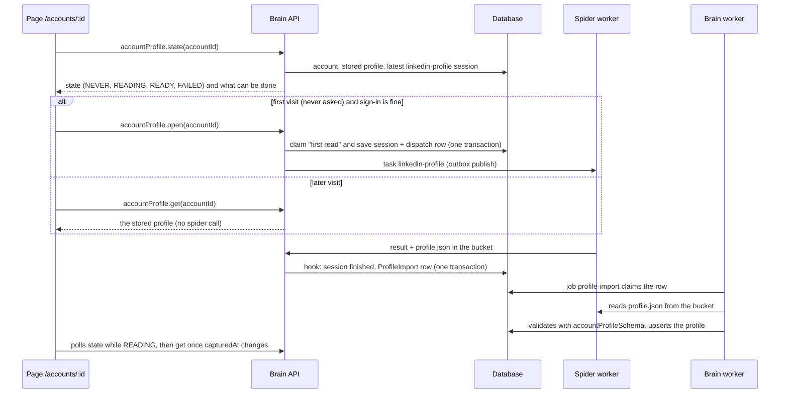

# Account profile backend: store the read profile, serve the page, read on first visit and on a button

- Status: in progress <!-- draft | locked | in progress | done -->
- Created: 2026-10-24
- Locked by user: yes, 2026-10-24 (every default of the nine open questions accepted; question 9, the live read, still needs the owner's go-ahead at that moment)

## Goal

Make `/accounts/:id` show the account's real LinkedIn profile instead of sample data. The first time the owner opens an account whose sign-in is fine, brain asks the spider to read the profile; when the spider is done, brain stores the result and the page shows it. Every later visit is served from the database, and a "Read profile" button asks for a fresh read.

## What exists today (checked in code, 2026-10-24)

- Spider: task `linkedin-profile` (version 2, PR #91, unmerged) reads the profile and attaches one `profile.json` that follows `accountProfileSchema` (`packages/contracts/src/profile.ts`, PR #90, unmerged). A live run takes about 4.5 minutes; `policy: { cooldownMs: 0, oneAtATime: 'account' }`; needs a proxy and an account.
- Brain: `TaskService.request` (outbox, `TASK_HOOKS[task].onRequest/onResult` in `database/taskHooks.ts`, one-at-a-time and cooldown checks in `checkPolicy`, triggers `manual | automatic | retry`). The same shape already exists for messages: hook `linkedInMessages.hooks.ts` (refuses unless the account is `ACTIVE`; on `SIGNED_OUT` sets `nextCheckAt` so the sign-in check runs; on `DONE/PARTIAL` creates a `MessageImport` row), job `message-import` (claims rows with a lease, reads the run's file from the bucket through `core/messageFiles.ts` outside the transaction, validates with the contract, stores, retries with back-off, ends `FAILED` with a fixed reason). Brain already may read `runs/` in the bucket (unibox-backend Q2).
- Body: `pages/AccountProfile.tsx` reads `loadProfile(kind)` from `components/account-profile/source.ts` (sample only, the one place meant to change). The account strip has Test login, Visit now and a disabled Read profile. `Accounts.tsx` already handles `CONFLICT` (a run that was recent) with `confirm-run-dialog.tsx` and `confirmed: true`. `linkedInAccount.get` is owner scoped.
- Not there: a table for the profile, a hook and importer for `linkedin-profile`, a router, a first-visit start, the working button.

## Proposal

### Flow

### Rules (the owner's words, made exact)

- First visit = the account has never been asked for a profile read (`LinkedInAccount.profileAskedAt` is null). The page then calls `accountProfile.open`. Brain starts the read only when the account's status is `ACTIVE` ("login is fine"), a working proxy exists, and nothing is running. Otherwise it starts nothing and the page says why ("Run Test login first", "Add a proxy that works first"). The claim of `profileAskedAt` and the session are saved in one transaction, so two tabs or React strict mode start one read, never two.
- A first read that fails is not started again by visiting; it shows the failure and the Read profile button. This keeps the number of visits to LinkedIn low (the owner's flag concern).
- Later visits only read the database. The page never calls the spider on its own again.
- The button "Read profile" is `accountProfile.read` (trigger `manual`). Enabled when the account is `ACTIVE` with a working proxy and no read is running (`visitBlocker`-style sentence otherwise). A second read inside the cooldown asks the owner to confirm (the existing `CONFLICT` dialog).
- While a read runs (session `IN_PROGRESS`, or its import not stored yet) the page shows what it has plus "Reading the profile, this takes about 5 minutes", and polls a light `state` query every 5 seconds; the full profile is fetched again only when `capturedAt` changes.

### Brain

1. **Migration `add_account_profile`** (additive):
   - `LinkedInAccountProfile`: `accountId` (primary key, to `LinkedInAccount`, cascade), `userId` (cascade), `data` Json (the validated `AccountProfile`), `capturedAt`, `importedAt`, `sessionId` (the run it came from, for the owner's own reference). One row per account: the latest read replaces the previous one.
   - `ProfileImport` (same columns as `MessageImport`: `sessionId` key, `status`, `attempts`, `nextAttemptAt`, `claimedUntil`, `lastError`, `createdAt`, `importedAt`; no profile content; own enum or the existing `MessageImportStatus` reused).
   - `LinkedInAccount.profileAskedAt DateTime?` (first-visit claim).
2. **Hook** `database/linkedInProfile.hooks.ts` (task name `linkedin-profile`, one line in `TASK_HOOKS`):
   - `onRequest`: refuse unless the account is `ACTIVE` (same sentence as messages); for `trigger: 'automatic'` also claim `profileAskedAt` with a conditional `updateMany` (count 0 means someone else asked, refuse); for `manual` set `profileAskedAt` if still null.
   - `onResult`: `SIGNED_OUT` sets `nextCheckAt` to now (the sign-in check runs, as for messages); `DONE` or `PARTIAL` creates a `ProfileImport` row (`skipDuplicates`). No network call.
3. **Import** `database/profileImport.service.ts` and worker job `profile-import` (30 s, one line in `worker/jobs/registry.ts`, title and purpose set for the cron monitor, quiet when idle): claim with a lease and `SKIP LOCKED`, read the session's artifact `profile.json` (path from the database, under the run's folder) through the existing bucket reader (generalised name, `MessageFiles.read` is already path-checked; no second copy), parse with `accountProfileSchema`, upsert. Owner and account come from the session row, never from the file. A file that does not parse, or a missing session, ends `FAILED` with an error class only; a bucket error retries with back-off (30 s, 2 min, 10 min, 30 min, 5 attempts). Storing the same run twice changes nothing.
   - A `PARTIAL` read replaces a stored profile only when none is stored yet (open question 3).
4. **Router** `accountProfile` (`ownerProcedure`, every call scoped by `ctx.user.id`; foreign or unknown id answers `NOT_FOUND`):
   - `state({ accountId })`: `{ phase: 'NEVER' | 'READING' | 'READY' | 'FAILED', capturedAt, importing, lastRun: { status, verdictLabel, finishedAt } | null, firstVisit, blocker: string | null }`. Light: no profile data. Pure query, no side effect.
   - `get({ accountId })`: `{ profile: AccountProfile | null, capturedAt }`, the stored `data` parsed again with the contract (typed return, not raw Json, so the body type stays shallow).
   - `open({ accountId })`: the first-visit start, idempotent; returns `{ started: boolean, reason?: string }`, never throws for "not now".
   - `read({ accountId, confirmed? })`: the button; goes through `TaskService.request` with trigger `manual`, errors mapped as `task.run` does (`CONFLICT` for the cooldown, `PRECONDITION_FAILED` for a refusal).
5. **Spider** (small): task version 3 with `policy.cooldownMs` of 30 minutes, so a button pressed again soon asks for confirmation. Nothing else changes.
6. **Account deletion** removes the stored profile and import rows by cascade; nothing keeps it elsewhere.

### Body

- `source.ts`: `loadProfile` becomes `useAccountProfile(accountId)` over `accountProfile.state` and `.get` (the sample fixtures stay, shown only for `?sample=full|sparse|empty` in the address, with the existing banner; the default is the real profile).
- `AccountProfile.tsx`: calls `open` once when `state.firstVisit` and `blocker` is null; shows skeleton while `READING` and nothing is stored, the profile when stored (with a small "Updating…" line while a new read runs), a `FAILED` card with the verdict label and the button, and the blocker sentence when it cannot start. Poll with `refetchInterval` only while `READING`.
- `account-strip.tsx`: the Read profile button becomes real (`profileBlocker(status, hasWorkingProxy, reading)` next to `visitBlocker`, busy while reading, confirm dialog on `CONFLICT`); "Profile read N ago" uses `capturedAt`.
- Tests for the pure parts (blocker sentences, phase to view mapping, polling rule), written first.

## Requirements

Confirmed (the owner's flow, 2026-10-24):

- First visit starts the read automatically, only when the login is fine. The spider's result is picked up by the backend, the database is updated, and the page serves it. Later visits read brain and the database only, and a "Read profile" button asks the spider for a new read, with the same pick-up and update.

Open questions (must be empty before locking; each has a proposed default):

1. **Auto read only once.** Is the automatic read tried only on the very first visit of an account, never again by visiting (even after a failure)? Default: yes, a failure shows the button.
2. **Gap between button reads.** 30 minutes, after which the owner can still confirm "read anyway". Default: 30 minutes.
3. **A partial read when a profile is stored.** Keep the earlier full profile and say the last read was partial, or replace it. Default: keep the earlier one; a partial read is stored only when nothing is stored yet.
4. **History.** Keep only the latest profile of an account (no earlier versions). Default: latest only.
5. **No scheduled re-read.** The profile is read only on the first visit and by the button, not daily like messages. Default: none (fewer visits to LinkedIn).
6. **Login not fine on the first visit.** Nothing starts; the page says "Run Test login first". Once the account is `ACTIVE`, the next visit (or a page reload) starts the first read, or the button does. Default: no automatic start while the page is open.
7. **Sample data.** Keep the preview fixtures behind `?sample=` only. Default: yes.
8. **Branches.** PR #90 (page) and #91 (spider) are open and this work needs both (contract and task). Default: start a new branch from `feat/linkedin-profile-task` (stacked), open the PR against `main` after #90 and #91 merge, or against #91's branch until then.
9. **A live check.** After the build, one live read through the real chain (page, brain, queue, spider, bucket, import, page) on one account, to confirm the whole path. Default: one run, on `dharmendrashaheagle+linkedin@gmail.com`, with your go-ahead at that moment.

## Scope and non-goals

- In scope: migration, hook, importer and job, `accountProfile` router, spider cooldown, the page and button on real data, tests, `MEMORY.md`.
- Out of scope: scheduled or automatic re-reads, history of profiles, keeping copies of pictures in the bucket (LinkedIn picture addresses expire, so photos can turn into initials after a few weeks), reading other people's profiles, comparing or exporting profiles, editing a LinkedIn profile, endorsements and pending recommendations (not read by the spider yet).

## Approach

- [x] 1. Lock this plan (answer the open questions).
- [x] 2. Branch from `feat/linkedin-profile-task`; migration `add_account_profile` (create-only, read the SQL, then deploy locally); `prisma generate`.
- [x] 3. `ProfileImportService` with tests first (claim, lease, parse failure, missing session, retry and give-up, idempotent store, owner from the session, partial rule); job `profile-import` and its registry line; cron monitor title and purpose.
- [x] 4. Hook `linkedInProfile.hooks.ts` with tests (refuses unless `ACTIVE`, automatic claim is atomic, `SIGNED_OUT` brings the sign-in check forward, `DONE/PARTIAL` queue an import, `FAILED/ERROR` queue none); one line in `TASK_HOOKS`.
- [x] 5. Router `accountProfile` (`state`, `get`, `open`, `read`) with resolver tests (owner scoping, foreign id, phases, `open` idempotent, no profile data in `state`, errors mapped); export from `trpc/api/router.ts`.
- [x] 6. Spider: version 3 with the 30 minute cooldown (test updated).
- [x] 7. Body: `useAccountProfile`, page states, real Read profile button with confirm dialog, strip text, pure helpers with tests; `apps/body/tsconfig.app.json` needs no new alias (resolver sits under `trpc/api/resolvers`).
- [x] 8. Integration test with real Postgres: hook then import then `get`, twice (idempotent), with the bucket reader stubbed.
- [ ] 9. `pnpm lint && pnpm ts:check && pnpm test:unit:run && pnpm build`, all warnings fixed; a browser check of every state with a stubbed API; one live read if question 9 is confirmed; `MEMORY.md`; plan done.

## Edge cases and risks

- **Two tabs, strict mode, a double click:** the first-visit claim is a conditional update in the same transaction as the session, and `checkPolicy` refuses a second `IN_PROGRESS` run of the task for the account (`TaskBusyError`); `open` answers `started: false` instead of an error.
- **The spider worker is down or does not know the task yet:** `TaskUnavailableError` becomes "Reading the profile is not available yet, try again in a moment" and `profileAskedAt` is not set (the claim is in the same transaction, so it rolls back). The outbox keeps a request when only RabbitMQ is down; after 15 minutes the session ends `NOT_QUEUED` and the page shows the failure and the button. Deploy order: spider (with the task) before brain, as for messages.
- **The run ends signed out:** the hook brings the sign-in check forward; the page shows "Signed out" with the Test login hint, no automatic retry of the read.
- **The result arrives twice, or the import runs twice:** `ProfileImport` is keyed by the session and `skipDuplicates`; the upsert keys on the account, so the same file twice changes nothing; an older run never replaces a newer one (`capturedAt` compared in the upsert).
- **Bucket errors or a file that does not fit the contract:** the import retries then ends `FAILED` with a fixed reason; the page keeps the old profile and says the last read could not be stored (state `FAILED`, button available). No profile text ever reaches a log or an error.
- **An empty or sparse profile:** a profile with only a name stores fine; the page already handles sparse accounts.
- **A different profile than the account:** owner and account come from the session row, never from the file; a file's `profileUrl` is not trusted for anything.
- **Third-party and private data:** the stored file holds the owner's contact info (phone, email, birthday) and other people's names and recommendation texts. It is served only to the owner (every call scoped to `ctx.user.id`, foreign ids answer `NOT_FOUND`), deleted with the account, never logged, never in the report. Spider run files stay sensitive and expire with the session (30 days of rows, 7 days of recordings); the database copy is the long-lived one and is replaced by each read.
- **Size:** `profile.json` is far under the contract maxima (about a few hundred kB); the importer's 2 MB read limit applies. `state` carries no profile data so polling stays cheap.
- **Cost of visiting LinkedIn:** at most one automatic read per account ever, a 30 minute gap for the button, one run at a time per account, and the lease keeps it apart from the message read and the visit.
- **Data that LinkedIn changes:** a page change makes a section empty and the run `PARTIAL`; with question 3's default the earlier full profile is kept.
- **Sample data in production:** only with `?sample=` in the address, with the banner.
- **Migration and rollback:** additive tables and one nullable column; rolling back the app leaves unused tables. Never reset the database.
- **Dev vs production:** locally needs RabbitMQ, the spider worker, a bucket reader (`SPIDER_GCS_BUCKET` and credentials); without the bucket the import fails with a fixed reason and retries, as for messages.

## Verification

- `pnpm lint && pnpm ts:check && pnpm test:unit:run && pnpm build`; integration tests for the hook, importer and router with Postgres.
- A browser check of the states: never read and signed out, reading, stored, failed, partial kept, no proxy; light and dark.
- One live read through the whole chain (needs your go-ahead, question 9). State what could not be run.

## Outcome

Built on branch `feat/account-profile-backend` (stacked on `feat/linkedin-profile-task`): migration `add_account_profile`, hook, `profile-import` job, router `accountProfile` (`state`, `get`, `open`, `read`), spider task version 3 (30 minute cooldown), the page on real data with the first-visit start and the working Read profile button (sample data only with `?sample=`). Lint, type check, unit tests (brain 1174, spider 963) and build pass; the integration test (hook, import, state, partial and older reads, cascade) passes against Postgres.

Deviations: the importer reads through the existing `MessageFiles.read` (not renamed, it is already path-checked); `get` takes a `version` input that the server ignores and the page uses as a cache key; the Read profile button takes its blocker sentence from the server's `state.blocker` instead of the page working it out.

Not run: a browser check of the states, and the live read through the whole chain (page, brain, queue, spider, bucket, import). Both are left for the owner's go-ahead (question 9).
