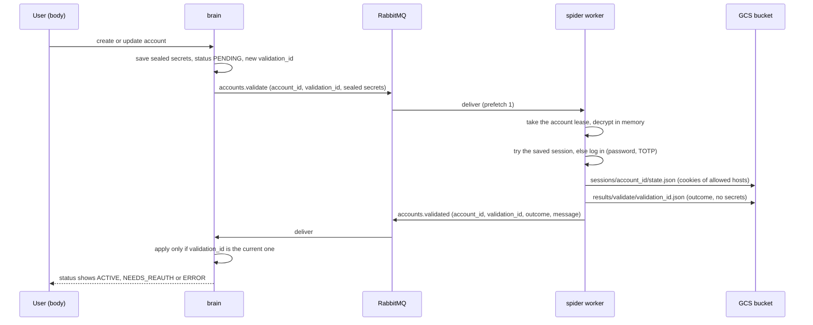

# Account validation: brain publishes, spider validates, brain updates the status

- Status: done <!-- draft | locked | in progress | done -->
- Created: 2026-10-12
- Locked by user: yes, 2026-10-12 (all seven recommendations accepted)

## Goal

When a user adds a LinkedIn account or changes its credentials in brain, brain publishes a validation task on RabbitMQ.
The spider worker takes it, checks the credentials against LinkedIn, saves the resulting session in the bucket and
publishes the outcome on RabbitMQ. Brain reads the outcome and sets the account status (`ACTIVE`, `NEEDS_REAUTH`,
`ERROR`). Authorization is the attested LinkedIn permission (`.plan/linkedin-account-linking.md`, B1), which names
automated login with a user-provided password and TOTP, cookie storage and spoofing.

## Current state (read from the code, 2026-10-12)

- Brain `LinkedInAccountService` stores one AES-256-GCM sealed bundle per account (`secret`, `secretIv`, `secretTag`,
  `keyVersion`, key `LINKEDIN_CRED_ENC_KEY`) holding `{ password?, totpSecret?, session? }`, and a `status`
  (`PENDING`, `ACTIVE`, `NEEDS_REAUTH`, `ERROR`, `DISABLED`) with `statusMessage` and `lastVerifiedAt`. `create` starts at
  `PENDING`; changing secrets resets to `PENDING` (not when `DISABLED`); resuming a paused account sets `PENDING`.
- Brain has a `MessageBroker` (`src/core`) with one shared connection and a health probe only. No publisher or consumer.
- Spider owns the topology (`scraping.exchange`, quorum queue `linkedin.requests`, dead-letter queue, `scraping.results`
  with a 24 h TTL that nothing reads). Its message types live in `apps/spider/src/types`, which brain cannot import.
- Spider has no LinkedIn login: its `login` action only loads stored cookies and refuses to type credentials. Spider
  has no TOTP code generator. Spider reads and writes sessions at `sessions/<account_id>/state.json` and holds a
  per-account lease (`AccountLock`), from `.plan/camoufox-browser.md`.

## Design

**Contract.** A new workspace package `packages/contracts` (built with tsup to CJS like `packages/config`) holds, for both
apps: the exchange, queue and routing-key names, `assertAccountTopology(channel)` (idempotent, called by both sides),
the zod schemas and types of the two messages:

- `ValidateAccountCommand`: `validation_id` (uuid), `account_id`, `email`, `sealed` (`ciphertext`, `iv`, `tag`,
  `key_version`), `requested_at`.
- `ValidateAccountResult`: `validation_id`, `account_id`, `outcome` (`VALID`, `INVALID_CREDENTIALS`, `NEEDS_REAUTH`,
  `ERROR`), `message` (short, fixed text, never page content), `session_storage_path?`, `checked_at`.

**Secrets in the message.** The command carries the sealed bundle exactly as stored in the database (brain does not
decrypt to publish). Spider decrypts it in memory with the same `LINKEDIN_CRED_ENC_KEY` (new env for the worker, required
in production), never logs or stores it. The queue and the dead-letter queue only ever hold ciphertext.

**Queues.** Same exchange. `accounts.validate` (quorum, dead-lettered, delivery limit) and `accounts.validated`
(durable, TTL 24 h, capped). Brain consumes `accounts.validated`; spider consumes `accounts.validate`.

**Brain (apps/brain, no new top-level folder).**
- `MessageBroker` gains a confirm channel for publishing and one for consuming.
- `LinkedInAccountValidation` service in `src/database`: `request(account)` creates a `validation_id`, stores it on the
  row (`validationId String?`, additive migration) and publishes after the database write; `applyResult(result)` loads the
  row, ignores the result unless `validation_id` equals the row's `validationId` and the account is not `DISABLED`, maps the
  outcome to the status, clears `validationId`.
- Triggers: `create`, `update` when email or secrets change, resuming a paused account, and a new owner mutation
  `verify` (cooldown 5 minutes, only when not already `PENDING` with a recent request).
- Outcome mapping: `VALID` -> `ACTIVE`, `lastVerifiedAt` now, message cleared; `INVALID_CREDENTIALS` and `NEEDS_REAUTH` ->
  `NEEDS_REAUTH` with the message; `ERROR` -> `ERROR` with the message.
- A publish failure does not fail the user's mutation. The account stays `PENDING` and the owner can use `verify`.
- The consumer starts in `server.ts` next to the HTTP server and closes on shutdown. Invalid messages go to the
  dead-letter queue; a database error nacks for retry.

**Spider.**
- A second consumer (`accounts.validate`) in the worker process. A single in-process mutex keeps one browser open at a
  time across scrape and validation tasks. Each validation takes the account's lease (`AccountLock`); busy means
  re-queue after `SPIDER_ACCOUNT_BUSY_DELAY_MS`, as for scrape tasks.
- `AccountValidator` (new, separate from the scrape actions, so scrape tasks still cannot type credentials):
  1. If the bundle has a `session` (li_at cookie), set it and open the feed. Feed reached -> `VALID`.
  2. If that is missing or rejected and a password exists, open the login page, type the email and password, submit.
     Feed -> `VALID`. A security challenge that asks for a two-step code -> generate the code from `totpSecret`
     (RFC 6238, SHA1, 6 digits, 30 s, built on `node:crypto`, tested with the RFC vectors) and submit it; no secret ->
     `NEEDS_REAUTH`. A wrong-credentials message -> `INVALID_CREDENTIALS`. Any other checkpoint, CAPTCHA or puzzle ->
     `NEEDS_REAUTH` (never solved). Anything unexpected -> `ERROR`.
  3. On `VALID`, write the cookies of allowed hosts to `sessions/<account_id>/state.json` and the outcome record to
     `results/validate/<validation_id>.json`, then publish the result with `session_storage_path`.
- Only the allowed hosts are visited (the same `HostPolicy` and in-browser block); `SPIDER_MIN_DELAY_MS` applies between
  steps. Steps use `humanize` and the Camoufox driver from the last plan.
- Retries: an infrastructure error is retried by the existing back-off (3 times). After the last retry the consumer
  publishes an `ERROR` result ("Verification could not run, try again") and acknowledges, instead of dead-lettering, so an
  account is never stuck in `PENDING`. A wrong password or a checkpoint is a result, never a retry: no automatic second
  login attempt, because repeated failures lock accounts.

**Brain to bucket.** Not needed in this plan. Spider keeps the session in the bucket; brain only reads the result message
and keeps its own copy of the secrets as today. Brain never touches the bucket.

## Requirements

Locked answers (2026-10-12): the recommended option of each question below was accepted.

1. Secrets transport: forward the sealed bundle as stored and share `LINKEDIN_CRED_ENC_KEY` with the worker
   (recommended, ciphertext only in queues, no new infrastructure). Alternatives: plaintext inline (secrets and the TOTP
   seed visible to anyone who can read the queue), or hand-off through the bucket (brain would need bucket access).
2. Password login with a TOTP code is new automation of LinkedIn's login page, covered by the attested permission. Its page
   selectors and challenge detection can only be tested here against a local fake login site, not against live
   LinkedIn, so the first real run may need selector fixes. Accept shipping it that way? Recommended yes, with a worker
   setting `SPIDER_VALIDATION_MODE=session|full` (default `full` locally) so it can be limited to the cookie check.
3. Session copy: spider writes `sessions/<account_id>/state.json` and returns its key; brain does not copy it
   (recommended). Alternative: brain also reads the bucket and stores the cookies in the account's sealed bundle.
4. Triggers and recovery: create, update of email or secrets, resume, and a `verify` mutation with a 5-minute cooldown;
   no periodic sweeper (recommended). Alternative: brain republishes old `PENDING` accounts on boot.
5. Shared contract: a new `packages/contracts` workspace package used by brain and spider (recommended). Alternative:
   duplicate the two message types in brain, which can drift.
6. One browser at a time per worker process across scrape and validation tasks (recommended), because each Firefox is
   heavy. Alternative: one consumer each, up to two browsers.
7. After the last retry, spider publishes an `ERROR` result instead of dead-lettering validation tasks (recommended).

## Scope and non-goals

- In scope: `packages/contracts`; brain publisher, result consumer, `verify` mutation, `validationId` migration, status
  mapping, tests; spider validation consumer, `AccountValidator`, TOTP generator, session and result writes, tests;
  compose (`LINKEDIN_CRED_ENC_KEY` for `spider-worker`), env examples, `MEMORY.md`.
- Out of scope: body UI changes (the existing list shows the status; a "Verify" button is a small follow-up), proxies for
  validation, scraping or messaging with the account, key rotation, staging deployment, solving CAPTCHAs or checkpoints,
  moving the session into brain.

## Approach

- [x] `packages/contracts`: names, `assertAccountTopology`, zod schemas and types, shared `extractLiAt`, tests; both apps
      depend on it and the Docker builds ship it.
- [x] Brain: migration (`validationId`, `validationRequestedAt`), `MessageBroker` channels, `AccountValidationQueue`,
      `LinkedInAccountValidationService` (request, verifyForUser, applyResult), tRPC triggers and `verify`, consumer in
      `server.ts`; unit tests first, integration test on RabbitMQ and PostgreSQL.
- [x] Spider: TOTP generator, credentials opener, `AccountValidator`, `processValidation`, generalized `consumeQueue` with
      `onExhausted`, publisher and topology additions, mutex, worker wiring; unit tests first, real-browser tests on a
      stand-in login site, RabbitMQ integration tests.
- [x] Compose and env examples, `MEMORY.md`, plan outcome.
- [x] `pnpm lint && pnpm ts:check && pnpm test:unit:run && pnpm build`, integration tests, real-browser tests. The full
      brain -> RabbitMQ -> worker -> RabbitMQ -> brain run on the local stack was NOT done: the worker needs write access to
      the bucket (session, lease), and this machine's Application Default Credentials belong to another account.

## Edge cases and risks

- Stale or duplicate results: a result only applies if its `validation_id` is the row's current one, so an older
  validation cannot overwrite a newer one, a redelivered result is a no-op, and a result for a deleted account is dropped.
- Paused while validating: a result never changes a `DISABLED` account.
- Lost publish (crash between the database write and the publish): the account stays `PENDING`; `verify` recovers it.
  A transactional outbox would close the gap and is a follow-up if it happens in practice.
- Account lockout: no automatic second login after a wrong password or a checkpoint; `verify` has a cooldown; one task per
  account through the lease; conservative delays.
- Secrets: ciphertext only in RabbitMQ and the dead-letter queue; plaintext only in worker memory; never in logs, error
  messages or the result; the result `message` is a fixed set of sentences, never page text. The worker now holds the
  decryption key, so it is as sensitive as brain's.
- Key mismatch: if the worker's `LINKEDIN_CRED_ENC_KEY` differs from brain's, decryption fails; spider reports `ERROR`
  ("could not read the stored credentials") without retrying forever.
- Message size and shape: zod-validated on both sides; invalid messages dead-lettered; account ids are validated as path
  safe before they name objects.
- Live LinkedIn behaviour is unverified here: selectors, challenge pages and bot checks change and can block a headless
  login. The result is then `NEEDS_REAUTH` or `ERROR`, never a false `ACTIVE`: `VALID` requires reaching the feed.
- Shutdown: the brain consumer stops taking messages on SIGTERM and finishes the one in progress.
- Existing accounts: they stay as they are. Only new changes publish; owners can use `verify`.
- CI: brain integration tests already have PostgreSQL and RabbitMQ service containers. Spider e2e (real browser) stays out
  of CI as today.
- Rollback: revert the commits; the added column is nullable. The queues are new and can be deleted.

## Verification

- Automated: unit tests for the contract schemas, brain request and applyResult (stale, duplicate, disabled, deleted),
  triggers, `verify` cooldown, TOTP vectors, `AccountValidator` outcomes, the consumer's final-retry `ERROR`, and that no
  secret appears in any message or log.
- Integration: brain publishes and applies on a real RabbitMQ and PostgreSQL; spider consumes on a real RabbitMQ.
- End to end on the local stack: create an account in brain with the allowlist pointing at the fake login site, watch it go
  `PENDING` -> `ACTIVE`, then a wrong password -> `NEEDS_REAUTH`.
- Not verifiable here: live LinkedIn.

## Outcome

Shipped on branch `feat/spider` (not committed). Brain publishes a validation task whenever an account is created, its email or
secrets change (the service now resets an account to `PENDING` on an email change too), it is resumed, or the owner calls the
new `linkedInAccount.verify` mutation (5 minute cooldown, `PRECONDITION_FAILED` when paused, `TOO_MANY_REQUESTS` inside the
cooldown). The command carries the credentials sealed exactly as stored; spider opens them with the shared
`LINKEDIN_CRED_ENC_KEY`. Spider's second consumer (`accounts.validate`, one browser at a time through a mutex, the account
lease shared with scrape tasks) runs `AccountValidator`: the saved `li_at` token first, then the password, answering a
two-step page once with a code from the stored key, reporting any other security check as `NEEDS_REAUTH`, and a wrong password
as `INVALID_CREDENTIALS` without a second attempt. A valid login saves the cookies to `sessions/<account_id>/state.json`, a
record to `results/validate/<validation_id>.json`, and publishes the result on `accounts.validated`. Brain's consumer applies it
with one conditional update on `validationId`, never to a paused account, so stale or repeated results change nothing. After the
last infrastructure retry spider answers `ERROR` instead of dead-lettering. `packages/contracts` holds the shared schemas,
topology and `extractLiAt` (moved out of brain `core`).

Deviations and findings:
- Email changes now reset an account to `PENDING` (previously only secret changes did), because a different email is a
  different login.
- `LINKEDIN_CRED_ENC_KEY` defaults to `''` in spider's env outside development, so the API process (which never needs it) still
  starts; the worker checks it at start.
- Spider's `consumeTasks` became a thin wrapper over a generic `consumeQueue`; log wording changed slightly.
- The worker image needed its own glibc `worker-build` stage (previous plan); the new package is built by the existing
  `build:lib` postinstall and shipped by `pnpm deploy`.
- Two small lint warnings (object-curly-newline vs prettier) remain in test files.

Verification: `pnpm lint` (0 errors), `pnpm ts:check`, `pnpm test:unit:run` (brain 220, spider 264, contracts 48, body 37) and
`pnpm build` pass; brain integration tests (25, including request, apply, stale, paused and the consumer on real PostgreSQL and
RabbitMQ) and spider integration tests (8, including the sealed round trip and the final-retry `ERROR`) pass; 6 real-Camoufox
tests against a local stand-in login site pass (token, password fallback, wrong password on a `/checkpoint/` path, two-step
code, wrong code, missing key); the brain, spider API and spider worker images build and load the contracts package.

NOT verified: live LinkedIn (selectors and challenge pages are best effort), the lease and session writes against the real
bucket, and a full run across both apps on the local stack.

Follow-ups: a body "Verify" button and polling; a transactional outbox if a publish is ever lost; a worker in staging (queued
validations wait without a TTL); key rotation that reaches brain and the worker together.
