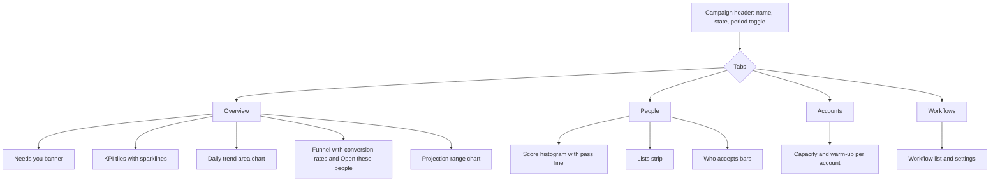
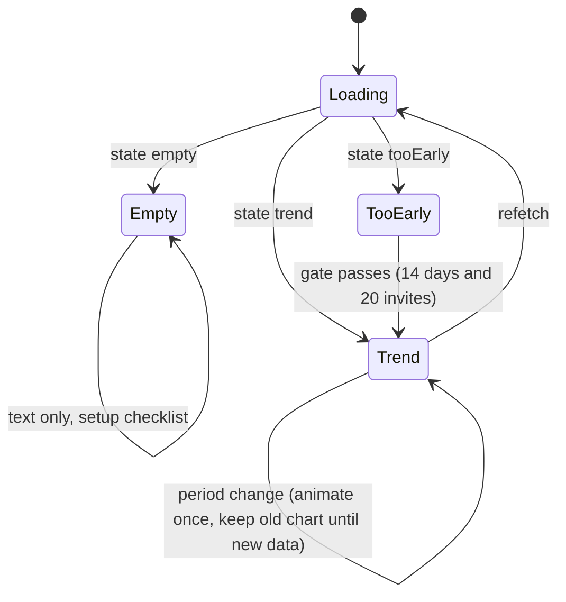

# Campaign detail: grouped, graph-led analytics

- Status: in progress <!-- draft | locked | in progress | done -->
- Created: 2026-11-13
- Locked by user: yes, 2026-11-13 (chat: "implement it"; Q9 default accepted: 365-day cap)

## Goal

The campaign detail page shows the same numbers in many places with no grouping and almost no charts. Group the page into a few clear sections, and show each campaign's history (found, qualified, invited, accepted per day) with animated charts, so the owner can see lead generation and outreach over time.

## Requirements

Confirmed:

- Show information grouped and visually clear, not scattered across cards (owner, 2026-11-13).
- Use graphs heavily, with a historical view (owner, 2026-11-13).
- Empty state is text only: it says there is not enough data yet and why (Q7). Full state shows what was achieved and what the trend and projection say (earlier plan `campaign-detail-insights.md`).
- Gate of 14 complete UTC days and 20 invites before trends and projection (locked in `campaign-detail-insights.md`; the values are my defaults, see open questions).
- `messaged` and `replied` are last-touch per day and are never summed; `accepted` totals can double count and that is disclosed (locked in `campaign-detail-insights.md`).
- Reduced motion turns animation off (`prefersReducedMotion()` in `apps/body/src/components/campaigns/campaign-insights.ts`).
- Layout convention: page root `grid w-full gap-4 px-4 lg:px-6`, no `max-w-*`, no `mx-auto`; do not edit `apps/body/src/components/ui/*`.

Decided by the owner (2026-11-13, in chat):

- Q1 Chart set: daily trend area chart, funnel with conversion rates, projection range chart, score histogram (existing), and sparklines in the four KPI tiles. Not in this plan: daily invites vs acceptance-rate combo chart and per-account capacity radial charts.
- Q2 Periods: 7d and 30d, plus "All time" (`all`). "All time" needs a backend change (see Approach, Backend).
- Q3 Animation: chart animation (about 700 ms, on mount and period change, off under reduced motion) and count-up numbers on the KPI tiles.
- Q4 Duplicate row: keep one "Open these people" row, under the funnel on Overview.
- Q5 "Needs you" banner: top of Overview.
- Q6 Tabs: keep the four tabs (Overview, People, Accounts, Workflows).
- Q7 Empty state: no example charts. Show a plain "not enough data yet" message with the gate reason, and the setup checklist. Never show charts or fake zeros.
- Q8 Gate values stay at 14 complete UTC days and 20 invites.

Open questions (must be empty before locking):

- Q9 "All time" length. Default: back to the campaign's first day (or its first `CampaignDay` row, whichever is earlier), capped at 365 days so the chart and the query stay bounded; older days are not plotted and the chart says "last 365 days". Confirm the cap, or give another value.

## Scope and non-goals

- In scope: `apps/body` campaign detail page (`apps/body/src/pages/Campaign.tsx`) and its components in `apps/body/src/components/campaigns/`; pure helpers and their unit tests in `campaign-insights.ts`; the "All time" (`all`) trend period in `apps/brain` and `packages/contracts` (the trend service, its resolver input, and the contract type), with its tests.
- Out of scope: new endpoints; a new "Today" trend (Today stays the live funnel); changes to spider or the workflow engine; changes to `apps/body/src/components/ui/*`; a schema or migration (the data is already in `CampaignDay`).

## Data available (read-only check of `packages/contracts/src/campaign.ts`)

- `history: CampaignTrendDay[]`: one row per UTC day, with `counts` (found, qualified, invited, accepted, messaged, replied) or a state `notStarted | beforeHistory | noData | pending`.
- `totals`: found, qualified, invited, accepted (not messaged or replied).
- `gate`: whether trends and projection are allowed, with a reason.
- `projection`: a capped range, or hidden with a reason (`tooEarly` and others).
- `lists`, `capacity`, `state` (`CampaignTrendState`: `empty | tooEarly | trend`, `packages/contracts/src/campaign.ts`, line 173).
- `overview` query (all periods, including Today) gives the live funnel.
- Period plumbing today: resolver input `z.enum(['7d', '30d'])` (`apps/brain/src/trpc/api/resolvers/campaign/campaign.ts`, line 59); `CampaignTrendService.insights` takes `InsightsPeriod = '7d' | '30d'` and sizes the day list with `PERIOD_DAYS` and `historyDays(count, now)` (`apps/brain/src/database/campaignTrend.service.ts`, lines 14 to 22 and 137; `campaignTrend.ts`, line 32). The gate window is always 14 complete days (`windowDays`), so the period never changes the gate.
- The body page keeps `CampaignPeriod` (`today | 7d | 30d`) in state and the toggle (`apps/body/src/pages/Campaign.tsx`, lines 111 and 191 to 205).

## Approach

Grouping by tab (owner of each block):

- Overview
  - [ ] Step 3: Status strip: campaign state, "Needs you" (one card), and "Last Discover run" merged into one status card.
  - [ ] Step 3: Four KPI tiles (Found, Qualified, Invited, Accepted), each with a 14-day sparkline when history exists.
  - [ ] Step 4: Daily trend area chart with a period toggle (7d / 30d / All, Q2), gaps for non-counted days, tooltip with UTC date.
  - [ ] Step 5: Funnel: horizontal bars for the four stages with conversion rates between stages, replacing the four "no data" progress bars.
  - [ ] Step 6: Projection card: range chart with low and high band, basis note, and the reason when hidden.
- People
  - [ ] Step 7: Score histogram with the pass line (existing component), lists strip, and the single "Open these people" row.
  - [ ] Step 7: "Who accepts" becomes two small bar charts (by fit, by account) when accepted > 0; otherwise a short empty text.
- Accounts
  - [ ] Step 8: Capacity and warm-up per account using `Progress` (existing table kept for accounts).
- Workflows
  - [ ] Step 8: No layout change; only consistent card headings.
- Empty state (all tabs)
  - [ ] Step 9: Text-only empty state (Q7): "Not enough data yet" with the gate reason (`gateMessage`) and the setup checklist (`missingSetupItems`). No charts, no example data, no zeros shown as results.

Backend ("All time", Q2 and Q9):

- [x] Contract: add `CAMPAIGN_TREND_PERIODS = ['7d', '30d', 'all']` in `packages/contracts/src/campaign.ts` and use it for the trend input. The overview keeps `CAMPAIGN_PERIODS` (`today | 7d | 30d`), so Today stays the live funnel.
- [x] Brain: `CampaignTrendService.insights` accepts `all`. The day list starts at the campaign's first day (`CampaignDay` `_min.day`, or the campaign's creation day if earlier) and is capped at 365 complete UTC days (Q9). Add a pure helper `allTimeDays(firstDay, now, cap)` in `apps/brain/src/database/campaignTrend.ts` next to `historyDays`.
- [x] Resolver: `z.enum(['7d', '30d', 'all'])` in `campaign.ts` (line 59), and the unit test in `campaign.unit.test.ts` covers `all` passing through.
- [x] The gate and the projection keep their fixed windows (`windowDays`, `gateOf`, `projectionOf`). "All time" changes only the trend chart and its history rows.
- [ ] Body: the trend toggle becomes `Today | 7d | 30d | All` only on the trend chart; the page-level period still uses the `CampaignPeriod` type for the overview.

Count-up (Q3):

- [x] `useCountUp(target, { durationMs: 600 })` hook (`apps/body/src/components/campaigns/use-count-up.ts`). Counts from the previous value to the new one; under reduced motion or with a non-finite target it shows the final value at once.

Pure helpers (Step 2, in `campaign-insights.ts`, with unit tests in `campaign-insights.unit.test.ts`):

- [x] `conversionRates(funnel)`: stage-to-stage rate, null when the previous stage is 0 (reuse `rateOf` from `packages/contracts/src/campaign.ts`).
- [x] `sparklineSeries(history, stage)`: last 14 counted days, with `null` for gap days so the line breaks instead of dropping to 0.
- [x] `cumulativeSeries(history, stage)`: running total over counted days only.
- [x] `projectionBand(projection)`: two-point band for the chart, or null.

Animation and performance:

- [ ] Recharts built-in animation (`isAnimationActive`), duration about 700 ms, disabled under reduced motion. Animate on mount and on period change only.
- [x] Recharts stays lazy-loaded (`React.lazy`) and in its own chunk, so the rest of the page does not grow. Show a `Skeleton` while the chunk loads.

Dark mode and accessibility:

- [ ] Chart colours from the existing shadcn chart tokens (`--chart-1..5`), readable in dark mode.
- [ ] Every chart has `aria-label` and a text summary line (for example "12 invited in the last 7 days"). Tooltips are not the only source of values.

## Design

Information architecture (tabs and blocks):



State flow for the body (driven by `CampaignTrendState` and the gate):



Wireframe, Overview tab (desktop, about 1440 px; `[ ]` is a card):

```
+--------------------------------------------------------------------------+
| Campaign name  [Running]                     [Today|7d|30d|All]         |
| [Overview] [People] [Accounts] [Workflows]                              |
+--------------------------------------------------------------------------+
| (!) Needs you: 2 accounts need sign-in                       [Fix now]   |
+----------------+----------------+----------------+-----------------------+
| Found   1,204  | Qualified 310  | Invited   120  | Accepted   18         |
| sparkline ~~~~ | sparkline ~~~~ | sparkline ~~~~ | sparkline ~~~~        |
+----------------+----------------+----------------+-----------------------+
| Daily trend (area, found / qualified / invited / accepted)               |
|  ^     /\        /\__                                                    |
|  |____/  \______/     \___                                               |
|  +--------------------------------> UTC day                              |
+-----------------------------------+--------------------------------------+
| Funnel                            | Projection (range)                   |
| Found     ██████████  1,204       | Expected invites: 40 to 55 / week    |
|   -> 26%                          | basis: last 14 days                  |
| Qualified ███         310         | (hidden: reason shown when gated)    |
|   -> 39%                          |                                      |
| Invited   █           120         |                                      |
| [Open these people]               |                                      |
+-----------------------------------+--------------------------------------+
```

Wireframe, empty state (any tab, text only):

```
+--------------------------------------------------------------------------+
| Not enough data yet                                                       |
| Trends and projection start after 14 complete days and 20 invites.        |
| Today: 3 days, 6 invites.                                                 |
| Setup checklist:  [x] Workflow saved  [ ] Account connected  [ ] Lists    |
+--------------------------------------------------------------------------+
```

Wireframe, People and Accounts tabs:

```
People:  [score histogram with pass line]  [lists strip]
         [Who accepts: by fit bars] [by account bars]   (or short text when 0)
         [Open these people]
Accounts: [account rows: name | capacity Progress | warm-up Progress]
```

Mobile (375 px): one column; the KPI tiles become a 2 by 2 grid; the period toggle moves under the header; the tabs scroll horizontally; the x-axis shows about 4 labels.

Icons (`lucide-react`, already a dependency): `Activity` (trend), `Gauge` (projection), `Sparkles` (empty state), `ListChecks` (checklist), `TriangleAlert` (Needs you), `CircleCheck` (done), `Send` (invited), `Target` (qualified), `Users` (accepted), `Workflow` (workflows tab). No raster images are added; the page stays light.

Colours: `--chart-1` to `--chart-5` tokens for series; `--muted-foreground` for gaps and axes; no hard-coded colours.

## Edge cases and risks

- No history yet (`empty`, `tooEarly`): charts must not render fake zeros. Show the text-only "not enough data" message with the gate reason (`gateMessage`) and the setup checklist (Q7). No example charts.
- "All time" (`all`): the first day can be far back. Cap at 365 complete UTC days (Q9). Days before the campaign existed are `beforeHistory` and are not plotted as 0. Show "last 365 days" when the cap applies. A campaign with no `CampaignDay` rows returns the empty trend, not an error.
- "All time" and the gate: the gate and projection still use their fixed 14-day window. The chart length must not change the gate result, so a campaign can show a 365-day chart and still show "tooEarly" for the projection.
- "All time" query size: the day list and `dayRows` query grow with the cap; keep the query on the existing `campaignDay` index by campaign and day, and do not load message text.
- Count-up: the final value must show at once under reduced motion or when the value is not a finite number; the hook must not leave a timer running after unmount.
- Gap days (`beforeHistory`, `noData`, `pending`): use `connectNulls={false}` so the line breaks; do not plot them as 0.
- `tooEarly` with a hidden projection: the projection card shows the reason and no band. Confirm this pairing in `campaign-insights.ts` before coding.
- Paused campaign: the trend stays visible, and the projection is hidden or marked paused. The paused campaign stays in the denominator (locked decision).
- Accepted double counting: the tooltip and the card footnote say so. Totals for messaged and replied are never shown (only per-day last-touch lines).
- Timezone: history keys are UTC days (`todayKey` uses `toISOString`). Labels must say UTC, or convert all keys with the same rule. Mixing local and UTC dates shifts a day.
- Large counts: `allowDecimals={false}` and `tickFormatter` with compact numbers (for example 1.2k).
- Narrow screens (375 px): x-axis ticks use `interval` so labels do not overlap; tabs scroll horizontally (already done in `59f810b`).
- Animation on period change: old data must not flash. Keep the previous chart until the new query resolves, or show `Skeleton`.
- Reduced motion and print: animation off; no layout jump.
- Performance: recharts is about 295 kB in its own chunk. The build warning already exists; keep the chunk lazy.
- Security and secrets: no new data is exposed. Only the existing `campaign.insights` and `campaign.overview` responses are read. No tokens or message text in tooltips.
- Dev vs production: the body dev server redirects to authentik sign-in (`apps/body/src/auth/config.ts`). Browser checks need a signed-in session (owner action).
- Docker and CI: no change to Docker or CI. The body image is built the same way.
- Rollback: UI-only change in `apps/body`; revert the commit(s). No schema or data migration.

## Verification

- Pure helpers: unit tests in `apps/body/src/components/campaigns/campaign-insights.unit.test.ts` for gap handling, cumulative totals, conversion rate with a zero previous stage, and the projection band (only the cases that would fail without the change).
- Brain: unit tests for `allTimeDays` (first day after the cap, first day before the cap, no rows) in `apps/brain/src/database/campaignTrend.unit.test.ts` (or the existing file for `historyDays`), and the resolver case for `all` in `campaign.unit.test.ts`. Add an integration case in `campaignTrend.service` only if the day list is built from the database.
- Count-up hook: one unit test for the reduced-motion path (final value immediately) and one for the change from old to new target.
- Root gate: `pnpm lint && pnpm ts:check && pnpm test:unit:run && pnpm build` (exit 0). Report the chunk-size warnings as informational.
- Browser (needs a signed-in session): `/campaigns/<id>` in the four states (empty, tooEarly, trend with 7d, 30d and All) at 375 px and 1440 px, dark and light, and with reduced motion. Take screenshots and attach them to the Outcome.
- Confirm no duplicate "Open these people" row, that "Needs you" appears once, and that the empty state has no chart elements.

## Outcome

Shipped in code (not yet in a browser):
- Contracts: trend period `7d | 30d | all` (`CAMPAIGN_TREND_PERIODS`, `CAMPAIGN_TREND_ALL_DAYS = 365`).
- Brain: `allTimeDays` and the `all` branch in `CampaignTrendService.insights`; resolver accepts `all`. Unit tests added.
- Body: pure helpers (`conversionRates`, `sparklineSeries`, `cumulativeSeries`, `projectionBand`), `useCountUp` with reduced-motion path, sparklines in the KPI tiles, 7d / 30d / All trend chart, funnel conversion row, "Needs you" at the top of Overview, one "Open these people" row. Unit tests added.
- Build: `apps/body` campaign routes (`Campaign`, `Campaigns`, `NewCampaign`) are lazy-loaded, so the entry chunk fell from 635 kB to 329 kB and the Vite chunk warning is gone.
- Gate: `pnpm lint`, `pnpm ts:check`, `pnpm test:unit:run`, `pnpm build` all exit 0 with zero warnings.

Deviations:
- The trend card has its own 7d / 30d / All toggle (the trend has no Today view). The page-level Today / 7d / 30d toggle still drives the overview and insights.
- Q9 (365-day cap for All) uses the default, accepted with the lock.

Not done (open):
- Browser check at 375 px and 1440 px, dark and light, reduced motion, and the screenshots. Needs a signed-in session.
- Brain integration case for `all` (`campaignTrend.integration.test.ts`). Not run: Docker daemon was not running.
- Unticked Approach items on layout (Steps 3 to 9), chart colours, and `aria-label` checks need the browser check to confirm.
