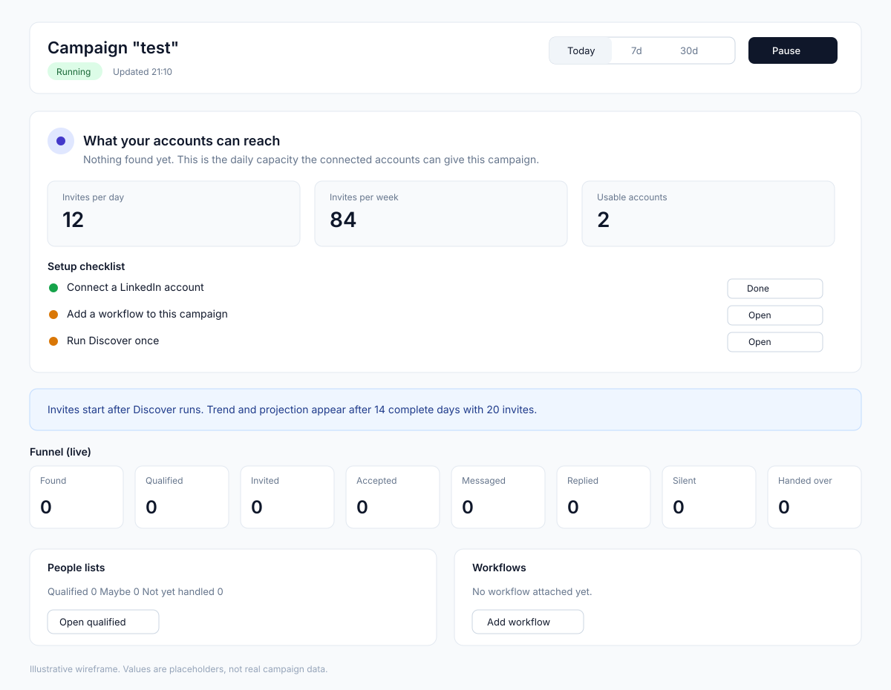
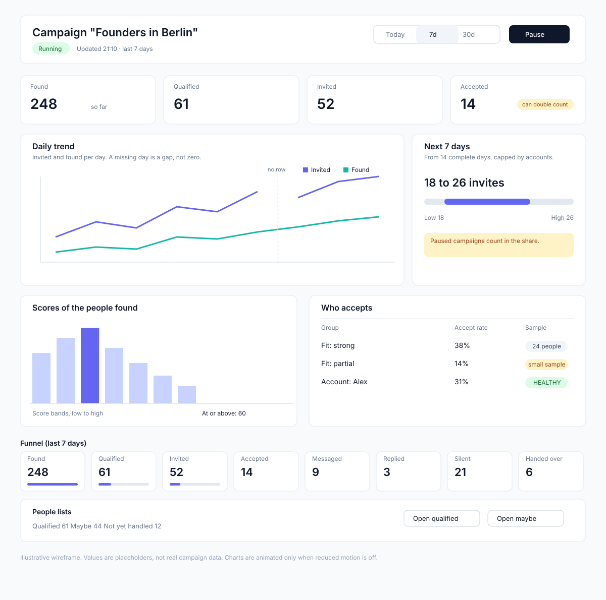
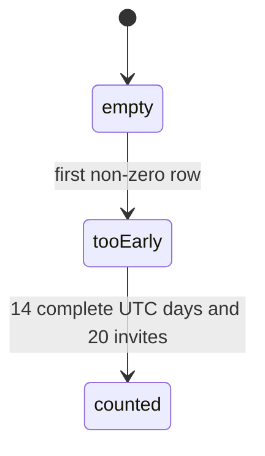
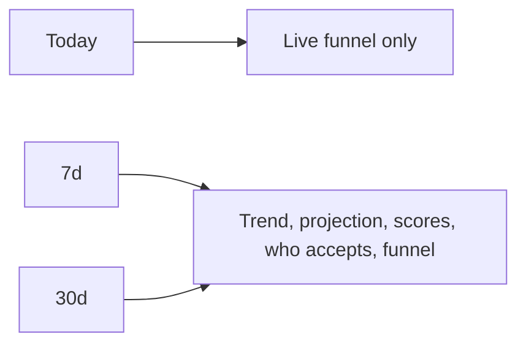
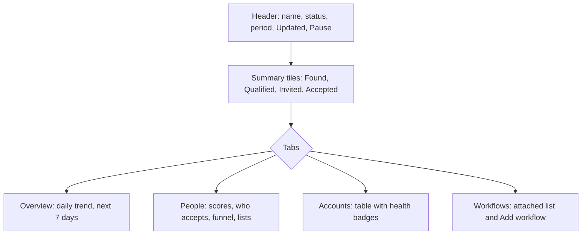

# Campaign detail page: UI and UX redesign with shadcn components

- Status: in progress <!-- draft | locked | in progress | done -->
- Created: 2026-11-13
- Locked by user: yes, 2026-11-13 (user confirmed the defaults for Q1 to Q7 and asked to lock and execute)

## Goal

The campaign detail page (`/campaigns/:id`) looks like a stack of bordered text blocks and is hard to scan. Redesign its layout, hierarchy and visuals with the shadcn components already in `apps/body/src/components/ui/`, so the owner sees the campaign's status, reach and results at a glance, and the empty and full states read clearly. Data, queries and the behaviours locked in `.plan/campaign-detail-insights.md` do not change.

## Requirements

Confirmed:

- Keep the locked behaviours from `.plan/campaign-detail-insights.md`: `empty | tooEarly | counted` state from the server; trend gate (14 complete UTC days, 20 invites); projection shown as a range capped by the share; empty means non-zero rows; Today tab shows live funnel only (no trend, no projection, no capacity panel); "Updated HH:MM" and "so far" labels; setup buttons only open existing screens; reduced motion respected.
- Keep the page root convention: `grid w-full gap-4 px-4 lg:px-6`, no `max-w-*`, no `mx-auto`.
- Use shadcn components from `apps/body/src/components/ui/` (Card, Badge, Progress, Tooltip, ToggleGroup, Tabs, Alert, Skeleton, Table, Button, Separator). No new UI library.
- Use the existing chart primitives (`ChartContainer` from `@/components/ui/chart`) for graphs. Animation comes only from recharts built-in animation.
- No API or contract change. This is a UI-only change in `apps/body`.
- Copy: plain sentences, no emojis, no promises of results.

Open questions (must be empty before locking):

- Q1. Hero summary card: add a top summary card (campaign name, status badge, period, "Updated HH:MM", primary action) above the sections, or keep the header as it is but restyled? Default: add a restyled header card with the status badge and the period control.
- Q2. Funnel: a horizontal stepper with a Progress bar per stage, or the current single line restyled as tiles? Default: a tile row (one tile per stage, count large, percent of Found under it), wrapping to a 2-column grid on narrow widths.
- Q3. Histogram ("Scores of the people found"): switch from the custom div histogram to a recharts `BarChart` inside `ChartContainer`, keeping the "At or above" slider? Default: yes, a bar chart in `ChartContainer`. The "At or above" control stays a native range input styled with Tailwind, because the repo has no shadcn `Slider` component.
- Q4. Who accepts and Accounts: convert the plain text lists to shadcn `Table` with a Badge for health. Default: yes.
- Q5. Period control: keep Today, 7d, 30d as a `ToggleGroup` (default) or keep `Tabs`. Default: `ToggleGroup`.
- Q6. Is the empty state a card with a checklist of setup steps (`missingSetupItems`) and capacity figures in `Card` tiles? Default: yes.
- Q7. Section tabs: in the full state, group the sections into content `Tabs` (Overview, People, Accounts, Workflows) so the page is not one long scroll, or keep one scrolling page? Default: yes, content `Tabs` in the full state only. The empty state stays one page because it is short. The period control (Q5) stays outside the tabs, in the header.

## Scope and non-goals

- In scope: `apps/body/src/pages/Campaign.tsx` layout and sections; `apps/body/src/components/campaigns/*` (panel, trend chart, capacity, lists strip, plus new small presentational components for the header, funnel tiles, histogram and tables); copy tweaks needed by the new layout.
- Out of scope: API, resolvers, contracts and rollup logic; `campaign-insights.ts` helper behaviour (reused as is, unless a helper needs a new formatter); the campaigns list page; `chart-area-interactive.tsx` sample data; new dependencies (no motion library); Pause and Resume behaviour; the Workflows list behaviour; mobile app work.

## Design

Wireframes (illustrative, placeholder values, not real campaign data):

### Empty state

### Full state

### Diagrams

Insights state from the server (see `.plan/campaign-detail-insights.md`). Empty means no non-zero rows:

Period control (client state). The insights query is disabled for Today, so Today never shows trend or projection:

Full-state layout, top to bottom (Q7 groups everything below the header into tabs):

### Tabs

- Period: `ToggleGroup` with Today, 7d, 30d in the header (Q5).
- Sections: `Tabs` for Overview, People, Accounts, Workflows in the full state (Q7). The active tab is kept in the URL search param `tab`, so a reload keeps it. Empty state renders no section tabs.

### Images

- The two SVG wireframes above are design references only. Real screenshots (Step 14) are kept out of the repo.

### Icons

Each icon is a `lucide-react` icon already used in `apps/body`, and each name was checked against the installed package.

| Where | Icon |
| --- | --- |
| Status Running | `Play` |
| Status Paused | `Pause` |
| Found | `Users` |
| Qualified | `Target` |
| Invited | `Send` |
| Accepted | `CircleCheck` |
| Trend card | `Activity` |
| Projection ("Next 7 days") | `Sparkles` |
| Scores | `ChartColumn` |
| Funnel | `Filter` |
| People lists | `ListChecks` |
| Accounts and health | `ShieldCheck` |
| Who accepts | `UserRoundCheck` |
| Capacity (empty state) | `Gauge` |
| Setup checklist | `Settings2` |
| Workflows | `Workflow` |
| Alerts and CUJ 5 reason | `TriangleAlert` |
| Updated time | `Clock` |

Icons are decorative (`aria-hidden`) and always sit next to text, so the colour and icon are never the only signal.

## Approach

- [x] Step 1: Read the current page and panel once more; record which sections map to which components (done in planning: header, insights panel, Needs you, Last Discover run, funnel, Compare, Handed over, Who accepts, Scores, Accounts, GoLive, Workflows, Pause dialog).
- [x] Step 2: Add a header card (`Card`) with campaign name, `Badge` for status (Running with `Play`, Paused with `Pause`), the period `ToggleGroup`, "Updated HH:MM" with `Clock`, and the Pause or Resume `Button`. Keep the Pause `Dialog` as is.
- [x] Step 3: Add a summary row of `Card` tiles (Found, Qualified, Invited, Accepted) with a delta or "so far" note, reusing `TrendSummary` data.
- [x] Step 4: Replace the empty state with a `Card` showing capacity figures (per day, per week, usable accounts), a setup checklist from `missingSetupItems` with `Badge` and `Button` links, and the CUJ 5 reason as an `Alert`.
- [x] Step 5: Restyle the funnel as tiles with `Progress` under each stage. Keep the Handed over tile and its "Open these people" button. If Q7 is yes, group the full-state sections into content `Tabs` (Overview, People, Accounts, Workflows) and keep the tab in the `tab` search param.
- [x] Step 6: Restyle the trend chart inside a `Card` with a `ChartContainer` and a `ChartTooltip`; keep the keyed period animation and reduced-motion check; add a `Skeleton` while the insights query loads.
- [x] Step 7: Restyle the projection block as a `Card` with a range bar (`Progress` or a styled track), the basis text in `CardDescription`, and the gate message in an `Alert` when `tooEarly`.
- [x] Step 8: Convert "Who accepts" (by fit and by account) and "Accounts" to `Table` with `Badge` health labels and `Tooltip` on the small-sample marker.
- [x] Step 9: Convert the histogram to a `BarChart` in a `ChartContainer` with the "At or above" control.
- [x] Step 10: Restyle the lists strip and the Workflows list as `Card` rows; keep the link targets.
- [ ] Step 11: Check mobile width (375 px) and desktop (1440 px) in the browser; check dark mode; check reduced motion.
- [x] Step 12: Add or update unit tests only for new pure logic (for example, any new formatter or a helper that maps health to a Badge variant). Do not test markup. Not applicable: the redesign adds components only and no new pure helper.
- [x] Step 13: Run `pnpm lint && pnpm ts:check && pnpm test:unit:run && pnpm build` from the repo root. Fix every error and warning.
- [ ] Step 14: Take screenshots of an empty campaign and a full campaign on `localhost:3000/campaigns/<id>` and compare with the current page.
- [ ] Step 15: Update `MEMORY.md` (one changelog line) and fill in the Outcome.

## Edge cases and risks

- Empty campaign (no found, no invites, no non-zero rows): the empty card must not show zeros as results; show capacity and setup instead.
- Campaign with invites but no found people, or history without live people: must not fall into the empty card (locked rule).
- Paused campaign: header badge and projection copy must say paused; the denominator counts the paused campaign (locked).
- No usable accounts or no workflow: setup checklist shows the right item; `noAccounts` reason copy is kept.
- Today tab: the insights query is disabled; the trend, projection and histogram cards must not render or must show a clear "Live counts only" note; avoid a flash of skeleton on Today.
- Gap days and `tooEarly`: the chart must show gaps, not zeros (`connectNulls={false}`).
- Long names and long lists (many accounts, many fit labels): truncate with `truncate` or `line-clamp`, and scroll inside `Table` wrappers on narrow widths, not the page.
- Recharts in jsdom/unit tests: keep chart components out of unit tests; test pure helpers only.
- Lazy-loaded panel: the fallback must be a `Skeleton` of the same height to avoid layout shift.
- Reduced motion: no chart animation and no bar grow transition when `prefersReducedMotion()` is true.
- Accessibility: charts need a text summary or `aria-label`; Badge colour must not be the only signal (keep the word); Tooltip content must also be reachable by keyboard (shadcn Tooltip is Radix, which handles focus).
- Dark mode: use theme tokens (`text-muted-foreground`, `bg-card`, `--chart-*`), not fixed colours.
- Data privacy: the page shows counts and names of the owner's accounts only; no change to what is sent to the browser.
- Rollback: UI-only, so reverting the commit restores the old page; no migration, no data change.
- Shared component risk: changes to `components/ui/*` affect other pages; do not edit those files, only compose them.
- Prettier reformats unrelated lines in `Campaign.tsx`; format only the changed blocks or check the diff.

## Verification

- `pnpm lint && pnpm ts:check && pnpm test:unit:run && pnpm build` from the repo root, all clean.
- Browser check at `localhost:3000/campaigns/<id>` for an empty campaign and a full campaign, at 375 px and 1440 px, in light and dark mode, with reduced motion on and off.
- Confirm each locked behaviour still shows: Today hides trend and projection; "so far" and "Updated HH:MM" labels; each CUJ 5 reason; setup links open existing screens.
- Confirm no network call changed: check the request list in the browser (same `campaign.overview` and `campaign.insights` calls).
- Record what was run and what could not be run (staging check needs the owner's staging session).

## Outcome

Status: in progress. Steps 1 to 10, 12 and 13 are done. Steps 11 (browser check) and 14 (screenshots) are blocked: the local dev server (`localhost:3002`) redirects `/campaigns/:id` to the authentik sign-in page, and there is no local auth bypass, so the page could not be opened. Step 15 is partly done (this Outcome); `MEMORY.md` and the status change to `done` wait for the browser check.

What shipped (UI only, in `apps/body`):
- Campaign header, summary tiles, funnel with `Progress`, trend chart in a `Card`, projection `Card` with `Alert` for the gate, `Table` for Accounts and Who accepts, histogram as a `BarChart` (lazy-loaded), lists strip and Go live and Workflows as `Card`s.

Deviations from the plan:
- The "Updated HH:MM" label stays in the insights panel header line (`campaign-insights-panel.tsx`), not in the page header card.
- The lists strip sits inside the insights section, not at the top of the page.
- Summary tiles sit above the funnel (`Campaign.tsx`).
- The funnel was trimmed to the four downstream stages.
- `ProjectionBlock` does not show a second "too early" note when the projection is already hidden as `tooEarly` (`campaign-insights-panel.tsx` line 48).

Follow-ups:
- Run Steps 11 and 14 once a signed-in session is available (light and dark mode, 375 px and 1440 px, reduced motion on and off, empty and full campaigns).
- Confirm that `tooEarly` always comes with a hidden projection (not verified).
- Decide whether the plan and the SVG wireframes are committed to PR #219.

Verification run: root `pnpm lint && pnpm ts:check && pnpm test:unit:run && pnpm build` exited 0 (7/7 build, 6/6 lint, 5/5 ts:check); body `tsc --noEmit` exited 0.
