# Lead pipeline: find posts, find engagers, invite, warm up, message, hand off

- Status: rejected (2026-11-13, not done; owner asked to focus only on campaign-detail-insights). Was: ready for the owner's approval (revision 9, 2026-11-04: the twelve finders, all sixteen automations, the nine new blocks N1 to N9, the ranking model and the notification, viewer, feed and mutual reads are confirmed by the owner and carried into phase plans 7 to 10; nothing is built)
- Created: 2026-11-03
- Locked by user: not yet (the executive plan was approved on 2026-11-04; this revision adds the screens and the block design for approval)
- Phase plans: [p1 foundations](lead-pipeline-p1-foundations.md), [p2 checks](lead-pipeline-p2-checks.md), [p3 engage](lead-pipeline-p3-engage.md), [p4 words and approval](lead-pipeline-p4-ai-drafts.md), [p5 campaign page](lead-pipeline-p5-campaign-page.md), [p6 campaign starter](lead-pipeline-p6-campaign-starter.md), [p7 ranking](lead-pipeline-p7-ranking.md), [p8 reading blocks](lead-pipeline-p8-reading-blocks.md), [p9 new reads](lead-pipeline-p9-new-reads.md), [p10 automations](lead-pipeline-p10-automations.md)

## Goal

Give a GTM engineer a catalog of small blocks, one spider task and a few platform pieces so they can build, by themselves on the canvas, any lead-prospecting or outreach workflow they can think of. The first workflow to prove it is a daily automation for problem one (find prospects for our service):

1. find about 20 posts a day about the problems we solve, take their commenters and reactors, read profiles, rank them against the ideal customer;
2. invite the best from every signed-in account, inside each account's daily and weekly limit;
3. while an invite is pending, react to and comment on the person's posts;
4. when they accept, send one first message 1 to 24 hours later, aware of anything already said;
5. when nobody replies in 4 days, or nobody accepts in 21 days, list the person on My network and hand them over in a CSV.

Words come from the owner's texts or from an LLM; AI words wait for the owner's approval. Problem two (booking calls) is out of scope. No code is written in this task.

## Decisions (owner, 2026-11-03 and 2026-11-04)

| Topic | Decision |
| --- | --- |
| Accounts | Every account of the owner that is attached and signed in is used. The acts of one person go through the account that sent the invite. |
| Limits | Every daily and weekly limit = LinkedIn's maximum x a random number from 0.65 to 0.80. Maximums: invites 20 a day and 100 a week, notes 5 a month (doc `.docs/linkedin-free-account-limits.md`); first messages 20, reactions 60, comments 20 a day (owner's numbers); replies keep 40 a day. After the rule: 13 to 16, 39 to 48, 13 to 16 and 26 to 32. Posting and removal limits stay. |
| Warm-up | Reactions and comments. Stops on accept only. No cap of acts per person; at least 1 day between acts for a person; the daily limit rations who is served; least recently engaged first. |
| Words | Writing is its own block, "Write words", with two ways: from the owner's texts, or With AI (an LLM reads the post, the person and the chat). Acts only send words; they never write them. |
| AI | Vercel AI SDK (`ai`); Gemini first (`@ai-sdk/google`), `@ai-sdk/openai-compatible` for any other; the model id is an env value. The platform's key; cost on the Usage page. Defaults: 10 into the inbox a day, 48 hours to decide (approval adds 24), $5 an owner a month, $50 the platform a month, $5 the platform a day. "No AI" is reversed for writing only; mood stays rules. |
| Approval | AI words wait for the owner in one inbox (comments, first messages, replies). No auto-approve, ever. |
| Voice | A saved, reusable "writing voice" shared by every With AI block and by campaigns. |
| Chat | A block fetches the stored chat between the account and a person. Chat text may go to the AI provider with emails and phones removed: on by default, switchable per block, said in a first-use notice. A block checks whether a person is a connection of an account. |
| Unanswered invites | Never withdrawn. After 21 days the person stays pending, is listed on My network, exported, and the pipeline moves on. Notice at 2,400 pending on an account, new invites for it paused at 2,850. |
| First message | 1 to 24 hours after they accept, one text per campaign, no second message. |
| Silence | 4 days without a reply produces the hand-off CSV only. |
| Hand-off | A rolling file, one row per person, never twice; plus "Send via API". The link is the person's page on this platform (opens for the owner's login); no phone, no LinkedIn link. |
| Campaigns | One per solution (keywords, ideal customer, voice). The Starter is planned only. |
| Privacy | Draft and post text kept 30 days, then counts and cost. The first-use risk notice wording is approved. |
| Design | Every block does one thing, has few settings with safe defaults, short plain wording, and returns the same shape. Details below. |
| Automations | All sixteen blue-sky automations (A1 to A16) are in the plan, built in three waves (phase 10). |
| New blocks | N1 to N9 are approved, Label with AI (N3) in particular (phases 7 and 8). |
| Ranking | The model is the default: fit 50, intent 30, reach 10, relationship 10, tiers 80, 60, 40, a review lane for tier A; calibrated on real results (phase 7). |
| New reads | Who viewed my profile, my feed, notifications and (for A6) mutual connections are read-only tasks and blocks (phase 9). Mutual reads: tier A only, about 10 a day an account (a proposal to change). |
| SaaS: who pays for AI | The platform pays for AI. The per-user caps stay as protection and are the same for every user ($5 a month and 10 drafts a day, as in phase 4); the platform caps stay ($50 a month, $5 a day). |
| SaaS: plans | No plans. Every user has the same limits (the limit rule, the caps and the browsing budgets). |
| SaaS: shared workers | No per-user cap on work. Work is taken in a fair order across users, so one user's backlog cannot starve the others; the per-account limits and budgets still apply. |
| SaaS: same person | Two users may invite or message the same person. No platform-wide cap or check across users. |
| SaaS: one account, one user | A LinkedIn account can belong to one user only. If `soni@elitale.com` is added by one user, no other user can add it. Phase 1 carries the change. |

## Block design rules (UI and UX)

Applies to every new block and every changed one.

1. One thing. A block has one job and one reason to change. Looking, deciding, writing, asking and acting are different blocks.
2. Few settings. At most 4 basic settings, the rest under "Advanced". Every setting has a safe default, so a block works the moment it is dropped on the canvas, and a founder never has to open Advanced.
3. Short words. A block label is a verb and an object, at most 4 words ("Send message"). A setting label is at most 5 words. A hint is one sentence of at most 14 words, with a number or an example. No jargon on screen (no "ICP", "port", "hook", "ledger"). Units are in the field ("hours", "days"). Errors are one sentence and name the field: "Fit to today's limit: pick what to fit."
4. A live sentence. Each block's Settings tab ends with one plain sentence built from the settings: "Lets people through 1 to 24 hours after they accepted." The same sentence shows under the block on the canvas.
5. Same anatomy. The existing block dialog stays: tabs Input (a made-up sample), Settings, Output (what it handed on), a state strip and an error panel. New blocks add nothing to it.
6. Same output. Every block hands on the same shape (next section), so any block that takes a kind of item can take it from any block that gives that kind.
7. Safe by default. Acts are off ("Act for real"), paid reads show their price, a preview acts on nothing and says what would happen.
8. Built from tables, not branches. Facts, actions, limits and reasons live in small tables in contracts; adding one is a line, not an `if`.

Block dialog, any block (example: Wait per person):

```
+------------------------------------------------------------------+
| [clock] Wait per person                          Ready           |
|  Input | Settings | Output                                       |
|------------------------------------------------------------------|
|  After        [ They accepted      v]                            |
|  Wait at least[ 1 ] [ hours v]                                   |
|  Plus up to   [ 23 ] [ hours v]   random, the same for each person |
|  > Advanced                                                       |
|------------------------------------------------------------------|
|  Lets people through 1 to 24 hours after they accepted.          |
|                                         [ Preview ]  [ Done ]    |
+------------------------------------------------------------------+
```

### What every block hands on

| Part | Meaning |
| --- | --- |
| Main output | The items that did their part, unchanged unless the block says (an act block hands on the ones it planned). |
| Else output | The items it left out, each with `result.reason` as one fixed sentence (at most 80 characters, never the person's words). Only blocks that split or skip have it; the canvas shows an orange dot. |
| Item fields | `result` { action, status, account, at, reason } (exists); `facts` (exists); `written` (new: the words for this item, up to 4,000 characters, any kind); `chat` (new, people only: pointers and counts, never text). A block that does not know a field passes it on untouched. |
| Step message | One line: "12 in, 8 on, 4 to Else", then the main cause. Counts only. |
| Kinds | profile, post, company, job, ad, conversation. A block that gets a kind it cannot use passes those items on and says so. |

### What any block does when something is wrong

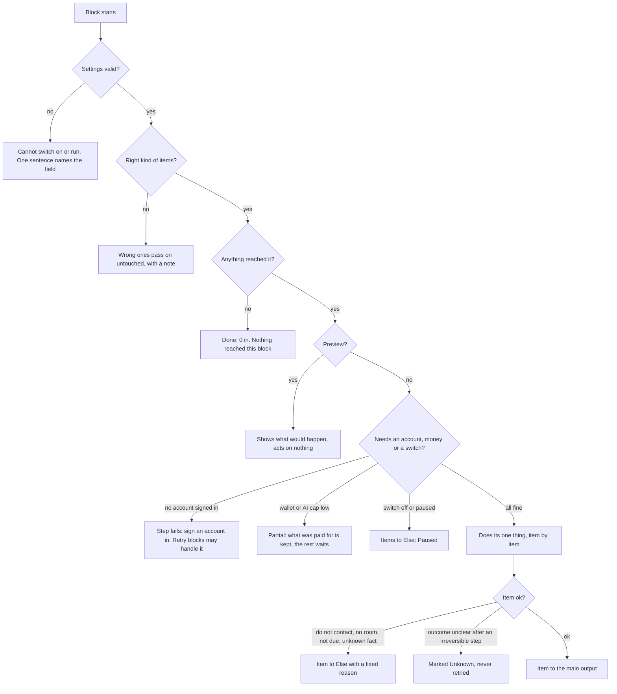

## The flow

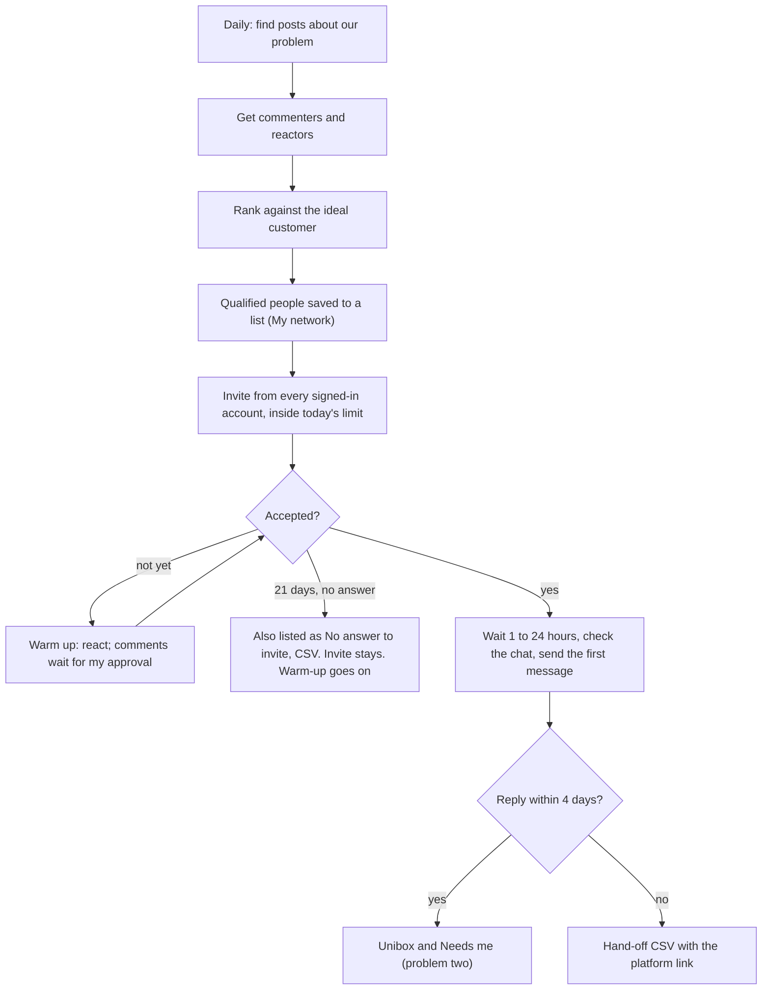

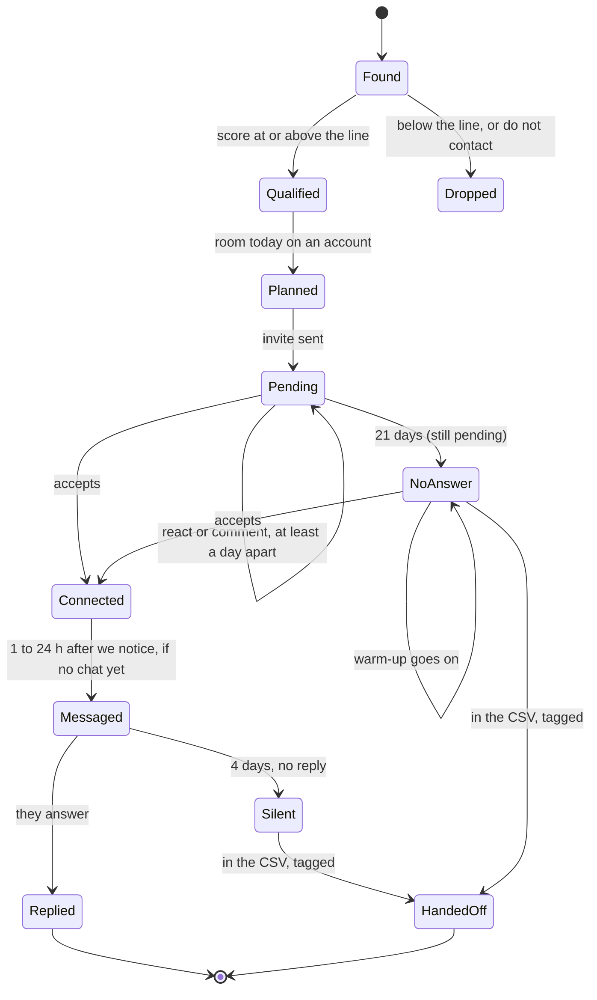

Why six small daily workflows: people accept on different days; a run is one batch with one live run per workflow; a Wait of days would hold everyone to the slowest person. Each stage asks My network "who is ready for this step today?". The label `lead-<campaign>` ties them together. Words that wait for approval are rows in an inbox, not a paused run.

## What the owner builds (six workflows)

Legend: green exists, yellow exists but changes, red is new.

Stage 1, Discover. It ends with "Add to list": My network keeps a person's score only through a list member, and their comment only in the list entry.

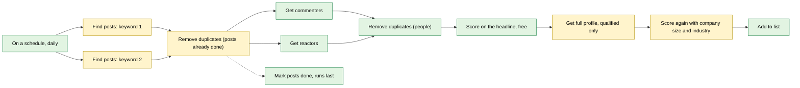

Stage 2, Invite. Only 3 to 4 notes a month per free account, so only the best few carry one.

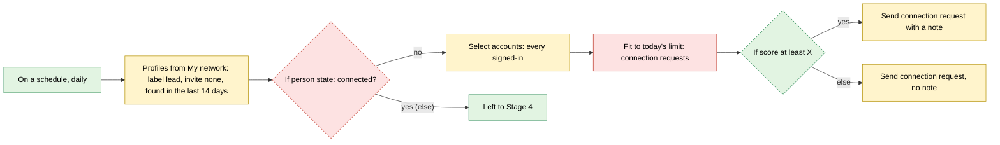

Stage 3, Warm up. One canvas, two chains: the daily chain ends in the inbox; "When I approve" starts the second chain with the approved comments.

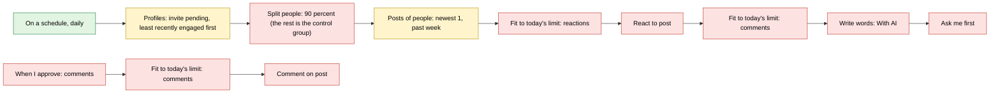

Stage 4, First message. Runs every 2 hours. The chat is checked first so we never open a cold conversation with someone we already talk to. With Automatic words the AI path is not needed: Write words and Ask me first drop out and Send message holds the text.

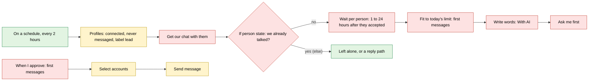

Stage 5, Hand off the silent. Stage 6 is the same with "invite pending 21 days or more" in the input and the tag `no-answer`.

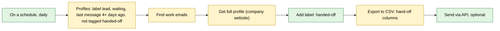

## Prospect-finding flows (confirmed 2026-11-04)

Stage 1 above is one way to find people. A GTM engineer needs many, and all of them should end the same way, so everything after (invite, warm-up, message, hand-off) is shared. A finder is a short chain that ends in "Score, read profile, Add label, Add to list".

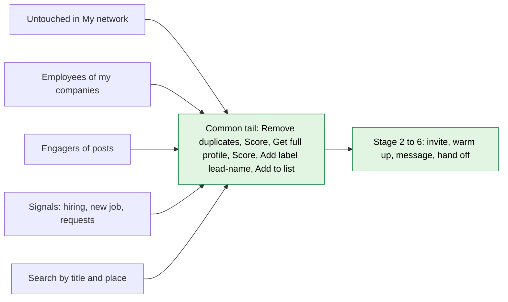

The tag matters: Stage 2 picks people by the label `lead-<campaign>`, and the list matters because My network keeps a score only through a list member.

### The twelve finders

Legend as above. "Free" means no paid read; prices are the catalog's.

| # | Finder | Starts from | Paid by | Status |
| --- | --- | --- | --- | --- |
| 1 | Untouched people in My network | people you already hold and never touched | free (a profile read only for the qualified) | needs C4 preset "Untouched" |
| 2 | Untouched connections | connected, never messaged | free | exists with B3, B4, B7 |
| 3 | Employees of my target companies, with titles | `/companies` | about $0.004 a person plus $0.10 a page of 25 | exists (template "Who works at my target accounts") |
| 4 | Known people at my target companies | My network, by company | free | needs C4 filter "Works at my companies" |
| 5 | Engagers of posts in `/posts` (mine or imported) | `/posts` | about $0.002 a comment or reaction | exists (template "People engaging with posts I choose") |
| 6 | Engagers of people I watch | people with a label | posts $0.002, engagers $0.002 each | exists (template "Watch people I care about") |
| 7 | A competitor's audience | a company in `/companies` | posts and engagers $0.002 each | exists (templates "My competitor's audience", "Engaged with me and my competitor") |
| 8 | Hiring signal | companies hiring for a role | jobs and employees per the estimate | exists (template "Companies hiring for a role") |
| 9 | Job changers | LinkedIn search | per person found | exists (template "New in their job") |
| 10 | People who asked to connect with me | my received requests | free (a browser read of the account) | exists (Get my requests, Answer requests) |
| 11 | Search by title and place, or by company | LinkedIn search | per row found | exists (templates "Decision makers in my market"; Search companies) |
| 12 | Qualified but never invited | My network backlog | free | exists with C4 order by score |

Also exist as templates and need nothing: "People talking about my problem" (Stage 1 here), "People like my best customer" (what a customer engages with, then who else engaged there) and "From a list of websites".

#### 1 Untouched people in My network

Who: people already in My network that nobody has acted on: not connected, no invite, never messaged, status New, not on Do not contact. Typical sources: imported CSVs, people found by earlier workflows, targets saved by hand.

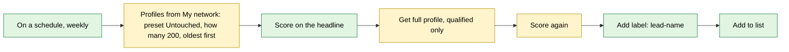

- The preset "Untouched" fills the existing filters: connection not connected, invite none, never messaged, status New, and a time frame "Added more than N days ago" (default any). The block shows the live count ("412 untouched").
- Hands on: people with `score` and the tag. Negative: none match gives "No people match."; people already in another list are skipped with "Already in a list." and keep their label only.

#### 2 Untouched connections (message first)

Who: people connected to one of my accounts that I never wrote to. No invite is needed; this goes straight to a message.

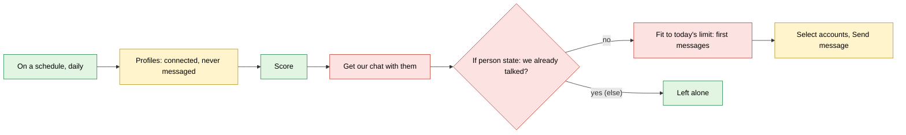

- Fits the same Stage 4 tail (Write words and Ask me first when the words are written by AI).

#### 3 Employees of my target companies, with certain titles

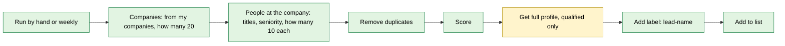

- Titles and seniority are the block's own settings ("Current job titles", "Seniority"). Paid per person and per page: the estimate shows it before a run.
- Negative: a company with no people found passes nothing on and the step says "3 companies had nobody."; a company that is not on LinkedIn is skipped with "Company page not found."

#### 4 Known people at my target companies (free first)

Who: people already in My network who work at the companies on `/companies`. My network matches them by the company's link or name, so no paid search is needed.

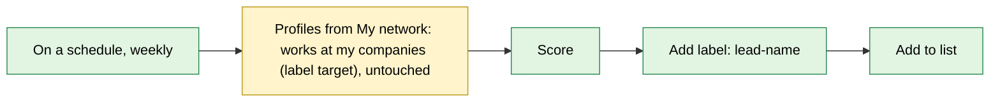

- Needs a filter "Works at my companies" with a company label (today the filter takes typed company names). Run this before finder 3; run 3 only for the companies with few known people.

#### 5 Engagers of posts in `/posts` (mine or imported)

Who: people who commented or reacted on posts saved in `/posts`: posts you wrote (saved through "See results") and posts you imported by link or CSV.

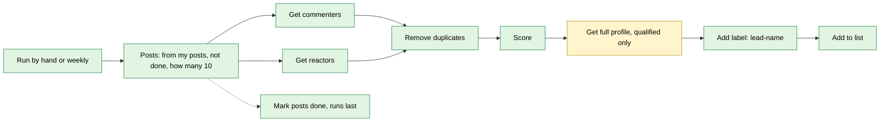

- "Only my posts" is the Posts block's author filter. A post read recently is not read again (30-day reuse). Negative: a post nobody engaged with passes nothing; a deleted post is skipped with "Post not found."

#### 6 Engagers of people I watch

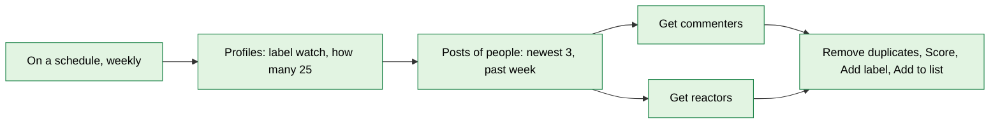

- Influencers, partners, or your own best customers. The same chain with the people's posts replaced by their company's posts is finder 7.

#### 7 A competitor's audience

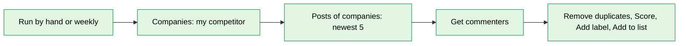

- "Engaged with me and my competitor" adds my posts and a Merge block that keeps only people on both sides.

#### 8 Hiring signal

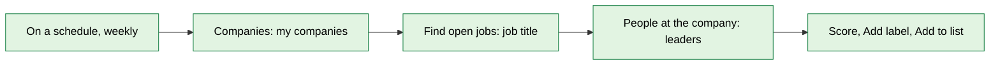

- Gives a reason to write: the open role. A message can say "I saw you are hiring a Head of Sales". The role travels on the person as a signal.

#### 9 Job changers

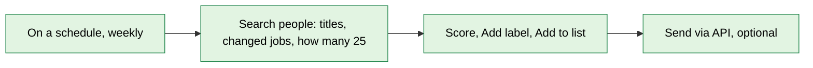

- People in a new role answer more. Run it weekly; Remove duplicates keeps the same person from coming back.

#### 10 People who asked to connect with me

Who: people whose connection request to one of my accounts is waiting. They already showed interest, so they skip the invite stage.

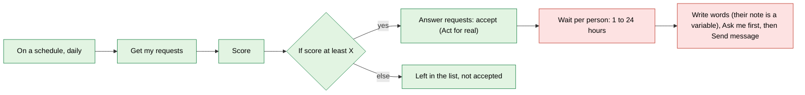

- Their own note is available to the words as `{their_note}`. Never accept below the line: the Else keeps them for the owner to decide.

#### 11 Search by title and place, or by company

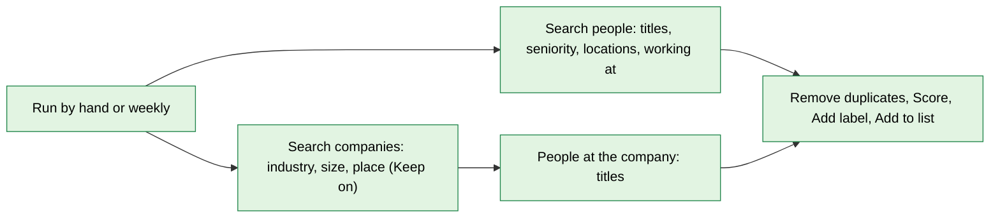

- The widest finder and the most expensive; cap "How many" and read the estimate. Search is capped by LinkedIn at about 1,000 results.

#### 12 Qualified but never invited (backlog)

Who: people a finder already qualified (label `lead-name`) that Stage 2 had no room for. Run it when room is free, or after changing the ideal customer.

```mermaid
flowchart LR
   classDef have fill:#e2f4e2,stroke:#1e8449,color:#000
   classDef changed fill:#fff4cc,stroke:#b7950b,color:#000
   classDef new fill:#fde2e2,stroke:#c0392b,color:#000
   T["On a schedule, daily"]:::have --> P["Profiles: label lead-name, invite none, found over 14 days ago, best score first"]:::changed
   P --> S["Score again (new ideal customer)"]:::changed
   S --> A["Select accounts"]:::changed
   A --> RM["Fit to today's limit: connection requests"]:::new
   RM --> I["Send connection request"]:::changed
```

- Old people go stale: the default drops people found more than 60 days ago.

#### Combining finders: engagers of my own posts who are not connected

```mermaid
flowchart LR
   classDef have fill:#e2f4e2,stroke:#1e8449,color:#000
   classDef new fill:#fde2e2,stroke:#c0392b,color:#000
   T["On a schedule, weekly"]:::have --> P["Posts: my own posts, not done"]:::have
   P --> E["Get commenters and reactors"]:::have
   E --> K{"If person state: connected?"}:::new
   K -- "no" --> S["Score, Add label, Add to list, then Stage 2"]:::have
   K -- "yes (else)" --> M["Send message path (Stage 4)"]:::have
```

The routing block (B3) is what lets one finder feed both the invite path and the message path.

### Finders fail soft

```mermaid
flowchart TD
   S["A finder runs"] --> I{"Anything to start from? (posts, companies, people)"}
   I -- "no" --> E1["Done: Nothing to start from. The step says what to add"]
   I -- "yes" --> W{"Wallet above its floor?"}
   W -- "no" --> E2["Stops before paying: Wallet is low. Nothing is lost"]
   W -- "yes" --> F{"Found anyone?"}
   F -- "no" --> E3["Done: 0 found. The block that found none is named"]
   F -- "yes" --> D{"All already known (duplicates, do not contact)?"}
   D -- "yes" --> E4["Done: 0 new. Counts of each reason"]
   D -- "no" --> Q{"Anyone at or above the line?"}
   Q -- "no" --> E5["Done: 0 qualified. Shows the best score and the line"]
   Q -- "yes" --> OK["Tagged and listed; Stage 2 takes them"]
```

Confirmed by the owner on 2026-11-04. The phase plans carry what they need: phase 1 (the preset "Untouched" and the filter "Works at my companies"), phase 5 (the "Found by" cut) and phase 6 (finder recipes).

## Blue-sky automations from the ICP's point of view (confirmed 2026-11-04)

These start from the ideal customer, not from the blocks. Green means a block exists, yellow means it changes, red means it is new (the nine blocks N1 to N9 below). Confirmed by the owner on 2026-11-04 (all sixteen); carried into phases 7 to 10.

### 1 Think like the ICP

Four questions describe a buyer on LinkedIn:

- Who: title, seniority, function.
- Where: company size, industry, place, stage, the tools they use.
- When: a trigger such as a funding round, a hire, a new job, a post about the problem, a competitor's change.
- How they behave: what they post, comment on and react to, which jobs they open, whom they follow and know.

Every one of those leaves a trace somewhere on LinkedIn. The goal is to collect the traces from every corner, keep them as signals on the person and the company, rank, and treat each person by their rank.

```mermaid
flowchart LR
   subgraph Corners["Where an ICP leaves traces"]
      P["Posts: pain, questions, competitor mentions, hiring, funding"]
      H["Hashtags and keywords"]
      C["Company pages: people, jobs, ads, growth"]
      J["Jobs: open roles and what they ask for"]
      S["Search: titles, places, industries"]
      N["My network: connections, requests, chats"]
      A["A person's activity: comments, reactions"]
      R["Profile: skills, school, past employers, flags"]
      F["My feed: new jobs, anniversaries, announcements"]
      V["Who viewed my profile"]
      E["Events, groups, newsletters (partial)"]
   end
   Corners --> SIG["Signals on the person and the company, kept in My network"]
   SIG --> SC["Score: fit, intent, reach, relationship, fading with age"]
   SC --> T2["Tier A, B, C, D"]
   T2 --> L["Lanes: review, standard, warm only, parked"]
   L --> O["Outcomes: accepted, replied, silent, handed off"]
   O --> SC
```

### 2 The map of corners

| Corner | What the ICP leaves there | Signal it gives | How we get it | Status | Risk |
| --- | --- | --- | --- | --- | --- |
| Posts, by keyword | asks for a tool, complains, compares or leaves a competitor, announces a hire or funding | asked, posted, competitor, hiring, funding | post search and engagement reads (data service) | exists; N3 reads the intent | low |
| Hashtags | posts under a topic tag | posted | keyword search with the tag; a true hashtag feed needs the account's browser | try Find posts first | low |
| Company pages | people, headcount, posts, open jobs, ads | employee, hiring, ads running | data service | exists | low |
| Jobs | an open role, the text of the job | hiring, tools they use, pains | job search (data service) | exists; N3 reads the text | low |
| People search | titles, places, past employers | fit | data service | exists | low |
| My network | connections, requests, chats, invite state | requested, connected, replied | stored by the accounts' reads | exists | low |
| A person's activity | what they comment on and react to | engaged with, asked | data service (their comments and reactions) | exists | low |
| Profile details | skills, school, past employers, flags (`hiring`, `openToWork`, `creator`, `verified`, `premium`) | fit, relationship, reach, job change | paid profile read, stored | exists; N7 and N9 read it | low |
| My feed | new jobs, anniversaries, announcements of my connections | jobchange, funding | the account's browser (planned task "Get my feed posts") | needs a task | low |
| Who viewed my profile | the few recent viewers a free account sees | viewed | the account's browser (new task) | needs a task | low |
| Events, groups, newsletters | speakers and organisers named in posts, group posts, commenters on editions | posted, engaged | partly through post search; member and subscriber lists are not visible | partial | medium |
| Mutual connections | who in my network knows them | mutual | the profile shows a count; the list needs the browser | later, not recommended in bulk | medium |

What LinkedIn does not give us: poll voters, newsletter subscribers, full follower lists, group member lists beyond what a member sees, contact details of people we are not connected to, anything only inside Sales Navigator. An idea that needs one of them is left out.

### 3 Ranking: fit, intent, reach, relationship

```mermaid
flowchart TD
   X["A person"] --> NEG{"A negative rule? competitor, student, recruiter, customer, do not contact"}
   NEG -- "yes" --> OUT["Excluded, with the reason"]
   NEG -- "no" --> FIT["Fit 0 to 50: title, seniority, function, company size, industry, place, tools"]
   FIT --> INT["Intent 0 to 30: signals, each fading with age"]
   INT --> RCH["Reach 0 to 10: active lately, mutual connections, language"]
   RCH --> REL["Relationship 0 to 10: shared school, employer, group"]
   REL --> SUM["Score 0 to 100 and the top three reasons"]
   SUM --> TIER{"Tier"}
   TIER -- "80 and over" --> A["A"]
   TIER -- "60 to 79" --> B["B"]
   TIER -- "40 to 59" --> C["C"]
   TIER -- "under 40" --> D["D, parked"]
```

Proposed signal weights (guesses to calibrate on real accept and reply rates, not facts). Each fades by half every `half-life` days, intent is capped at 30:

| Signal | Points | Half-life (days) |
| --- | --- | --- |
| Asked for a tool or advice about the problem | +20 | 14 |
| Asked to connect with us | +20 | 30 |
| Posted about the problem | +15 | 30 |
| Commented or reacted on our posts | +15 or +5 | 30 |
| Visited our profile | +12 | 14 |
| Commented on a problem post with the problem's words | +10 | 30 |
| In a new role in an ICP title (under 90 days) | +10 | 90 |
| Their company is hiring for a related role | +10 | 45 |
| Funding or launch announcement | +8 | 60 |
| Engaged with a competitor | +6 | 60 |
| Replied "not now" before | +5 | re-check date |

Reach: active in the last 30 days +4, posts regularly +2, five or more mutual connections +2, same language +2. Relationship: a shared school, past employer or group +4 each, at most 8. Negatives exclude or cap: a competitor or vendor, a student or intern, a recruiter or agency (when the ICP is not one), an existing customer or open deal (a list the owner uploads), no activity for a year (cap 40).

Treatment by tier:

```mermaid
flowchart LR
   A["Tier A"] --> LA["Review lane: two reactions first, a note written by AI, I approve it, then the invite"]
   B["Tier B"] --> LB["Standard lane: invite without a note, warm-up, first message"]
   C["Tier C"] --> LC["Warm-up only: react, no invite until a signal lifts the score"]
   D["Tier D"] --> LD["Parked: re-scored every week, nothing spent"]
```

The lanes are built with blocks that exist (two If blocks on the score, one chain per lane). Accounts are ranked the same way (fit plus triggers plus the best three contacts) and the best N accounts go first. Every score shows its top three reasons; every month the tuning view compares accept and reply rate by tier, signal, source and variant and suggests weight changes (the owner decides).

### 4 The lead machine

Everything below is one machine: finders write signals into My network, one scoring model ranks, exclusions protect, lanes treat, results feed back.

```mermaid
flowchart TD
   subgraph Find["Finders, each on its own schedule"]
      F1["Intent radar: posts that ask, complain, compare, hire, announce"]
      F2["Account engine: target accounts, triggers, buying committee"]
      F3["Content flywheel: engagers of my own posts"]
      F4["Competitor displacement: their audience and leavers"]
      F5["My network: untouched, dormant, requests, viewers"]
      F6["Lookalikes: people like my best customers"]
   end
   Find --> ST["Signal store: person and company, with signals and dates"]
   ST --> SCORE["Score by signals, score the account"]
   SCORE --> EXC["Exclusions: customers, open deals, competitors, a colleague contacted this week"]
   EXC --> LANES["Tier lanes"]
   LANES --> OUT1["Invite, warm up, first message"]
   OUT1 --> RES["Accepted, replied, silent"]
   RES --> HAND["Hand-off CSV and API, other channels"]
   HAND --> BACK["Replies elsewhere come back through the API"]
   BACK --> EXC
   RES --> CAL["Weekly calibration by tier, signal, source, variant"]
   CAL --> SCORE
```

### 5 Sixteen automations

#### A1 Intent radar

Idea: five searches that catch people at the moment of need: asking for a tool, complaining about the problem, comparing or leaving a competitor, hiring for the role, announcing funding or a launch. An AI label says which and how urgent; urgent ones go to a review lane the same day.

```mermaid
flowchart LR
   classDef have fill:#e2f4e2,stroke:#1e8449,color:#000
   classDef changed fill:#fff4cc,stroke:#b7950b,color:#000
   classDef new fill:#fde2e2,stroke:#c0392b,color:#000
   T["Every 3 hours"]:::have --> Q1["Find posts: asking for a tool"]:::have
   T --> Q2["Find posts: complaining about the problem"]:::have
   T --> Q3["Find posts: comparing or leaving a competitor"]:::have
   T --> Q4["Find posts: hiring for the role"]:::have
   T --> Q5["Find posts: funding or launch news"]:::have
   Q1 --> M["Remove duplicates (posts done)"]:::changed
   Q2 --> M
   Q3 --> M
   Q4 --> M
   Q5 --> M
   M --> CL["Label with AI: intent and urgency"]:::new
   CL --> AU["Authors: Get full profile"]:::have
   AU --> SS["Score by signals"]:::new
   SS --> IF{"If urgent, or score 80 and over"}:::have
   IF -- "yes" --> RV["Review lane: Write words, Ask me first, reply or invite"]:::new
   IF -- "else" --> EN["Commenters and reactors, Score by signals, Add label, Add to list"]:::new
```

Needs: N1, N3.

#### A2 Buying committee builder

Idea: rank accounts first, then reach three roles in each (the buyer, a champion, a user), one person at a time, and stop the rest of the company when one answers.

```mermaid
flowchart LR
   classDef have fill:#e2f4e2,stroke:#1e8449,color:#000
   classDef changed fill:#fff4cc,stroke:#b7950b,color:#000
   classDef new fill:#fde2e2,stroke:#c0392b,color:#000
   T["Weekly"]:::have --> AC["Companies: my target accounts"]:::have
   AC --> JB["Find open jobs: related roles"]:::have
   JB --> SA["Score company: fit and triggers"]:::new
   SA --> TOP["Take the best 50 accounts"]:::have
   TOP --> PB["People at the company: buyer titles"]:::have
   TOP --> PC["People at the company: champion titles"]:::have
   TOP --> PU["People at the company: user titles"]:::have
   PB --> TG["Add label: role"]:::have
   PC --> TG
   PU --> TG
   TG --> BP["Pick best per company: 3"]:::new
   BP --> SS["Score by signals"]:::new
   SS --> SO["Space out people of one company: one every 3 days, none after a reply"]:::new
   SO --> INV["Fit to today's limit, Send connection request"]:::changed
```

Needs: N2, N1, N4, N5.

#### A3 Trigger-based account engine

Idea: raise an account's score when a trigger appears (a role opens, ads start, a founder posts about the problem) and only then reach its people with a message that names the trigger. Uses the Account signals in A2; runs daily over the whole target list and starts A2's people steps only for accounts that crossed the line. Needs: N2.

#### A4 Job-post tool detector

Idea: read the text of target companies' job posts, label the tools and pains they mention ("uses HubSpot", "building outbound"), tag the account, and treat it as a fit signal. Needs: N3 and the job text.

#### A5 Customer lookalike graph

Idea: learn what my best customers have in common, let the owner tick the pattern, search with it, and also take the people who engage where my customers engage.

```mermaid
flowchart LR
   classDef have fill:#e2f4e2,stroke:#1e8449,color:#000
   classDef new fill:#fde2e2,stroke:#c0392b,color:#000
   C["Profiles: label customer"]:::have --> RD["Get full profile"]:::have
   RD --> PAT["Find the pattern: titles, past companies, schools, skills, sizes"]:::new
   PAT --> SP["Search people with the ticked pattern"]:::have
   C --> EP["What this person engages with"]:::have
   EP --> CM["Commenters and reactors there"]:::have
   SP --> M["Merge, Remove duplicates"]:::have
   CM --> M
   M --> SS["Score by signals: similarity to customers"]:::new
   SS --> L["Add label, Add to list"]:::have
```

Needs: N6, N1.

#### A6 Warm path finder

Idea: for a qualified person, find who in my network knows them and ask that person for an introduction, or mention the mutual connection in the note. Needs: the account's browser to read mutual connections. Not recommended in bulk (many profile views); do it only for tier A.

#### A7 Shared-context notes

Idea: compare each prospect with the sending account (school, past employer, skills, city) and let the words use it ("fellow Stanford alum"). Accept rate usually rises with a true shared fact. Needs: N9 and new variables `{shared_school}`, `{shared_employer}`.

#### A8 Content flywheel

Idea: I publish posts about the problem; everyone who engages is a warm lead; non-connections get an invite that names the post, connections get a thank-you message; each post is tracked as a source.

```mermaid
flowchart LR
   classDef have fill:#e2f4e2,stroke:#1e8449,color:#000
   classDef changed fill:#fff4cc,stroke:#b7950b,color:#000
   classDef new fill:#fde2e2,stroke:#c0392b,color:#000
   T["Weekly"]:::have --> W["Write words: a post from a topic"]:::new
   W --> Q["Ask me first"]:::new
   AP["When I approve"]:::new --> WP["Write a post"]:::have
   T2["Daily"]:::have --> PO["Posts: my own, posted 3 or more days ago, not done"]:::have
   PO --> E["Get commenters and reactors"]:::have
   E --> K{"If person state: connected?"}:::new
   K -- "no" --> SS["Score by signals: engaged with my post +15"]:::new
   SS --> I["Send connection request, note names the post"]:::changed
   K -- "yes (else)" --> TM["Write words, Ask me first, Send message"]:::new
   PO --> AT["Add label: src-post"]:::have
```

Needs: Write words for a post (a new kind), N1.

#### A9 Competitor displacement

Idea: four doors into a competitor's world, one angle ("switching"), two openers tested against each other.

```mermaid
flowchart LR
   classDef have fill:#e2f4e2,stroke:#1e8449,color:#000
   classDef new fill:#fde2e2,stroke:#c0392b,color:#000
   S1["Competitor posts: commenters"]:::have --> M["Merge, Remove duplicates"]:::have
   S2["Find posts: alternatives to the competitor, switching from it"]:::have --> M
   S3["Search people: worked before at the competitor, now in my titles"]:::have --> M
   S4["Competitor's customers' posts: commenters"]:::have --> M
   M --> SS["Score by signals: competitor +6, former employee +8"]:::new
   SS --> SP{"Split people"}:::new
   SP -- "share" --> OA["Opener A: a switching story"]:::new
   SP -- "the rest" --> OB["Opener B: a comparison question"]:::new
   OA --> INV["Send connection request"]:::have
   OB --> INV
```

Needs: N1.

#### A10 Events and community harvest

Idea: people named as speakers or attendees in posts ("see you at X"), group posts, and commenters on newsletter editions become finders through post search. Member and subscriber lists are not available, so it is partial. Needs: nothing new beyond Find posts.

#### A11 Second-degree expansion

Idea: commenters on my best connections' posts and people my connections engage with. This is finder 6 with my best connections as the watched people. Needs: nothing new.

#### A12 Reactivation engine

Idea: old connections who never heard from me, and people who said "not now" months ago, come back when something changes (a new job, hiring, a post about the problem).

```mermaid
flowchart LR
   classDef have fill:#e2f4e2,stroke:#1e8449,color:#000
   classDef changed fill:#fff4cc,stroke:#b7950b,color:#000
   classDef new fill:#fde2e2,stroke:#c0392b,color:#000
   T["Weekly"]:::have --> P["Profiles: connected over 90 days, never messaged, or replied not now over 6 months ago"]:::changed
   P --> RF["Get full profile (fresh read)"]:::have
   RF --> CH["Detect changes: new job, new company"]:::new
   CH --> SS["Score by signals"]:::new
   SS --> IF{"If score 60 and over with a fresh signal"}:::have
   IF -- "yes" --> GC["Get our chat"]:::new
   GC --> W["Write words: a reason to reconnect"]:::new
   W --> Q["Ask me first"]:::new
   IF -- "else" --> PK["Parked, looked at again next week"]:::have
```

Needs: N7, N1.

#### A13 Inbound capture

Idea: everyone who raised a hand gets a fast lane: people who asked to connect, who viewed my profile, who engaged with my posts, who accepted and never replied. They get a high intent signal and the review lane. Needs: a viewers task (wave 2) and N1.

#### A14 Referral loop

Idea: ask my customers and best connections "who else should I talk to?" with a short AI-written message (approved), and add the names they send back to Untouched people. Needs: nothing new beyond Write words.

#### A15 Closed loop with other channels

Idea: the hand-off CSV goes to email, WhatsApp or calls; a reply there comes back and stops LinkedIn outreach to that person and the rest of their company.

```mermaid
flowchart LR
   classDef have fill:#e2f4e2,stroke:#1e8449,color:#000
   classDef new fill:#fde2e2,stroke:#c0392b,color:#000
   H["Hand-off CSV or Send via API"]:::have --> EM["Email, WhatsApp, calls in other tools"]
   EM --> RP["A reply or a booking there"]
   RP --> API["When called by API: people and the outcome"]:::have
   API --> TG["Add label: replied-elsewhere"]:::have
   TG --> DN["Stop contacting them"]:::new
   TG --> CAL["Counts feed the weekly calibration"]:::new
```

Needs: N8.

#### A16 Experiment engine

Idea: every note, opener, send time and ICP segment is a variant; Split people allocates, the campaign page compares accept and reply rate with sample sizes, and the owner promotes a winner. Needs: nothing new beyond Split people and phase 5.

### 6 Nine new block ideas (each does one thing)

| # | Label (type) | The one thing | Basic settings and defaults | Hands on | Used by |
| --- | --- | --- | --- | --- | --- |
| N1 | Score by signals (`score.signals`) | Scores fit, intent, reach and relationship with fading, and says why | Model: Balanced; tier lines 80, 60, 40; signals fade: 30 days | main: people with `score`, `tier`, reasons; Else: excluded by a negative rule, with the reason | A1, A2, A5, A8, A9, A12, A13 |
| N2 | Score company (`score.company`) | Scores an account from fit and triggers | Model: Balanced | companies with `score` and the trigger reasons | A2, A3 |
| N3 | Label with AI (`process.classify`) | Puts one label from my list on each item by reading its text | Labels: 2 to 8, each with a short meaning; read: the post text; sure at least: 70 percent | main: items with the label; Else: not sure | A1, A4 |
| N4 | Pick best per company (`process.bestPer`) | Keeps the best N people of each company | per company: 3 | main: the best; Else: the rest | A2 |
| N5 | Space out people of one company (`logic.spaceOut`) | Lets one person of a company through every N days and none after a colleague replied | days: 3; stop after a reply: on | main: allowed; Else: "A colleague was contacted lately." | A2 |
| N6 | Find the pattern (`process.pattern`) | Sums up what a group has in common: titles, companies, schools, skills, sizes | top: 10 | people pass on unchanged; the Output tab shows the report to tick | A5 |
| N7 | Detect changes (`collect.changes`) | Says what changed in a profile since our last read | watch: job, company, headline | main: people with a change; Else: no change | A12 |
| N8 | Stop contacting them (`output.doNotContact`) | Puts people on Do not contact with a reason | reason: replied elsewhere; also their colleagues: off | the same people | A15 |
| N9 | Compare with my account (`collect.shared`) | Finds what a person shares with the sending account: school, past employer, skills, city | accounts: any of mine | people with `shared` facts; none shared pass on | A7 |

Smaller changes the blocks need: signal types beyond comment, reaction, employee and hiring (asked, posted, job change, funding, viewed, requested, shared, mutual, tool); "Remove duplicates" can leave out people at companies labelled `customer`; Write words gets a third kind, a post from a topic (with "Topics" it starts a chain); Add label replaces tags by prefix and takes companies; Search people can start from an ideal customer; When called by API takes an `outcome` (details in phase 10). Spider reads in phase 9: notifications, profile viewers, mutual connections, and the feed capture added to the daily visit. The tiers need no block: two If blocks on the score.

N3 is the generic AI block the plan had left as a candidate (T2); the ideas make it worth building. It reads, it does not write, and it follows the same caps, privacy rules and switch as Write words.

### 7 Waves and what to confirm

| Wave | Automations | Why this order |
| --- | --- | --- |
| 1 | A1 Intent radar, A2 Buying committee, A8 Content flywheel, A15 Closed loop, A16 Experiments | Highest intent and control; needs N1 to N5 and N8 |
| 2 | A3 Triggers, A4 Tool detector, A5 Lookalike graph, A7 Shared context, A12 Reactivation, A13 Inbound capture | Needs N6, N7, N9 and two small spider tasks |
| 3 | A9 Competitor displacement, A10 Events, A11 Second-degree, A14 Referral loop | Mostly existing blocks once wave 1 exists |
| 3 (limited) | A6 Warm path | Tier A only, about 10 mutual reads a day an account (not in bulk: many extra profile views for one fact) |

Compliance for every idea above: only data the data service or the owner's own signed-in accounts can see; every send stays inside the limits and Do not contact; no idea works around a block LinkedIn puts in place; people's data keeps the retention rules; and the owner remains responsible for how other channels use the CSV.

Answers (owner, 2026-11-04): all sixteen automations; N1 to N9 approved; the ranking model is the default; the reads (notifications, viewers, feed, and mutual for A6) are allowed. The build order is the waves above; each phase plan carries its part.

## One thing per block: where I split (SOLID)

| Earlier idea | Problem | Now |
| --- | --- | --- |
| Comment block with an AI mode, an approval setting and drafts a day | Writes, asks, queues and acts in one block | Four blocks: **Write words** writes; **Ask me first** asks; **When I approve** starts the chain; **Comment on post** only comments |
| Send message with a wait after accept and "skip if we talked" | Timing and checking inside an act | **Wait per person** and **If person state** do those; Send message only sends |
| Find posts with "leave out done posts" | Searching and filtering together | **Remove duplicates** takes posts and leaves out the done ones |
| A control-group setting on React | Splitting inside an act | **Split people** |
| An AI mode on Send message and Reply | Two writers | **Write words** writes for every kind |
| Approve handing words straight to the act services | The inbox knew every act | The inbox only decides; an event starts the act chain like any other trigger |

How the five principles show up:

- Single responsibility: ten new blocks, each one verb (look, wait, split, fit, write, ask, start, react, comment, fetch).
- Open for extension: a new fact, action or limit is a line in a table (`EVENT_FACTS`-style fact table, `PLATFORM_MAX`, action table); a new writing way is a new strategy behind "Write words"; a new reason is a line in the reasons table.
- Substitutable: any block that outputs a kind can feed any block that takes it; new item fields are optional, so old blocks pass them on.
- Small interfaces: blocks call small static services (limits, engage, chat context, AI, drafts), never the database directly; act blocks know nothing about AI or approval.
- Depend on abstractions: the AI provider hides behind `AiService`; the draft hand-off hides behind an event; both swap without touching a block.

## The catalog

Checked in the code on 2026-11-04 (read, not run).

### New blocks (10)

| # | Label (type) | The one thing | Basic settings and defaults | Hands on | Phase |
| --- | --- | --- | --- | --- | --- |
| B1 | Fit to today's limit (`process.room`) | Lets through only what the accounts can handle today | For: connection requests; best first by: best score | main: the first N; Else: the rest ("No room left today.") | 1 |
| B2 | Wait per person (`logic.personWait`) | Holds a person until enough time has passed since an event | After: they accepted; at least: 1 hour; plus up to: 0 | main: due; Else: "Not due yet." | 1 |
| B3 | If person state (`logic.ifPerson`) | Checks what we already have with a person (connected, invite, chat, status) | one check: connected to any of my accounts is yes | main: match; Else: no match or not known | 2 |
| B4 | Get our chat with them (`collect.chat`) | Finds the stored chat for each person | accounts: any of mine; latest: 10 messages | main: all people with `chat` pointers | 2 |
| B5 | Split people (`logic.split`) | Sends a stable share of people one way | share: 50 percent | main: the share; Else: the rest | 2 |
| B6 | React to post (`account.reactToPost`) | Reacts once to each post | reaction: Like; accounts: their inviter; days apart: 1; Act for real: off | main: planned; Else: skipped | 3 |
| B7 | Write words (`process.write`) | Puts words on each item | how: With AI; voice: pick one; goal: empty; length: short | main: items with `written`; Else: not written | 4 |
| B8 | Ask me first (`logic.approve`) | Puts words in my inbox | at most a day: 10; expire after: 48 hours | main: none (a leaf); Else: not queued | 4 |
| B9 | When I approve (`trigger.approved`) | Starts a chain with what I approved | what: anything; from: this workflow; group for: 5 minutes | the approved items, `written` = the final words | 4 |
| B10 | Comment on post (`account.commentOnPost`) | Comments once on each post | words: `{written}`; accounts: their inviter; days apart: 1; Act for real: off | main: planned; Else: skipped | 4 |

Not in the list on purpose: a generic "Ask AI" block, a trigger "When someone accepts", an API lookup mid-flow, a live chat read, follow and endorse acts (candidates T1 to T5, each waits for a real use).

### Changed blocks

| # | Block | Change (the setting and its default) | Phase |
| --- | --- | --- | --- |
| C1 | Select accounts | "Use": every signed-in account (new blocks) or pick | 1 |
| C2 | Remove duplicates | Takes posts too: "Leave out posts I already processed" (on) | 1 |
| C3 | Find posts | No 7-day reuse of results for windows of a week or less; a price hint | 1 |
| C4 | Profiles input (My network) | Time frames "Older than N days" and "Between N and M days"; filter "Waiting for a reply"; order "Best score" and "Least recently engaged" | 1 and 3 |
| C5 | Score against an ideal customer | Also uses company size and industry when the profile was read; shows each reason | 1 |
| C6 | Get full profile | "Also read their company" (on): its website for the CSV | 1 |
| C7 | Find work emails | Also takes the people that reach it | 1 |
| C8 | Posts of people | Carries the author and score on each post; says how many had no post | 3 |
| C9 | Send connection request | "Spread over" days (1; advanced); people go to accounts in proportion to their room; an account at its pending cap is left out | 1 |
| C10 | Send message and Reply | The limit by the rule; words may use `{written}` | 1 and 4 |
| C11 | Export to CSV | "Columns": standard or hand-off | 1 |
| C12 | Act blocks | Account choice "Their inviter" (React, Comment only) | 3 |

### Blocks from the blue-sky automations (phases 7 to 9)

| Phase | Blocks |
| --- | --- |
| 7 | N1 Score by signals, N2 Score company, N4 Pick best per company, N5 Space out people of one company, N8 Stop contacting them; change C14 (Remove duplicates leaves out customers; Add label replaces by prefix) |
| 8 | N3 Label with AI, N6 Find the pattern, N7 Detect changes, N9 Compare with my account; the post kind of Write words (C13) |
| 9 | Get notifications, Get profile viewers, Get my feed posts, Get mutual connections |
| 10 | The sixteen recipes and changes C15 to C17 (C18, the Topics setting, is part of C13) |

### Spider task

S1 `linkedin-engage` (phase 3): one task for reacting and commenting, up to 10 acts a run. Recording first. Phase 9 adds S2 `linkedin-notifications`, S3 `linkedin-viewers`, S4 the feed capture in `linkedin-browse` and S5 `linkedin-mutual`, all read-only.

### Platform pieces that are not blocks

| # | Piece | Phase |
| --- | --- | --- |
| P1 | Limits module (`PLATFORM_MAX`, seeded draw) | 1 |
| P2 | Act queue `PostAct`, engage service, job, import, `Person.lastEngagedAt` | 3 |
| P3 | AI service on the AI SDK, caps, checks, costs | 4 |
| P4 | No automatic withdrawal; the pending cap with notice and pause | 1 |
| P5 | `APP_URL` and the platform person link | 1 |
| P6 | My network: "No answer to invite" tab and a days filter on Waiting, both with CSV | 1 |
| P7 | Drafts inbox: table `Draft`, router, page, badge, header alerts; the `approval` event | 4 |
| P8 | `PlatformSetting` (switches `acts` and `ai`, caps); monitors; status module "AI writing" | 3 and 4 |
| P9 | Retention of draft and post text (30 days), erasure | 4 |
| P10 | First-use notices (risk; AI with chat) | 1 and 4 |
| P11 | Writing voice (saved object) | 4 |
| P12 | Campaign row, page, rollup, Starter | 5 and 6 |

## Building any workflow, not only this one

Nine recipes a GTM engineer would try, against the blocks:

| Recipe | Blocks in order | New blocks used |
| --- | --- | --- |
| R1 Engage-first outreach (this plan) | the six stages | B1 to B10 |
| R2 Competitor post engagers, invite with a note | Commenters from post links, Reactors from post links, Remove duplicates, Score, Select accounts, Send connection request | none |
| R3 Wake up old connections that never answered | Profiles (connected, last message 90+ days ago), Get our chat, If person state (they never wrote), Write words, Ask me first; When I approve, Send message | B3, B4, B7 to B9 |
| R4 Hiring signal | Companies, Find open jobs, People at the company, Score, Select accounts, Send connection request | none |
| R5 Answer new messages | When a message arrives, Message mood, Get our chat, Write words, Ask me first; When I approve, Reply in a conversation | B4, B7 to B9 |
| R6 Route by relationship | Profiles, If person state: connected? yes: Get our chat, Send message; no: Send connection request | B3, B4 |
| R7 A/B test two invite notes | Profiles, Split people, two Send connection request blocks, then the funnel by branch (phase 5) | B5 |
| R8 Thank people who comment on our own posts | Write a post, Commenters from post links, Send connection request or Send message | none |
| R9 The same pipeline with no AI | R1 with typed words in Send message and Comment on post, no Write words, no inbox | B1 to B6, B10 |

```mermaid
flowchart LR
   classDef have fill:#e2f4e2,stroke:#1e8449,color:#000
   classDef new fill:#fde2e2,stroke:#c0392b,color:#000
   P["Profiles from My network"]:::have --> K{"If person state: connected?"}:::new
   K -- "yes" --> CH["Get our chat with them"]:::new
   CH --> Q{"If person state: we already talked?"}:::new
   Q -- "no" --> M["Send message"]:::have
   Q -- "yes (else)" --> R["Left for a reply workflow"]:::have
   K -- "no (else)" --> I["Send connection request"]:::have
```

## Capacity and cost (assumptions; measure in week one)

- Invites: 65 to 80 a week and account (about 9 to 11 a day). Five accounts: about 46 to 57 a day.
- 20 posts a day with about 60 engagers is 1,200 rows and 120 to 180 qualified people a day, three times what five accounts invite. Set posts from the accounts (about 6 to 8 here); Stage 2 takes people found in the last 14 days.
- Pending invites grow without a ceiling: 70 a week passes 3,000 in about 43 weeks, so the 80 and 95 percent rule matters.
- Each pending person is reached about every 5 days at full reaction volume, not every day; the screen says so.
- Browsing time: 39 to 48 reactions plus 13 to 16 comments in runs of 10 is about 50 minutes next to invites (about 21), messages and reads: outreach accounts will not fit on Safe (90). Refused acts wait.
- Data cost a day: 1,200 engagement rows $2.40, 150 profile reads $0.60, posts of pending people about $1.50, work emails $0.02 each. AI: cents a day (assumption; measured from tokens).

## The limit rule

`limit = floor(maximum x f)`, `f` from 0.65 to 0.80, drawn per account, action and day (week for the weekly invite limit) from a hash, so a retry sees the same number. Never shown or set by the owner; screens say "Today's limit 15, used 4". The browsing budget, the 10 minute gap between runs and the 40 percent cap on background reads sit on top. Detail in phase 1.

## Phases

| Phase | Gives the owner | Plan |
| --- | --- | --- |
| 1 Foundations | Limits rule, every signed-in account, no repeated posts, better ranking, Fit to today's limit, Wait per person, no withdrawal and the pending cap, the hand-off CSV and My network lists. Stages 1, 2, 4 (typed words), 5, 6 | [p1](lead-pipeline-p1-foundations.md) |
| 2 Checks | If person state, Get our chat, Split people. Routing by relationship | [p2](lead-pipeline-p2-checks.md) |
| 3 Engage | The engage task, React to post, the act queue, the `acts` switch. Stage 3 with reactions | [p3](lead-pipeline-p3-engage.md) |
| 4 Words and approval | AI service, voice, Write words, Ask me first, When I approve, Comment on post, the inbox. Stage 3 with comments, Stage 4 With AI, R5 | [p4](lead-pipeline-p4-ai-drafts.md) |
| 5 Campaign page | The morning screen, funnel, control-group result, fleet health | [p5](lead-pipeline-p5-campaign-page.md) |
| 6 Campaign Starter | One form that builds the six workflows, switched off | [p6](lead-pipeline-p6-campaign-starter.md) |
| 7 Ranking | Signals, the ranking model, tiers and lanes, company scoring, calibration, N1, N2, N4, N5, N8 | [p7](lead-pipeline-p7-ranking.md) |
| 8 Reading blocks | Label with AI, Find the pattern, Detect changes, Compare with my account, post drafts | [p8](lead-pipeline-p8-reading-blocks.md) |
| 9 New reads | Notifications, viewers, feed, mutual connections as tasks and blocks | [p9](lead-pipeline-p9-new-reads.md) |
| 10 Automations | The sixteen recipes in three waves | [p10](lead-pipeline-p10-automations.md) |

Phase 2 can run beside phase 1. Each phase plan carries, for every block, the screen, the accepted values, the defaults, how it runs, what it hands on, and a diagram of the negative cases.

## Requirements

Confirmed: everything under "Decisions". No question is open. Persona reviews of revision 3 are folded in (GTM engineer, founder, platform admin).

## Scope and non-goals

- In scope: B1 to B10, C1 to C12, S1, P1 to P12, the screens and the phase plans.
- Out of scope: problem two, phone numbers, sending email, WhatsApp or calls, a second message, auto-approve, the candidates T1 to T5, withdrawing invites, showing the random factor, code in this task.
- Doc fixes when built: `.docs/linkedin-free-account-limits.md` says 300 for the note length (the code uses 200, recorded on a free account on 2026-10-30) and an inbox read every 2 hours (now every 30 minutes by day); its project-limits list changes with P1.
- Compliance: the doc says automation is against LinkedIn's terms and accounts can be restricted before any limit; the rule keeps volume under the limits and does not make it safe (the first-use notice says so). Inside the project's stance (own accounts, limits, Do not contact honoured). The CSV and chat text hold personal data (retention and erasure in phase 4; the CSV never holds chat text). Cold email, WhatsApp and calling have their own rules; the owner's responsibility outside this tool.

## Edge cases and risks (shared; each phase adds its own)

- One live invite per person is unique; Stage 2 takes only invite state NONE and leaves connected people to Stage 4; a pending invite of any age counts as live.
- A person who connects another way has no invite of ours: Stage 4 takes "connected and never messaged".
- Conversation times are LinkedIn's wall clock kept as if UTC: "days since" is right to about a day. Invite dates are real.
- Stored chats cover only the newest conversations: "none stored" is not "none exist".
- Accepts are noticed up to a day late; the 1 to 24 hours count from when we noticed.
- An account restricted or signed out mid-run: acts wait or expire; browsing refusals are `later`.
- The approval start (phase 4) is a direct start of the run by a worker job, like an API call (owner, 2026-11-04); `TaskEvent` is not used. The code of `startFromApi` and the run queue is read again first.
- Unverified until built and run: reaction and comment markup, LinkedIn's unseen limits, accept rate, engage minutes, score weights, AI quality and cost, the owner's numbers (20, 60, 20). Each is listed in its phase plan and in `MEMORY.md`.
- Rollback: additive tables and optional fields; blocks are off until "Act for real"; the `acts` and `ai` switches stop acts and AI at once.

## Verification

Per phase. Always: `pnpm lint && pnpm ts:check && pnpm test:unit:run && pnpm build`, brain integration tests for database work, then the real path (a preview run through the worker, the tRPC calls, the page), and, for acts, a real account only after the owner's go-ahead. State what could not be run.

### To verify after the plan is executed (owner, 2026-11-04)

Each item stays unverified, in the phase plan and in `MEMORY.md`, until its pass condition is met on real data.

| Item | How | Done when |
| --- | --- | --- |
| Approval path (phase 4) | Design decided 2026-11-04: approving marks the draft and the job `approval-start` starts the run directly, with the run id on the draft as the idempotency (no `TaskEvent`). Read `WorkflowTriggerService.startFromApi` and the run queue first, then approve a draft in a preview and a live run. | Approving starts the chain exactly once (a double click and a worker restart too). |
| Page markup (notifications, viewers, feed, mutual) | Recorded once on 2026-11-03 on one Free account (findings in phase 9 and phase 3): the viewers page is `/analytics/profile-views/` and shows only counts and companies; notification rows have a person, a kind and a time but no post link; the feed has no post key. Still to record: the notification tabs with their rows actually loaded (the saved pages show loading placeholders for 10 to 40 seconds), a Premium account, life events, mutual connections, a failed comment, the address `/feed/update/urn:li:activity:<id>/` opened directly, a post with comments off, a deleted post, a repost, and a second account. The reaction picker and a post page were recorded on 2026-11-04 (phase 3). | Each reader passes on a real fixture; an unreadable page gives `PARTIAL` and keeps the page. |
| What a free account sees | Verified for the viewers page (companies and counts only, no names). Still to check: notifications and mutual connections on a Free and a Premium account. | Block hints and rows say what the account sees. |
| Accept rate | A small live batch after wave 1, read on the campaign page cut by tier, note and variant. | At least 100 invites a tier before a rate is trusted. |
| Signal weights | Preview the model on 200 to 300 people whose outcome is known. | Tier A replies clearly more than B, C and D; if not, the weights are changed by the owner. |
| AI label quality | Hand-label 50 posts per label set and compare. | Agreement of 85 percent or more on the labels that drive action. |
| Mutual reads | Start at 3 a day on one account; raise only after two clean weeks (no sign-out, checkpoint or refused act). | The limit stays one constant in code. |
| Add label on companies (C15) | The block (`process.tag`, shown as "Add label") takes only profile input today, so this is a real change. | Companies can be labelled, and labels reach Score company. |

## Outcome

Filled in when done.
