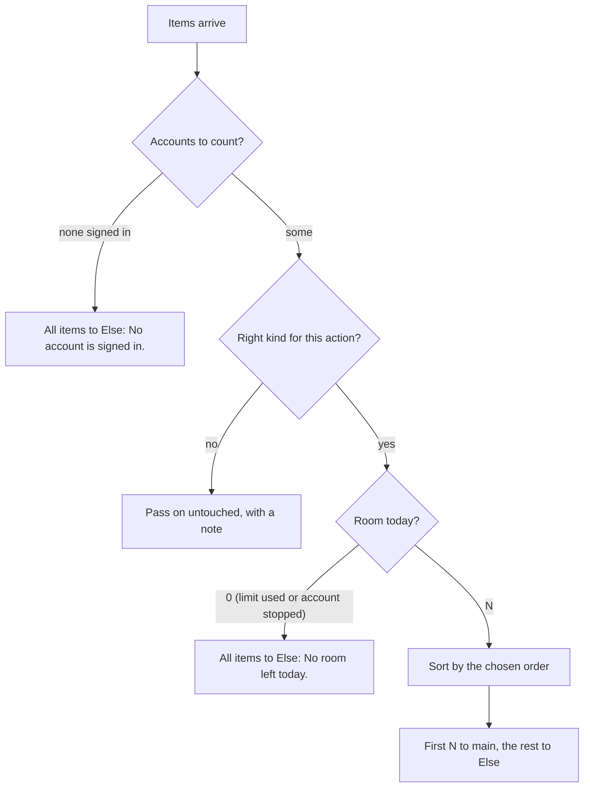
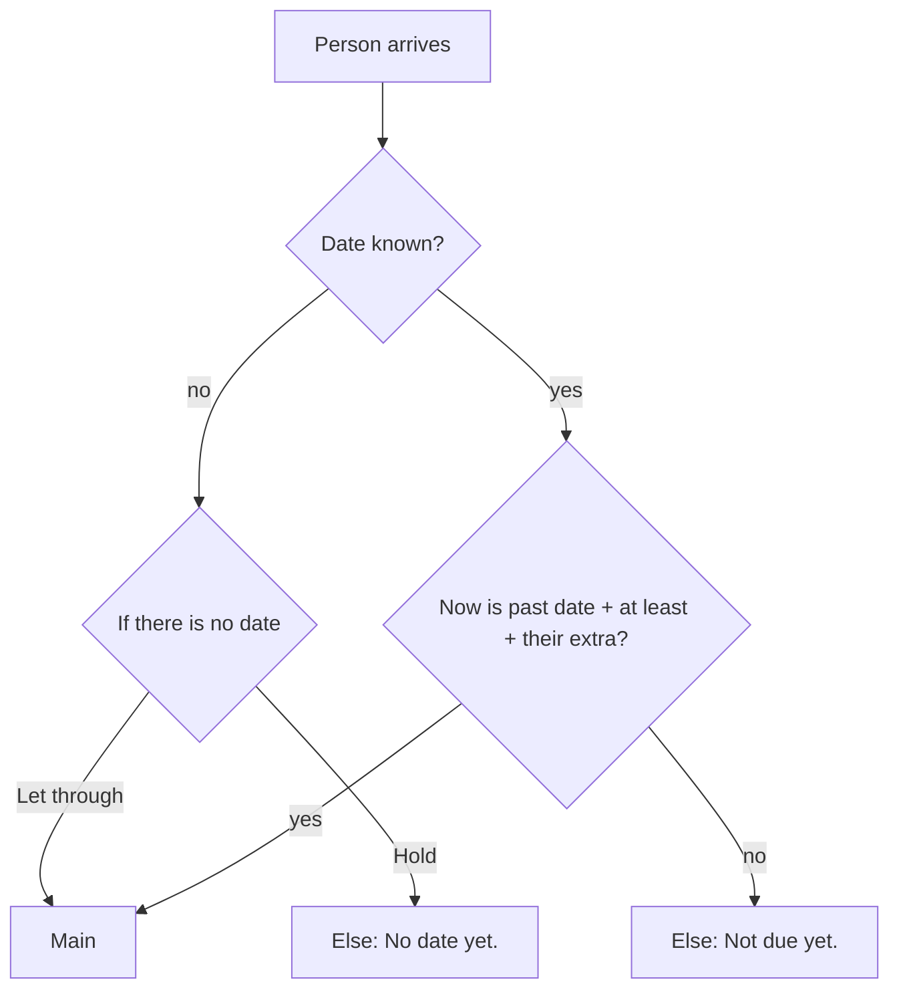
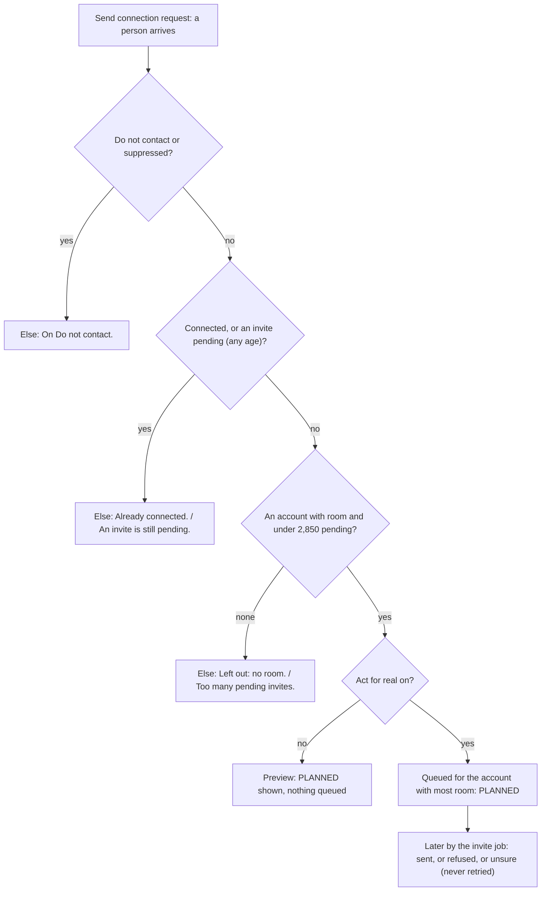
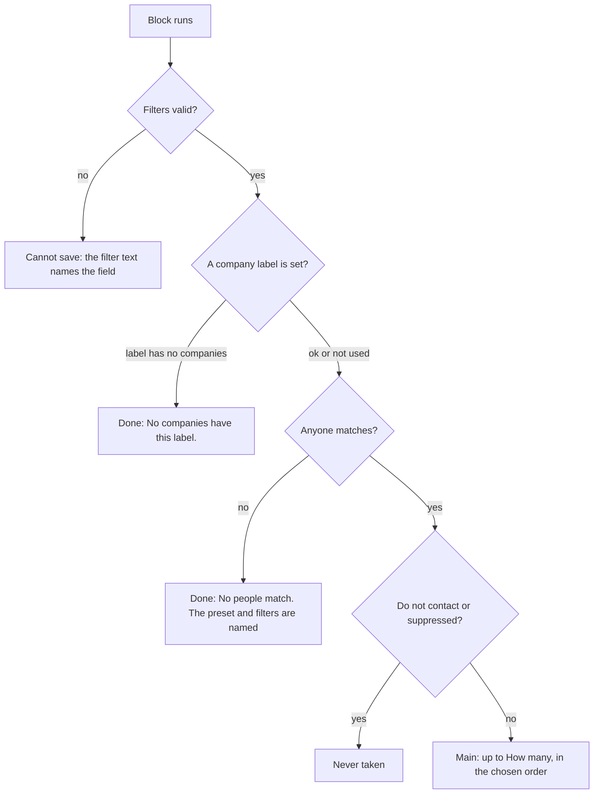

# Lead pipeline, phase 1: foundations

- Status: done (built and tested offline on 2026-11-04; browser pages, a real-path run of the Stage workflows and live acts not run, see Outcome)
- Created: 2026-11-03
- Locked by user: yes (2026-11-04)
- Parent: [lead-outreach-pipeline.md](lead-outreach-pipeline.md) (decisions, diagrams, catalog)

## Goal

Make the loop work with the blocks that exist, after a set of small changes: one limits rule for every account, "every signed-in account", Find posts that does not repeat itself, a ranking that uses company size and industry, a room block, no automatic withdrawal with a pending cap, and a hand-off CSV and My network lists. At the end the owner can build Stages 1, 2, 4 (Automatic words), 5 and 6 by themselves. No code is written in this task.

## Requirements

Confirmed (parent "Decisions"): the limit rule and the reference maximums, every signed-in account, never withdraw, notice at 2,400 and pause at 2,850 pending, hand-off CSV with the platform link and no phone, the first-use notice wording.

Confirmed (owner, 2026-11-03): replies in a conversation keep today's 40 a day as their maximum, so the rule gives 26 to 32. Posting limits (3 a day, 1 hour apart) and removals (10 a day) are not LinkedIn limits and stay as they are.

Open: none.

## Scope and non-goals

- In scope: the pieces below (P1 limits, C1, C2, C3, C4, C5 and C6, B1 Fit to today's limit, B2 Wait per person, C9 and C10 in part, P4, P5 and P6, P10) and the doc fixes.
- Out of scope: reactions and comments (phase 3), AI (phase 4), the chat checks (phase 2), the campaign page and Starter.

## Specs

### 1. Limits module (P1)

- A table `PLATFORM_MAX` in `packages/contracts`: invites per day 20 and per week 100, notes per month 5, first messages per day 20, replies per day 40, reactions per day 60, comments per day 20, pending invites cap 3,000. A comment beside each says its source (doc Estimate, owner's reference number, project number).
- `limitOf(kind, accountId, date)`: `u` = the first 32 bits of SHA-256 of `kind | account id | day` divided by 2^32; `f = 0.65 + 0.15 x u`; `limit = max(1, round(max x f))` (rounded, not floored, so the ends of the range, 13 to 16 for 20, are all reachable; decided while building, 2026-11-04). The day is the account's local day (its office zone, else the proxy's country zone, else UTC, as the browsing budget already decides). The weekly invite limit uses the ISO week, the monthly note limit the month. Pure, no table, so a retry and every process see the same number.
- Used by: `planInvites` (its fixed `perDay` and `perWeek` become arguments), `LinkedInReplyService` (first messages and replies), B1 (Fit to today's limit), the engage service (phase 3), and the account drawer. The room is `limit - used`, never below 0 (a limit that shrank overnight does not make it negative). Counts keep their windows: a rolling 24 hours, a rolling 7 days.
- The body's copy `invite-rules.ts` and its parity test go away: brain returns the numbers (`people.invitePlan`, a "Today's limits" part of `linkedInAccount.today`), since body cannot import contract values. The invite dialog sentence uses them.
- The owner never sees `f`. The drawer shows "Today's limit 15, used 4" for invites, first messages, reactions and comments.
- Tests: range (always inside 0.65 and 0.80), stable per account, day and kind, different between days and accounts, the mean of many accounts near 0.725, the minimum of 1, day and week boundaries in an account's zone, a retry sees the same number, and the planner with the new limits (the existing planner tests, re-based).

### 2. Every signed-in account (C1)

- `account.select` gets `scope`: `pick` (default for blocks saved before) or `all` (default for new blocks, set by the body's `startConfig`). `accounts` is needed only for `pick`. A saved block keeps working with no `migrate`.
- At run time `all` means every account of the owner with status ACTIVE (signed in, not paused), at most 20 (`MAX_POOL`; the step says how many were left out). Accounts in PENDING, NEEDS_REAUTH, ERROR or DISABLED are skipped; the step lists them in one fixed sentence. No account: the existing `ACCOUNTS_SIGNED_OUT` error.
- The block summary and the API sample change; the validation note "No LinkedIn action comes after this block" stays.

### 3. Find posts without repeats (C2)

- New setting `skipDone` ("Leave out posts I already processed"; new blocks on). It drops found posts whose row in `/posts` is PROCESSED, before they are saved or reach Get commenters, so no engagement read is paid for them. It needs Keep on (a validation error says so), because without Keep the posts are not saved and cannot be recognised.
- The 7-day search reuse (`remembering.recall`) is skipped when `postedWithin` is 1 hour, 24 hours or a week. Longer windows keep it.
- Mark posts done at the end of the chain turns the posts PROCESSED (the block exists and runs last).
- The search itself is still paid for each day (about $0.002 a post found); say it in the block hint.
- Several keywords: one Find posts block each, into the same chain (they merge). No change.
- Tests: a post processed yesterday is not returned today; a 24 hour search never uses the cache; a month search still does.

### 4. Profiles input from My network (C3)

- New time frame choices beside "last N days": "Older than N days" and "Between N and M days ago" (setting `days`, `daysTo`), resolved at run start in the block's zone, for the date fields connected, last message from you, last reply from them and (new) invited on.
- `peopleFiltersSchema` gets `waiting` (we wrote last and no answer came, `Person.waiting`) and `invitedOn` as a date field of the time frame. The page's Filters sheet gets the same two, and the parity test between contracts and `my-network/filters/model.ts` follows.
- `order` gets `score` (best first, `Person.score`, empty last) beside newest and oldest. `leastEngaged` comes in phase 3 with `lastEngagedAt`.
- Tests: each new filter in `peopleWhere`, the new windows at midnight and in a zone with daylight saving, the order with empty scores.

### 5. A ranking that uses what we read (C4)

- `scoreIcp` keeps the headline score (free). A second, optional step uses the profile read of the person: the ideal customer's `industries` and `companySizes` match the current company's industry and size (weights proposed: industry 15, company size 15, taken from the 100 so the sum stays 100; today's title 30, seniority 20, location 5 and engagement signals stay). Each match is a visible reason ("company size 51 to 200").
- A person without a read is scored on the headline only, as today, and the reason says "profile not read yet".
- The two thresholds (headline, then full) are two Score blocks in the chain; the block summary says so.
- Weights are guesses: expose them in the ideal customer screen as read-only numbers in this phase; tune from real accept rates later.
- Tests: golden people for each combination, no regression in existing scores when the ideal customer has no industries or sizes.

### 6. Profile, company and email reads (C5, C6)

- Get full profile: when the person's current company is known and not read in 30 days, read the company page (paid, price shown in the estimate) so the website is stored; the profile row gets the company's domain. A toggle turns it off (on for new blocks).
- Find work emails: takes the people reaching it as well as pasted links (as Get full profile does), $0.02 an email found, remembered for 90 days (existing `knownEmails`), stored on `LinkedInProfile.email`.
- Tests: a person with a stored email costs nothing; a pasted link and a person reaching it are both handled.

### 7. Fit to today's limit (B1, `process.room`): rules

- Group Process; `takesAnything` (people or posts); flags `keepsAside` (an Else output).
- Settings: `action` (connection request, first message, reply, reaction, comment), `orderBy` (best score, least recently engaged, newest; default best score), accounts (as the act blocks: from Select accounts, one account, and later their inviter).
- Room per account = limit of today minus what it did in the window minus what is queued for it; the total is the sum over the accounts the block uses. In this phase reactions and comments count as 0 done (their queue is phase 3).
- Keeps the first `total room` items in the chosen order; the rest go to Else with one fixed sentence ("No room left today on your accounts"); nothing is lost, they are still in My network.
- Preview shows each account's room ("Account A: 15 of 16 left"). The step message counts kept and left out.
- Tests: totals with several accounts, zero room, one account over its limit, the order, the Else output, the same numbers as the invite planner.

### 8. Send connection request and Send message: rules

- C8: accounts take people in proportion to their room, not in turn (today they take turns evenly, so an account with less room leaves people that another could take); a new setting "Plan at most N days ahead" (default 1; today's planner uses 14, so a better person arriving tomorrow queues behind worse ones); an account over the pending cap (see 9) is left out with a fixed sentence and the others go on; the step shows today's room. The note stays optional; the "notes out" fallback stays.
- Send message (this phase): the first-message limit comes from the limits module and the words may use `{written}` (phase 4). The wait after an accept is not in this block any more: it is the block "Wait per person" (B2), so Send message only sends. "Skip people we already talked to" is a check in phase 2 (If person state), not a setting here.
- Tests: weighted allocation, the horizon, the delay for a person accepted 30 minutes ago and 30 hours ago, the limit.

### 9. No withdrawal and the pending cap (P4)

- Remove the withdraw part of `LinkedInInviteService.dispatchWaiting` and the text of the `invite-send` job (`title` and `purpose` stay true). The Withdraw block and the manual button stay.
- The planner's "invited recently" skip lasted 21 days, so a pending invite older than that could be queued again and be answered `ALREADY_PENDING`. A pending invite (SENT or UNKNOWN) of any age is live; the skip sentence changes ("An invite is still pending").
- The pending count of an account is a count of its invites in the pending states (an existing index). At 2,400 the account drawer and the header alerts show a notice; at 2,850 the planner leaves that account out ("This account has too many pending invites"). The count covers only invites made here; the notice says so.
- The accept read still runs once a day while an account has pending invites, with no end date now: check its cost on an account with 2,000 pending (the read stops at the first known connection, so it should stay small).
- Existing rows in WITHDRAW_QUEUED stay and finish.
- Tests: no withdraw is queued at 22 days, a 40-day pending invite is not queued again, the notice and pause thresholds.

### 10. Hand-off: CSV, link, lists (C10, P5, P6)

- `APP_URL` in brain env (a public base address, required in production, set in the staging config; the same value the authentik blueprint uses). The link is `APP_URL/network?open=<slug>`. A helper in brain builds it, so every export agrees.
- Export to CSV and `people.export` get the hand-off columns: link, name, title, company, domain, work email, invited on, accepted on, first message on, days waiting, what they engaged with (one sentence from the reason), score. No chat text, no phone, no LinkedIn link. Formula cells keep the existing prefix rule. "Never twice" comes from the tag `handed-off` and the input's "without labels".
- My network: a tab "No answer to invite" (invite pending 21 days or more, not Do not contact) with a count, and a "for at least N days" quick filter on the Waiting tab. Both have the same CSV download.
- The CSV link opens only for the owner's own login; the export dialog says so in one line.
- Tests: the link builder, the columns, the tab where, the counts, the export of a person with no email.

### 11. First-use notice (P10)

- The first time "Act for real" is switched on for a block that acts on LinkedIn, a dialog with the approved sentence: LinkedIn's rules forbid automation, you choose the risk, the product starts slowly and never passes the limits. It records the acceptance on the user (`User.riskAcceptedAt`, additive) and shows once.

### 12. Doc fixes

- Correct `.docs/linkedin-free-account-limits.md`: note length (200 recorded, not 300), inbox read cadence, and the "limits set by this project" list.

## Block cards and screens

The design rules of the parent apply: one thing, at most 4 basic settings, safe defaults, short words, a live sentence, the same output. Item fields and the Else output are as in the parent's "What every block hands on". Numbering follows the parent's catalog (B1, B2, C1 to C11); sections 7 and 8 above carry the old names.

### B1 Fit to today's limit (`process.room`)

One thing: lets through only as many items as the accounts can handle today.

```
+------------------------------------------------------------------+
| [gauge] Fit to today's limit                          Ready      |
|  Input | Settings | Output                                       |
|------------------------------------------------------------------|
|  For          [ Connection requests v ]                           |
|  Best first   [ Best score v ]                                    |
|  Accounts     [ From "Select accounts" v ]                        |
|------------------------------------------------------------------|
|  Lets through up to 12 connection requests today, best score     |
|  first. Sam 9 of 16 left, Ada 3 of 14 left.         [ Preview ]  |
+------------------------------------------------------------------+
```

| Setting | Accepts | Default | Hint |
| --- | --- | --- | --- |
| For | Connection requests, First messages, Replies, Reactions, Comments | Connection requests | "What the accounts do today." |
| Best first | Best score, Least recently engaged, Newest | Best score | "Who goes first when room is short." |
| Accounts | From "Select accounts", One account, Their inviter (reactions and comments only) | From "Select accounts" | none |

- Takes people (requests, messages), conversations (replies) or posts (reactions, comments). Another kind passes on untouched with a note.
- Runs: room per account = today's limit minus what it did in the window minus what is queued for it; the total is the sum over the accounts it uses; the first N items in the chosen order go on.
- Hands on: main = the first N, unchanged; Else = the rest, `result { action: "room", status: "SKIPPED", reason: "No room left today." }`. Step message: "12 in, 8 on, 4 to Else. Room today: 8." Reactions and comments count as 0 done until phase 3.
- Preview: each account's room ("Sam 9 of 16 left").



### B2 Wait per person (`logic.personWait`)

One thing: lets a person through once enough time has passed since an event. People who are not due wait for the next run (the stage that feeds it takes them again).

```
+------------------------------------------------------------------+
| [clock] Wait per person                               Ready      |
|  Input | Settings | Output                                       |
|------------------------------------------------------------------|
|  After         [ They accepted v ]                                |
|  Wait at least [ 1 ] [ hours v ]                                  |
|  Plus up to    [ 23 ] [ hours v ]   random, same for each person  |
|  > Advanced:   If there is no date  [ Let through v ]             |
|------------------------------------------------------------------|
|  Lets people through 1 to 24 hours after they accepted.          |
+------------------------------------------------------------------+
```

| Setting | Accepts | Default | Hint |
| --- | --- | --- | --- |
| After | They accepted, They connected, I invited them, I last wrote, They last wrote, I added them | They accepted | none |
| Wait at least | 0 to 365, in minutes, hours or days | 1 hour | none |
| Plus up to | 0 to 365, in minutes, hours or days | 0 | "A random extra, the same for each person." |
| If there is no date (advanced) | Let through, Hold | Let through | "People who connected another way have no accept date." |

- Takes people. Dates come from `LinkedInInvite.acceptedAt` and `invitedAt` (real times), `connectedOn`, `lastSentAt`, `lastReceivedAt` (LinkedIn's wall clock, right to about a day) and `firstSeenAt`. The extra is a stable hash of the person and the block, from 0 to the "plus up to" amount.
- Hands on: main = people whose time has passed, unchanged; Else = the rest, `reason: "Not due yet."`. Step message: "30 in, 9 on, 21 to Else (not due yet)."



### Changed blocks (what you see, accepted values, defaults, what they hand on)

| Block | Screen change | Accepts | Default | Hands on and negative cases |
| --- | --- | --- | --- | --- |
| Select accounts (C1) | "Use" [Every signed-in account / Pick accounts]; the account list shows only for Pick | every signed-in, or 1 to 20 accounts | every signed-in (new blocks); saved blocks stay on Pick | Items unchanged. Step: "5 accounts, 1 not signed in." No account signed in: the next act block fails with "No account is signed in." Over 20: the first 20 and a sentence |
| Remove duplicates (C2) | on posts: one toggle "Leave out posts I already processed" | on, off | on | Posts not yet processed pass; processed ones go to Else "Already processed."; people keep the old toggles. Needs Keep on in Find posts, else a note: "Turn on Keep in Find posts to remember posts." |
| Find posts (C3) | a hint under Posted within: "Each search costs about $0.002 a post." | as today | Posted within: week | A window of a week or less never reuses an earlier answer; a month or longer may. No posts found: Done, 0 out, "No posts found." |
| Profiles from My network (C4) | Time frame adds "Older than N days" and "Between N and M days ago"; Filters adds "Waiting for a reply"; Order adds "Best score" | days 1 to 3650 | as today | People or none. Empty result: Done, "No people match." A filter on a date that nobody has: "No people match." |
| Score against an ideal customer (C5) | the reasons list shows company size and industry; a hint "Uses company size and industry when the profile was read." | as today | Qualified at 60 | Items with `score`, `band`, `matched`. A person with no profile read is scored on the headline and says "profile not read yet" |
| Get full profile (C6) | toggle "Also read their company" | on, off | on | Same people with the profile and the company's website; a paid read shows its price in the estimate; a failed read leaves the person unchanged with "Could not read." |
| Find work emails (C7) | takes the people that reach it and pasted links | as today | Keep on | People with `email`; a person with no email found passes on with "No email found."; price "about $0.02 an email found" |
| Send connection request (C9) | advanced "Spread over [1] days"; the summary shows today's room; the note stays | 1 to 14 days | 1 | Result per person: PLANNED, or Else reasons: "On Do not contact.", "Already connected.", "An invite is still pending.", "Too many pending invites.", "Left out: no room.". People are shared among accounts by room |
| Send message (C10) | none | as today | as today | Result per person; a person with no connection to the chosen accounts: "Not connected." |
| Export to CSV (C11) | "Columns" [Standard / Hand-off] | two choices | Standard | The same items; the run shows the file. A person with no email has a blank cell. No chat text, no phone |



### Profiles from My network: presets and a company filter (C4, confirmed finders 1, 2, 4, 12)

One thing: takes people from My network by what we already know about them. The presets are shortcuts that fill the filters the block already has; nothing new is stored.

```
+------------------------------------------------------------------+
| [people] Profiles                                     Ready      |
|  Input | Settings | Output                                       |
|------------------------------------------------------------------|
|  From        [ My network v ]                                     |
|  Preset      [ Untouched v ]    412 people match                  |
|  How many    [ 200 ]   Best first [ Oldest v ]                    |
|  > Filters   time frame, labels, works at my companies, ...       |
|------------------------------------------------------------------|
|  Takes up to 200 people nobody has acted on, oldest first.       |
|                                         [ Preview ]  [ Done ]    |
+------------------------------------------------------------------+
```

| Preset | Fills | Finder |
| --- | --- | --- |
| Untouched | not connected, invite none, never messaged, status New | 1 |
| Connected, never messaged | connected, never messaged | 2 |
| Invite pending | invite pending | Stage 3 |
| No answer to invite | invite pending and invited more than 21 days ago | Stage 6 |
| Waiting for a reply | we wrote last and no answer, last message more than 4 days ago | Stage 5 |
| Qualified, not invited | a label, invite none, fit qualified (the filter `fit` is added to `peopleFiltersSchema` and the page's copy) | 12 |
| Custom | whatever the Filters hold | any |

| Setting | Accepts | Default | Hint |
| --- | --- | --- | --- |
| Preset | the list above | Custom | "A shortcut for the filters." |
| How many | 1 to 1,000 | 50 | none |
| Best first | Newest, Oldest, Best score, Least recently engaged | Newest | none |
| Works at my companies (filter, advanced) | 1 to 20 company labels from `/companies` | none | "People at the companies saved with this label." |

- The live count ("412 people match") is the block's existing count, shown beside the preset (capped at 10,000).
- "Works at my companies" resolves each label to its companies and matches a person by the company's link (`Person.companySlug`) or, when the person has no link, by the company's name. A person with no company is never matched.
- Hands on: main = people (name, headline, location, link); no Else. Negative cases:



- "Add to list" later refuses a person who is already in another list with the sentence "Already in a list."; such a person keeps the tag and is scored again only through their other list.
- Tests: each preset against a seeded database, the company-label filter (a company with and without a link, a label with no companies), the new `fit` filter and its parity with the page.

### Screens

Account drawer, "Today's limits" (limits and used; the draw is never shown):

```
+-- Sam ------------------------------------------ Healthy --+
| Today's limits                                            |
|  Connection requests   4 of 15        this week 38 of 71   |
|  First messages        1 of 14                             |
|  Reactions             0 of 44                             |
|  Comments              0 of 15                             |
| Pending invites  412 (14 %)                                |
+------------------------------------------------------------+
```

Pending notice (account drawer and header alerts): at 2,400 "Sam has 2,430 pending invites (81 % of about 3,000). New invites will pause at 2,850."; at 2,850 "New invites for Sam are paused. Other accounts go on." The count covers invites made here.

My network: a tab "No answer to invite" with a count beside Needs me, Waiting, Everyone and Do not contact; the Waiting tab gets a quick filter "for at least [4] days"; both have the same "Download CSV" button, and under it one line: "The link in the file opens for you, signed in."

First-use notice, once, when "Act for real" is first switched on:

```
+---------------------------------------------------------+
| Before this acts on LinkedIn                            |
| LinkedIn's rules forbid automation. You choose the risk.|
| This starts slowly and never passes the limits.         |
|                            [ Cancel ]  [ I understand ]  |
+---------------------------------------------------------+
```

## Approach

- [x] Write the unit tests for the draw and the new filters first
- [x] 1 limits module, then planner and reply service on it, then body numbers from brain
- [x] 2 every signed-in account
- [x] 3 Find posts
- [x] 4 filters, windows, order, the presets, the filter `fit` and the company-label filter (finders 1, 2, 4, 12)
- [x] 5 and 6 score, company, emails
- [x] 7 Fit to today's limit (B1: contract entry, executor, icon, registry tests) and Wait per person (B2, same steps)
- [x] 8 invite and message changes
- [x] 9 no withdrawal, pending cap
- [x] 10 APP_URL, columns, tab, quick filter
- [x] 11 first-use notice, 12 doc fixes
- [x] 13 one LinkedIn account, one user (see "Edge cases and risks"): the application check is built; the unique index and the profile-link check are not (see Outcome)
- [ ] Build the Stage 1, 2, 4, 5 and 6 workflows on a test user as the real-path check: not done (needs a browser session and the owner's go-ahead for anything live)

## Edge cases and risks

- Slower invites: the sustained rate drops from 14 to about 9 to 11 a day an account. Say so in the release note.
- A limit that shrinks between days: the room is clamped at 0; people already queued stay queued and go when room allows.
- The day of an account near midnight in its zone: tested with fixed instants.
- `all` accounts: an account added during a run is not picked up until the next run; one that signs out mid-run leaves its people for the next run.
- Moving the invite horizon to 1 day means a big batch is no longer queued for two weeks: people not placed today are taken by tomorrow's run, as long as Stage 2 still selects them (invite state NONE, found in the last 14 days).
- Removing automatic withdrawal changes a decision of 2026-10-30; record it in `MEMORY.md`.
- Migrations are additive: `User.riskAcceptedAt`, an index on invites if the pending count needs one, and no data change. Block versions are raised where saved settings change meaning (Find posts, Select accounts keep defaults that read old nodes the same way).
- Staging needs `APP_URL` in `STAGING_CONFIG_ENV` before the merge.
- One LinkedIn account, one user (owner, 2026-11-04): today only `(userId, email)` is unique (`LinkedInAccount` in the schema), so two users could add the same account. The change: the sign-in email is compared trimmed and lower case and must be unique across all users; adding or changing an email that another user holds is refused with "This LinkedIn account is already used." (it never says by whom). Existing rows may already hold duplicates across users or emails that differ only in case: check the data first, list the clashes, and ask the owner before the unique index is added (no data is deleted by the migration). Once an account's own profile is read, its LinkedIn profile link is compared the same way: a second account that turns out to be the same LinkedIn profile is stopped with a sentence (an email alias is the way round the first check). Tests: the same email from two users, a different case, an email changed to one held by another user, and the same user adding twice (as today).

## Verification

- `pnpm lint && pnpm ts:check && pnpm test:unit:run && pnpm build`; brain integration tests for filters, skip-done posts, no withdrawal, the pending cap, the export and the room.
- Real path: on a test user build Stages 1, 2, 4 and 5 and run each as a preview through the worker; check the spend, the room sentences, the CSV and the tab in the page; one live Stage 2 and 4 on test accounts after the owner's go-ahead. State what could not be run.

## Outcome

Shipped (all offline, with tests): the limits module and its numbers in the planner, the reply service, the account drawer and the header alerts; `account.select` scope `all`; Remove duplicates on posts and Find posts without repeats on short windows; Profiles time frames, order, presets and filters; the company read, company size and industry in the score; Find work emails that takes people; `process.room` and `logic.personWait`; invites shared by room with `planDays`; no automatic withdrawal and the pending cap; `APP_URL`, the hand-off CSV (Export to CSV `columns`, `people.export` `columns`), the No answer tab and the Waiting-for-N-days quick filter; the one-time risk notice (`User.riskAcceptedAt`, `acceptRisk`); the cross-user check on a LinkedIn login; the limits doc.

Deviations and follow-ups:

- Section 3 (`skipDone` on Find posts) was replaced by the parent plan's C2 and C3: Remove duplicates takes posts and Find posts skips reuse for windows of a week or less.
- Find work emails passes on only the people an email was found for (as before); the plan's "passes on with No email found" was not built.
- The unique index on `lower(btrim(email))` is not added: it needs the staging data checked first (the local database has no duplicates) and the owner's go-ahead. The profile-link comparison after the account's own profile is read is not built.
- Saved Send connection request blocks now plan one day ahead (the default of `planDays`), not 14.
- Reactions and comments count 0 used until phase 3; `AccountRoom` gained `replies`.
- Not run: the pages in a browser, the Stage 1, 2, 4 and 5 workflows on a test user, and any live act. Spider tasks for phases 3 and 9 wait for the owner's recordings.
