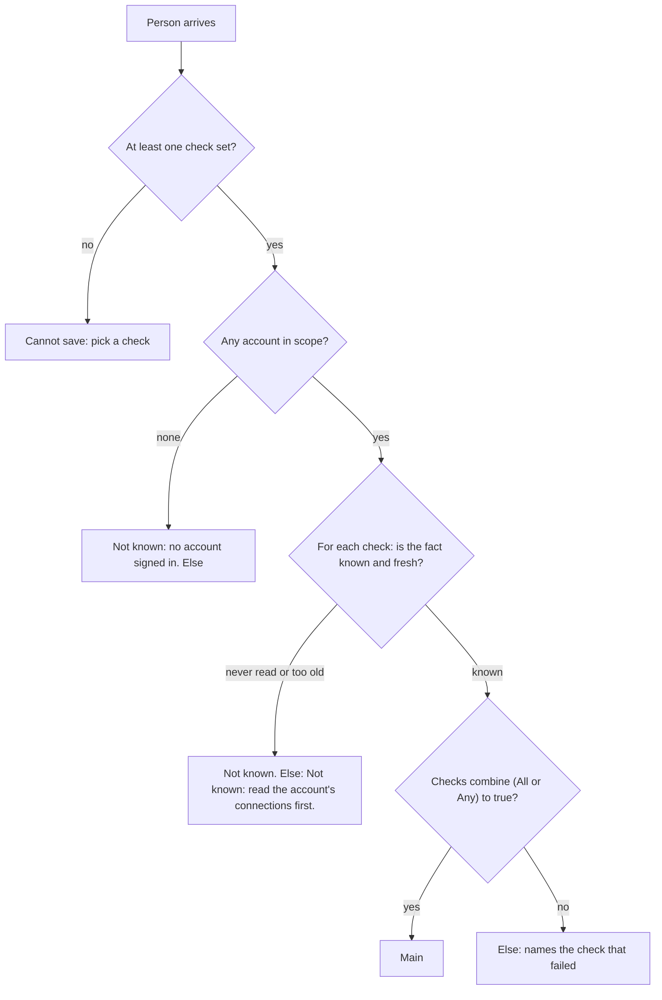
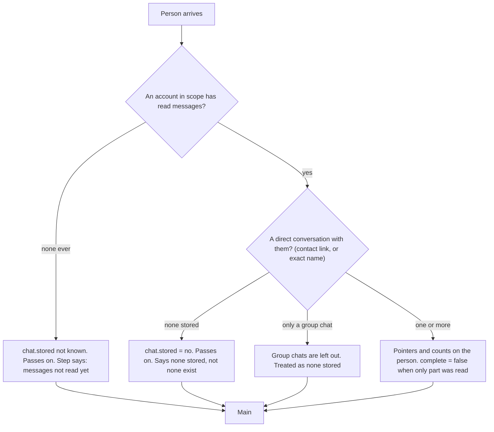
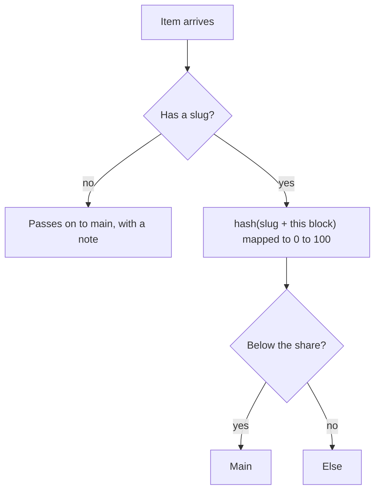

# Lead pipeline, phase 2: checks (If person state, Get our chat, Split people)

- Status: done (built and tested offline on 2026-11-04, locked by the owner's go-ahead "continue with p2"; the pages in a browser and the real-path run of R6 were not run, see Outcome)
- Created: 2026-11-03
- Locked by user: yes (2026-11-04)
- Parent: [lead-outreach-pipeline.md](lead-outreach-pipeline.md)

## Goal

Give a GTM engineer the blocks to route each person by what we already have with them, so one workflow can say "if this profile is a connection of one of my accounts, look at the chat and message them; if not, invite them", and so a later AI step knows what was already said. Also a stable way to split people for control groups and A/B tests. No code is written in this task.

## Requirements

Confirmed (owner, 2026-11-03):

- A block checks whether a profile is a connection of an account or not.
- A block fetches the existing chat between us and a profile so a workflow, and the AI, are on the same page about what was said.
- A GTM engineer must be able to build any workflow from the blocks.

Open: none.

## Scope and non-goals

- In scope: `logic.ifPerson` (B3), `collect.chat` (B4), `logic.split` (B5), the freshness note per account, the fact catalog, the screens and negative cases below.
- Out of scope: reading a chat live from LinkedIn (T4), AI (phase 4), any change to how messages are read or stored, an "unknown" output port (unknown goes to Else with a fixed sentence).

## Specs (rules and data)

### B3 rules: facts and freshness

- Group Logic, label "If person state", flags `keepsAside` (Else output), input and output `profile`, `version` 1. Same shape as "If the event says": a Match (all or any) and up to 3 rows of fact, operator and value.
- Account scope setting `scope`: any of my signed-in accounts (default), the accounts of the "Select accounts" before it, or one account. Facts about connections and chats use this scope.
- Setting `maxAgeHours` (default 36): a fact about an account whose connections or messages were last read longer ago than this is "not known".

Facts (all computed at run time from what is stored; free, no browser):

| Group | Fact | Kind | From | Not known when |
| --- | --- | --- | --- | --- |
| Connection | Connected to an account in scope | yes or no | `LinkedInConnection` (CONNECTED or REMOVING) by slug | no account in scope was read in the last `maxAgeHours` |
| Connection | Connected to how many of the accounts | number | same | same |
| Connection | Days since they connected | number | `LinkedInInvite.acceptedAt`, else `connectedOn` (a date) | not connected |
| Invite | Our invite is | none, queued, pending, accepted, ended | `Person.inviteState` | never |
| Invite | Days the invite has been pending | number | `LinkedInInvite.invitedAt` | no pending invite |
| Chat | We have a stored chat with them | yes or no | `LinkedInConversation` (direct) by contact link or the exact-name rule | no account in scope has read messages |
| Chat | We have written to them | yes or no | stored messages, direction ME | no stored chat |
| Chat | They have written to us | yes or no | direction THEM | no stored chat |
| Chat | We wrote last and no answer came | yes or no | `Person.waiting` | never |
| Chat | Days since our last message, since their last message | number | `Person.lastSentAt`, `lastReceivedAt` (wall clock, right to about a day) | none |
| Person | On Do not contact | yes or no | `Person.doNotContact` and suppressions | never |
| Person | Status | new, contacted, replied, not interested, done | `Person.status` | never |
| Person | Has the label | text | `Person.labels` | never |
| Person | Score | number | `Person.score` | not scored |
| Person | Profile read, has a work email | yes or no | `Person.profileRead`, `LinkedInProfile.email` | never |
| Person | Days since we last reacted or commented | number | `Person.lastEngagedAt` (phase 3) | never engaged |

- Operators: is, is not, at least, at most, is known, is not known. A fact that is not known matches neither "is" nor "is not" (the rule of "If the event says"); such a person goes to Else, and the step says "4 people were not known: read the account's connections first".
- Presets: "Is a connection" (connected is yes), "Not connected", "We already talked" (stored chat is yes), "Never messaged" (we have written is no), "They replied" (they have written is yes), "Invite pending 21 days or more" (our invite is pending and days pending at least 21).
- Output: matching people go on unchanged; the rest go to Else with a fixed sentence per fact ("Connected to an account"), never the person's data. Preview shows counts and a few names. The step message counts matched, not matched and not known.
- Freshness: the block's Settings tab shows for each account when its connections and messages were last read ("Connections read 3 hours ago, messages 12 minutes ago") from a small new read (`workflow.accountReads`), and a hint to add Get my connections or Get my conversations before it for a fresh answer.
- Estimate: no cost. One query per fact group for the whole batch (not one per person), in batches of 500 slugs.
- Validation: at least one row with a fact; a number for numeric operators; accounts of the scope exist.
- Tests: each fact on a seeded database, scope any and one account, unknown on a never-read account, Else contents, presets, 1,000 people with a bounded number of queries.

### B4 rules: stored chat

- Group Collect, label "Get our chat with them", input `profile`, output `profile` (the same people), no cost. It reads only what is stored; it opens nothing on LinkedIn.
- Settings: the account scope (as above), `latest` (how many of the newest messages the AI may see, default 10, 1 to 30), `maxAgeDays` (only chats active in the last N days; any by default), `redact` (remove emails and phone numbers before anything is shown or sent on; on).
- What each person gets on the item: `chat` = `{ stored, complete, accountIds, conversationIds (at most 5), messages, weWrote, theyWrote, lastFrom }` (an optional field of the person item; items saved before parse as before). No message text is copied into the run: the item holds pointers and counts, and whatever needs the words (the AI, the Output tab) reads them from the stored conversation, owner-scoped, at that moment. This keeps message text out of run items and their 14-day retention, and out of events and logs.
- Which conversation: a direct conversation with the person in any account of the scope, found by the contact link or by the exact-name rule the My network index already uses (`people_index_slug_by_name`); group chats are left out; two accounts that each have a chat with the person give two conversation ids.
- Step message: "40 people: 12 have a stored chat, 28 none stored, 0 not read".
- Output tab: per person a digest (counts, who wrote last, the last few messages cut to 200 characters, redacted), loaded on demand. Preview shows the first three.
- Honest limits, shown in the block hint: reads cover the newest conversations of each account (50 the first time, 20 after), so "none stored" is not "none exist"; a conversation that is not `complete` says so; times are LinkedIn's wall clock. To widen, run Get my conversations with a bigger limit first; a live read of one person is a later candidate (T4).
- Tests: a person with one, two and no chats; a group chat ignored; redaction; the pointer never holds text; the exact-name match; an account that never read messages gives "not read".

### B5 rules: stable split

- Group Logic, flags `takesAnything` and `keepsAside`. Setting `percent` (1 to 99, default 50). The share goes to the main output, the rest to Else (labelled "the rest" on the canvas).
- A person's side is a hash of their slug and the block's id, so the same person is on the same side in every run of this block (a control group stays a control group across days). The share is exact only on large batches; the step says so ("about 50 percent").
- Preview shows the counts. No cost. Works on any item that has a `slug` (people, posts, companies).
- Use: control group for warm-up (Stage 3), two notes or two messages compared, a canary on 10 percent. The funnel by branch is phase 5.
- Tests: stability across runs, distribution on 10,000 slugs, percent edges, posts and people.

### Skipping people we already talked to

There is no setting on Send message for it: sending and checking are different jobs. The check is B3 with the preset "We already talked" (its Else output carries the people to leave alone). The parent's Stage 4 diagram uses it. A test says that Send message writes from the account the person is connected to.

## Block cards and screens

The design rules of the parent apply. Item fields and the Else output are as in the parent's "What every block hands on".

### B3 If person state (`logic.ifPerson`)

One thing: checks what we already have with each person and sends them on or to Else.

```
+------------------------------------------------------------------+
| [branch] If person state                              Ready      |
|  Input | Settings | Output                                       |
|------------------------------------------------------------------|
|  Match   [ All v ]                                                |
|  1  [ Connected to my accounts v ] [ is v ] [ yes v ]       [x]   |
|  2  [ We have written to them   v ] [ is v ] [ no  v ]      [x]   |
|  [ + Add a check ]                      up to 3                   |
|  Accounts [ Any of my accounts v ]                                |
|  > Advanced: Facts older than [ 36 ] hours count as not known     |
|  Presets: Is a connection | Not connected | We already talked |   |
|           Never messaged | They replied | Invite pending 21+ days |
|------------------------------------------------------------------|
|  Passes people connected to any of your accounts that you have   |
|  not written to.                         [ Preview ]             |
+------------------------------------------------------------------+
```

| Setting | Accepts | Default | Hint |
| --- | --- | --- | --- |
| Match | All, Any | All | none |
| Check (1 to 3) | a fact from the table above, an operator for its kind, a value | row 1: Connected to my accounts is yes | "What we already have with them." |
| Accounts | Any of my accounts, From "Select accounts", One account | Any of my accounts | "Which accounts to look at." |
| Facts older than (advanced) | 1 to 720 hours | 36 | "Older reads count as not known." |

Operators by kind: yes or no: is, is not, is known, is not known; number: at least, at most, is, is known, is not known; choice: is, is not, is known; text: has, has not.

- Takes people. Hands on: main = people who match, unchanged; Else = people who do not match or are not known, `reason` one fixed sentence by cause ("Not connected.", "Already talked.", "Not known: read the account's connections first."). Step message: "30 in, 12 on, 18 to Else (4 not known)."
- Wrong kind in: passes on untouched with a note. Preview shows counts and a few names.



### B4 Get our chat with them (`collect.chat`)

One thing: finds the stored chat between my accounts and each person. It opens nothing on LinkedIn.

```
+------------------------------------------------------------------+
| [chat] Get our chat with them                         Ready      |
|  Input | Settings | Output                                       |
|------------------------------------------------------------------|
|  Accounts     [ Any of my accounts v ]                            |
|  Latest       [ 10 ] messages                                     |
|  > Advanced:  Only chats active in the last [ any v ]             |
|               Remove emails and phones [ on ]                     |
|------------------------------------------------------------------|
|  Finds the stored chat with each person. Cost: free.             |
|  Output tab: 12 have a chat, 28 none stored.                     |
+------------------------------------------------------------------+
```

| Setting | Accepts | Default | Hint |
| --- | --- | --- | --- |
| Accounts | Any of my accounts, From "Select accounts", One account | Any of my accounts | none |
| Latest | 1 to 30 messages | 10 | "How many of the newest messages the AI may see." |
| Only chats active in the last (advanced) | any, 7, 30, 90 days | any | none |
| Remove emails and phones (advanced) | on, off | on | "Before anything is shown or sent on." |

- Takes people. Hands on: main = every person, with the optional field `chat` = { stored, complete, accountIds, conversationIds (at most 5), messages, weWrote, theyWrote, lastFrom } (pointers and counts; no text). There is no Else: this block describes, it does not filter. Step message: "40 people: 12 have a stored chat, 28 none stored, 0 not read."
- The Output tab loads, for the owner only and on demand, a digest per person (counts and the last few messages cut to 200 characters, redacted). It is never stored in the run, logged, put in an event or exported.



### B5 Split people (`logic.split`)

One thing: sends a stable share of people one way and the rest another.

```
+------------------------------------------------------------------+
| [split] Split people                                  Ready      |
|  Input | Settings | Output                                       |
|------------------------------------------------------------------|
|  Share   [====o--------]  [ 50 ] percent                          |
|------------------------------------------------------------------|
|  Sends about 50 percent on. The rest go to Else. The same person |
|  always lands on the same side here.                             |
+------------------------------------------------------------------+
```

| Setting | Accepts | Default | Hint |
| --- | --- | --- | --- |
| Share | 1 to 99 percent | 50 | "Exact only on big batches." |

- Takes anything with a slug (people, posts, companies). Hands on: main = the share; Else = the rest (labelled "the rest"), no reason needed. Step message: "200 in, 101 on, 99 to Else." Preview shows the counts.
- Use: a control group for warm-up, two notes or two messages compared, a canary on 10 percent. A Add label block on the Else side marks the control group.



### Screens

- Block Output tab for Get our chat: a table with a person per row (name, "Chat: yes / none stored / not read", messages, who wrote last), and "Show digest" on a row opening the redacted last messages in a side panel.
- Block Settings tab for If person state: under Accounts, a line per account, "Sam: connections read 3 hours ago, messages read 12 minutes ago", and when old, "Add Get my connections before this block for a fresh answer."

## Approach

- [x] Fact catalog as one table in contracts (key, label, kind, options) shared by validation, the body and the executor
- [x] Tests first for each fact, then the executor with batched queries
- [x] B4 contract entry, executor, icon, presets, registry tests, `accountReads` read
- [x] B5 contract entry, item field, executor, Output tab digest, registry tests
- [x] B6 (the plan's name for the split block; it is B5 above) contract entry, executor, icon, registry tests
- [x] The test that Send message writes from the connected account
- [x] Body: fields for the three blocks, the freshness note, the Output tab digest
- [ ] Build R6 (route by relationship) on a test user as the real-path check: not done (needs a browser session and a test user with two accounts)

## Edge cases and risks

- Stored data lags: connections once a day per account, messages every 30 minutes by day. A person who accepted an hour ago may be "not connected". Say so on the block and show the read times.
- The same person connected on account A and in a chat on account B: scope decides; with scope "any" both count.
- A person whose slug is a LinkedIn member id (a chat started from a message window): found by the exact-name rule only; two people of one name are left unknown.
- Message text is sensitive: the Output tab loads it for the owner only, never logs it, and never writes it into run items, events or exports.
- A GTM engineer expects "no chat" to mean no chat. The block never says "no chat exists", only "none stored".
- Performance: facts are batched; a 50,000-person run must not issue one query per person (test with a count of queries).
- Rollback: additive blocks and one optional item field; no migration of data.

## Verification

- `pnpm lint && pnpm ts:check && pnpm test:unit:run && pnpm build`; brain integration tests for the facts and the executors; body tests for the fields and the digest.
- Real path: build R6 on a test user with two accounts and a few people in different states, run it as a preview through the worker, and check each branch and the Else sentences in the page. State what could not be run.

## Outcome

Shipped (offline, with tests): `logic.ifPerson` (If person state), `collect.chat` (Get our chat with them) and `logic.split` (Split people); the fact catalog and checks in contracts (`personFacts.ts`); `PersonStateService` (facts, chat pointers and the digest, all in batches of 500 slugs); `PersonItem.chat`; `workflow.accountReads` and `workflow.chatDigest`; the body freshness note, the Chat column and "Show digest"; redaction of emails and phone numbers (`core/redact.ts`); a test that Send message writes from the account each person is connected to.

Deviations and follow-ups:

- "We have written to them" and "They have written to us" read as no (not unknown) when messages were read and no direct chat is stored, so the preset "Never messaged" finds people with no chat. They are unknown only when no account in scope has a fresh message read.
- "Days since we last reacted or commented" is not offered: it needs `Person.lastEngagedAt` from phase 3.
- Group chats count as no chat in both the facts and the chat pointer.
- The digest reads the owner's accounts (or the one account of the block); it does not use the pointer's account list.
- The step message and the "1,000 people" bound: queries are batched, but no test counts them.
- Not run: the pages in a browser, the real-path run of R6 on a test user, and any live act. The spider integration tests (RabbitMQ) time out on this machine while other brokers' consumers run; they are unrelated to this change.
