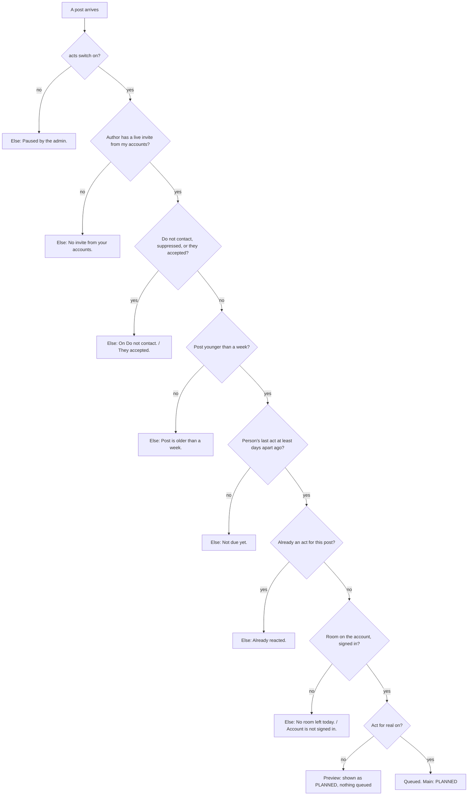
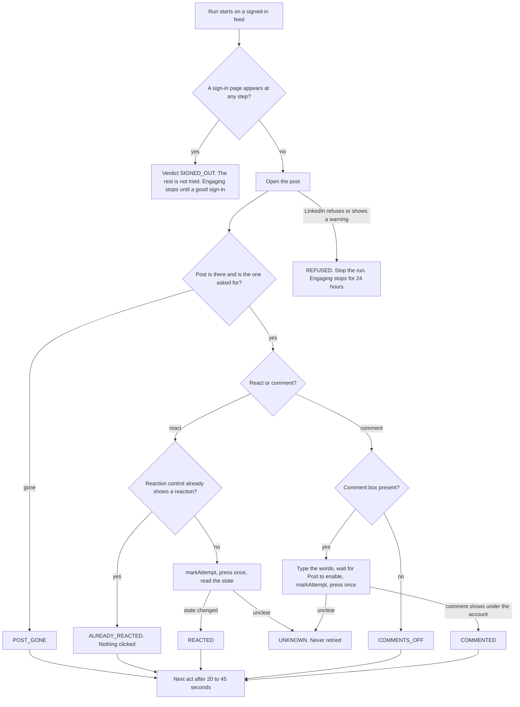

# Lead pipeline, phase 3: engage (React to post, the engage task, the act queue)

- Status: brain side built; spider task waits for recordings (see Outcome)
- Created: 2026-11-03
- Locked by user: no
- Parent: [lead-outreach-pipeline.md](lead-outreach-pipeline.md)

## Goal

Let a workflow react to posts of people whose invite is pending, from the account that sent the invite, inside that account's daily limit, one person every 1 to 2 days, until they accept. This phase builds the spider task (react and comment both, so it is recorded and tested once), the act queue and the React block. Comments and AI come in phase 4 on top of the same task and queue. No code is written in this task.

## Requirements

Confirmed (owner, 2026-11-03): warm-up with reactions and comments; stop on accept only; no cap of acts per person, 1 to 2 days between acts, least recently engaged first; the account that sent the invite does the acts; reactions 60 a day as the reference maximum (39 to 48 after the rule); a person's acts are 1 to 2 days apart.

Open: none.

## Scope and non-goals

- In scope: S1 (`linkedin-engage`, react and comment), P2 (the queue, service, job, import, `lastEngagedAt`), B6 React to post (`account.reactToPost`), C12 (account choice "Their inviter"), C4 (the "least recently engaged" order and a "not engaged for N days" filter), C8 (posts of people carry the author and score), P8 (the `acts` switch, the job's monitor entry), and the reaction and comment room of B1 (Fit to today's limit).
- Out of scope: the Comment block, AI, drafts (phase 4). The task already supports comments so its recording and tests are done once, but no block sends one yet.

## Specs

### S1 `linkedin-engage` (spider task)

- Contract in `packages/contracts/src/engage.ts` (`ENGAGE_CONTRACT_VERSION` 1), input: up to 10 acts for one account, at most 3 comments, each `{ id (brain's uuid), kind (react or comment), postUrl (a normalised `feed/update/urn:li:<type>:<id>` link, checked by the same parser as posts), reaction? (like, celebrate, support, love, insightful, funny), text? (a comment, at most 1,250 characters, owner's words), authorName? (to check the right post) }`. The report is one file `engage.json`: per act an outcome and one fixed sentence, never page text or the comment.
- Outcomes: REACTED, COMMENTED, ALREADY_REACTED, POST_GONE, COMMENTS_OFF, REFUSED, UNKNOWN. Verdicts: DONE, PARTIAL, SIGNED_OUT, LIMIT_REACHED, RESTRICTED, ERROR (declared with labels and tones; never the runner's own codes). `SIGNED_OUT` is declared and has the `/uas/login` unit test the registry requires.
- Steps for each act (lifecycle owned by the runner; the task starts on a signed-in feed): visit the post link with `visit`; check the landed page for the sign-in page; check the post is there and is the one asked for (the urn in the address, the author name when given); then:
   - React: read the state of the reaction control first. A control that already shows a reaction means ALREADY_REACTED and nothing is clicked (a second press on Like removes the reaction). Otherwise `markAttempt()` once, press the control (or open the picker and press the wanted one), and confirm the state changed; an unclear state is UNKNOWN.
   - Comment: find the comment box (COMMENTS_OFF when there is none), wait for it, type the words (`typeKeys`), wait for Post to be enabled, `markAttempt()` once, press Post once, confirm the comment shows under the account's name; an unclear outcome is UNKNOWN. Nothing is typed until the box and the button are confirmed present.
   - A pause of 20 to 45 seconds between acts (`PAUSES`-style random gaps); the run's browser time goes to the report.
- Pacing and budget: class ACTION, `estimateS` taken from the first real run (not guessed), `policy` one at a time per account. A run asked for 10 acts that refuses on the first answers REFUSED for that act and stops.
- Registration: a folder under `tasks/`, one line in `tasks/registry.ts`, an `ACCOUNT_ACTION_TASKS` line (`blocks: ['account.reactToPost']` now, the comment block added in phase 4), a `TASK_EVENT_DETAILS` entry (counts and an `outcome` fact), and an entry in `taskHooks.ts` (`onResult` runs in the finishing transaction and creates the `EngageImport` row; SIGNED_OUT and RESTRICTED stop the account's engaging until its next good sign-in, REFUSED stops it for 24 hours, as `invitesStopUntil` does for invites).
- Recording first. Before any selector is written, record on a real account with the devtools (`dev:record`) and write down the account and date: like a post; pick Insightful through the picker; comment on a post; a post that was already liked; a post with comments off; a deleted post; a company page post; a repost; and at least two accounts' layouts (LinkedIn serves different markup to different accounts). Keep fixtures for each layout, selectors in `linkedin/markup.ts` with the date, plain CSS only (no `:visible`, no `>>`), reads and clicks through the driver's shadow-root-aware paths. If the reaction picker needs hover or a long press, add that driver call, forward it in `recording/recordedDetectionSession.ts` and cover it in the driver's e2e test. Unverified until recorded: every selector, the picker, the comment box's shape, what LinkedIn does when an account reacts too fast.
- Recorded 2026-11-03 (read from `apps/spider/.devtools-recordings/session-2026-11-03T21-26-42-167Z`: one session on the feed, 38 steps, one test account that is a Free account, language en-US, a macOS device profile; read from the saved pages only, nothing was run against LinkedIn for this note):
   - The feed is the new server-rendered layout (`data-sdui-screen`, `componentkey` attributes, `data-testid="mainFeed"`), and it keeps its markup in the main document (no iframe for the post list). Plain CSS reached everything below.
   - Each post's action bar has `button[aria-label="Reaction button state: ..."]` (the label ends in `no reaction`, `Like` or `Love`, so the state is readable before clicking: this is the ALREADY_REACTED check), `button[aria-label="Open reactions menu"]` (the picker's opener), `button[aria-label="Comment"]`, `button[aria-label="Repost"]` and `a[aria-label="Send"]`.
   - The comment box is a tiptap editor: `[data-testid="ui-core-tiptap-text-editor-wrapper"] [contenteditable="true"][role="textbox"][aria-label="Text editor for creating comment"]` with the placeholder "Add a comment...", and next to it `button[aria-label="Show Emoji Picker"]`, `button[aria-label="Open GIF picker"]` and `button[aria-label="Share photo"]`. A comment shows as `id="replaceableComment_urn:li:comment:(activity:<post id>,<comment id>)"`, so the post's id can be read from the comment ids.
   - A post in the feed has no link to itself (its anchors point to `/feed/`) and no `urn:li:` in its attributes before comments load: the feed cannot name a post. The task must open the post's own address (`/feed/update/urn:li:<type>:<id>/`), as this plan already says; the feed is not used to find the post.
   - The post header has `a[href*="/in/<slug>/"]` with a child `div[aria-label="<Name> Verified Profile 3rd+"]` (the degree is in the label), the time as `<p><span>1d</span></p>`, `button[aria-label="Follow <Name>"]` and `button[aria-label="Open control menu for post by <Name>"]`. A company post links `/company/<slug>/`.
   - Re-checked on 2026-11-04 (this corrects an earlier note that said typing and the Post button were missing; they are in the saved pages): typing into the box works and shows as `<p>` text inside the editor (`componentkey="commentBox-<id>"`). The submit control sits in an element whose id ends `-commentButtonSection<...>` and is `button[type="button"]` with the text "Comment" (a reply box says "Reply"; there is no "Post" word). Right after the click it is `disabled` with `aria-busy="true"`, the text "Loading" and a `[data-testid="loader"]`; on the next page the comment is in the list as `[id^="replaceableComment_urn:li:comment:(activity:"]` with the time "now", `button[aria-label="View more options for <Name>’s comment."]` and its words in `span[data-testid="expandable-text-box"]`, and the editor is empty. A reply to a comment, an emoji (`button[aria-label="Show Emoji Picker"]`, then a `span` holding the emoji) and a photo (`button[aria-label="Share photo"]` makes a `body > input[type=file]`) were also recorded. So the confirmation of a comment is: the box is empty, the button was busy, and a comment by the account's own name with the same words is in the list.
   - Second recording, 2026-11-04 (`session-2026-11-03T21-56-53-722Z`, same account, 13 steps; read from the saved pages only): a post opened from the address that "Copy link to post" gives, `/posts/<author>_<title>-share-<share id>-<hash>/?utm_source=...`, so the post page, the picker and a comment were all seen.
      - The picker is a floating popover outside the page's main area: `[data-floating-ui-portal] [popover] ul` with six `button[aria-label="Like"|"Celebrate"|"Support"|"Love"|"Insightful"|"Funny"]` (there is no Curious). While it is open the opener `button[aria-label="Open reactions menu"]` has `aria-expanded="true"`. After a choice the state label shows it: `Reaction button state: Love`, `Celebrate`, `Funny` were each seen in turn. Which gesture opened it (hover or click) is not visible in the steps (the recorder logged the click on a neighbouring element), so the driver call is still to be proved.
      - The post page loads with the comment box already there; with an empty box there is no submit button in the page, and it appears only once text is typed (the box holds `nice product` and the button is `disabled aria-busy` "Loading" right after the click). So the task types first, then waits for the button.
      - The post's id is on the page: `[data-testid="ReactionFacepileCollection-urn:li:activity:<id>"]`, and `urn:li:activity:<id>` appears in the markup. It is not the number in the address: the address held `share-7523321070687510529` and the page's activity id was `7523321071710826496`. So "the urn in the address" cannot be the post check for `/posts/` links; the check is the activity id read from the page, and the link given to the task must be one the page opens (a `-share-` id is accepted by the contracts' link check but is not the activity id).
      - The post page also lists some reactors as `a[href*="/in/<slug>/"]` holding `div[aria-label="<Name> reacted with <Like|Love>"]`, and a "View all reactions" link (not used by this task).
   - Still NOT recorded: the address `/feed/update/urn:li:activity:<id>/` itself (whether it opens the same page as the `/posts/` link, and whether `urn:li:share:<share id>` does), a post with comments off, a deleted post, a repost, a failed or rejected comment (the one comment recorded ended on the loading state, then the page was left), taking a reaction back, a second account's layout, and any locale other than en-US.
   - Marker for the next recording session: for each missing case, press `s` then Enter once the page has settled, and wait 5 seconds after posting a comment before the next click.
- The `spider-task-writer` checklist is copied under Approach below and ticked before this plan is done.

### P2 The act queue

- Table `PostAct`: owner, account, person slug, post link and key, post author and headline, post excerpt (500 characters) and posted date (for the card and the age check), act (REACT or COMMENT), reaction, words (comment only, phase 4), mode (TEMPLATE or AI, phase 4), state, a fixed-sentence reason, `plannedAt`, `waitReason`, `waitUntil`, `startedAt`, `doneAt`, session, origin workflow, run and node. States: QUEUED, SENDING, DONE, FAILED, UNKNOWN, EXPIRED, CANCELLED. Unique on `(owner, post key, act)` for every state, so a post is never reacted to or commented on twice, even from another of our accounts. After 30 days the text columns are emptied; the row stays.
- `EngageImport` (as `InviteImport`): a finished run waits to be stored; a job reads `engage.json` and settles each act.
- `LinkedInEngageService` (static, in `database/`), the domain service that keeps the limits; blocks never raise a limit:
   - `plan(userId, accountId, acts, origin)`: checks, in order, the `acts` switch, Do not contact and suppression, the account is ACTIVE and not stopped, the post is not older than a week (when the posted date is known), the person's last act is at least 1 to 2 days ago (a stable random wait per person, from a hash), the account's room (limit of the day minus done minus queued), and that no act of the owner exists for the post; then inserts QUEUED rows. Each skipped person gets one fixed sentence ("Not due yet", "No room left today", "On Do not contact", "Already reacted to this post").
   - `dispatchWaiting()` for the job: per account with due QUEUED acts, no live engage session and a browsing budget that allows it, ask `TaskService.request` for one `linkedin-engage` run with up to 10 acts (at most 3 comments), mark them SENDING with the session id; a run that was not answered after 45 minutes ends its acts UNKNOWN ("No answer came from the browser. It is not sent again."), never retried. A refusal for browsing time is `later`: the acts get `waitReason` and `waitUntil`, as invites and replies do.
   - Before it asks, it checks again that the person's invite is still pending; if they accepted since, the act is CANCELLED ("They accepted."). This is how warm-up stops on accept.
- Job `engage-send` (every minute, as `invite-send`) follows the cron-monitor rules: `title`, `purpose`, quiet when idle, one `items` entry per account it asked for or left (user, account, action, ASKED or SKIPPED, a fixed sentence, the session id), a `summary` only when something was asked.
- `Person.lastEngagedAt` (and the filter and order): a trigger on `PostAct` marks the person dirty and the people index copies the latest DONE time. Without the trigger the index never sees it.
- Retention: PostAct rows live as long as the owner's data; text columns go at 30 days (phase 4's retention job does it).

### Rules for B6 React to post (`account.reactToPost`)

- Group Account Actions, input `post`, output `post`, `flags: { usesAccounts: true }`, a made-up `sample`, an `api` description (posts, account), the accounts and time-limit settings, and "Act for real" (off by default, switched off again by changing the reaction).
- Settings: reaction (tick one or more of Like, Celebrate, Support, Love, Insightful, Funny; one is picked per post by a hash of the post, so a retry picks the same), accounts (Their inviter, From "Select accounts", One account), days apart for one person (one setting, default 1; a stable random extra of up to one day is added inside).
- Behaviour: for each post it reads the author, finds the account (inviter: the account of the author's live invite; pool: the accounts take people in proportion to their room; one: the named account) and calls `plan`. The step ends when the acts are planned. A preview plans nothing and shows what would go and the room.
- Hands on: main = planned posts (`result.status` PLANNED, later REACTED); Else = skipped posts with the sentence. The next block only sees posts that were really handled.
- C12: `accountMode` gets `inviter`; only React and Comment offer it. A post whose author has no live invite of ours is skipped with "No invite from your accounts."
- C8: Posts of people put the author's slug and score on each post item and say how many people had no post in the window.
- B1 (phase 1) counts reactions and comments as done or queued here.
- C4: the Profiles input gets the order "least recently engaged" and the filter "not engaged for N days".

### P8 Switch and monitor

- Table `PlatformSetting` (key, JSON value, who and when): the switch `acts` (on by default). An admin toggles it in the operator pages; `plan` and `dispatchWaiting` read it every time, so it stops everything at the next pick-up. Pausing one account already exists. The same table carries the AI caps in phase 4.

## Block card and screens

The design rules of the parent apply (one thing, few settings, safe defaults, short words, a live sentence, the same output).

### B6 React to post (`account.reactToPost`)

One thing: reacts once to each post.

```
+------------------------------------------------------------------+
| [thumb] React to post                                 Ready      |
|  Input | Settings | Output                                       |
|------------------------------------------------------------------|
|  Reaction      [x] Like  [ ] Celebrate  [ ] Support               |
|                [ ] Love  [x] Insightful [ ] Funny                 |
|  Accounts      [ Their inviter v ]                                |
|  Days apart    [ 1 ]   for one person                             |
|  Act for real  [ off ]                                            |
|------------------------------------------------------------------|
|  Reacts Like or Insightful to each post, from the account that   |
|  invited the author. Off: shows what it would do.  [ Preview ]   |
+------------------------------------------------------------------+
```

| Setting | Accepts | Default | Hint |
| --- | --- | --- | --- |
| Reaction | one or more of Like, Celebrate, Support, Love, Insightful, Funny | Like | "One is picked for each post." |
| Accounts | Their inviter, From "Select accounts", One account | Their inviter | none |
| Days apart | 0 to 14 | 1 | "Gap between acts for one person." |
| Act for real | on, off | off | "Off: a run acts on nothing." |

- Takes posts. Hands on: main = planned posts with `result { action: "react", status: "PLANNED" }` (REACTED later, when the engage task answers); Else = skipped posts with one reason. Step message: "30 in, 22 planned, 8 to Else (5 not due, 2 no invite, 1 no room)."
- Reasons: "No invite from your accounts.", "Not due yet.", "No room left today.", "Post is older than a week.", "Already reacted.", "On Do not contact.", "They accepted.", "Paused by the admin.", "Account is not signed in."



### The engage task, every outcome



### Screens

- Account drawer, Today's limits: lines for Reactions and Comments with used and limit (as in phase 1).
- Block Output tab: a table of posts with the account, the result (PLANNED, REACTED, ALREADY_REACTED, POST_GONE...) and a link to open the post.
- My network person drawer: a line "Last reacted to or commented on: 2 days ago" from `lastEngagedAt`.
- Operator page: the switch "Acts" (on or off) with who changed it and when.

## Approach

- [ ] Plan the recording session and run it; save fixtures and the notes (account, date). Not done: waits for the owner's recordings
- [ ] Tests first: contract schema, the reader of each page shape, one test per verdict with the hands mocked, a test that lands on `/uas/login` and answers SIGNED_OUT, a real-browser e2e on a stand-in page. Contract schema done; the rest waits for the task
- [ ] Build the task; run it through the devtools "Run a task" on a test account against a post of the owner's own, then a test person's post. Not done: waits for the recordings
- [x] Brain: migration (additive: `PostAct`, `EngageImport`, `PlatformSetting`, `Person.lastEngagedAt`, `LinkedInAccount.engageStopUntil`, the trigger), service, job, import, hook
- [x] B6, C12, C4, C8, B1 counts; body fields (the block fields come from the contract) and the person drawer line. The account drawer line "Today's reactions" was done in phase 1 (rooms count `PostAct` now)
- [x] P8: the `acts` switch (`jobs.acts`, `jobs.setActs`, switch on the Cron monitor page)
- [ ] Build Stage 3 (with a Split control group) on a test user as the real-path check. Not done: needs the task
- [ ] Spider task checklist (`.github/skills/spider-task-writer/assets/checklist.md`) copied here and ticked. Not applicable yet: no task code

## Edge cases and risks

- A reaction press toggles: a second press removes the reaction. The state is read before every press, and an act is never retried after UNKNOWN.
- The author accepted between the plan and the send: checked again at dispatch; a person who accepts during the run gets at most that one act.
- Two accounts for one person (one invited, another connected): only the inviter acts; React skips others.
- Posts: deleted, comments off, a repost, a promoted post, a company page, a post older than a week, an author who blocked us: each has a fixed answer and none is retried blindly.
- The account is signed out, restricted, paused or over its budget: acts wait (`later`) and expire; a restriction stops engaging for that account.
- Browsing budget: runs of 10 acts, at least 10 minutes apart per account; outreach accounts may need Moderate or Aggressive. Refusals are `later`.
- Limits of LinkedIn on reactions and comments are not published; refusal handling and the first week's numbers decide whether the owner's reference numbers (60 and 20) are right.
- Privacy: post excerpts and author headlines are stored for the card and cleared at 30 days; nothing about the person goes into logs or events beyond counts.
- Rollback: additive tables; React is off until "Act for real"; the `acts` switch stops every act at once.

## Verification

- `pnpm lint && pnpm ts:check && pnpm test:unit:run && pnpm build`; brain integration tests for the service, the trigger and the index, the job, the import and the hook; the registry test (`ACCOUNT_ACTION_TASKS`, `SIGNED_OUT`); the spider e2e on a stand-in page.
- Real path: a devtools run on a test account (a reaction on the owner's own post), then Stage 3 as a preview through the worker, then one live run with Act for real on after the owner's go-ahead; check the act row, the person's `lastEngagedAt` in My network and the account drawer. State what could not be run.

## Outcome

Status: brain side built, spider side waiting (the owner shares recordings later; the task inputs, outputs and debugging files are ready).

Shipped: contract `engage.ts`; migration `20261104140000_lead_pipeline_engage`; `LinkedInEngageService` (plan, dispatch, store), hooks, `EngageImportService`, job `engage-send`; `account.reactToPost` with the `inviter` account mode; C8 (author slug and score on posts of people, and the count of people with no post); C4 as the date field `lastEngaged` on the Profiles input; the `acts` switch with who and when on the Cron monitor page; the person drawer line; reaction and comment rooms counted from `PostAct`.

Deviations: the spider task, recordings, devtools run and the Stage 3 real-path run are not done, so the task is unregistered and queued acts wait, then expire after 7 days. `account.reactToPost` has no `ACCOUNT_ACTION_TASKS` line yet (added with the task). Its `api` names the account only; posts through the API are not supported by the API item machinery (profile and company only). C4 is the date field plus "Older than N days" and the order "oldest", not a new filter in the My network panel. Not run: pages in a browser, any LinkedIn page.

Follow-ups: the spider task and its checklist; Comment block (phase 4 holds the words); posts through the API.
