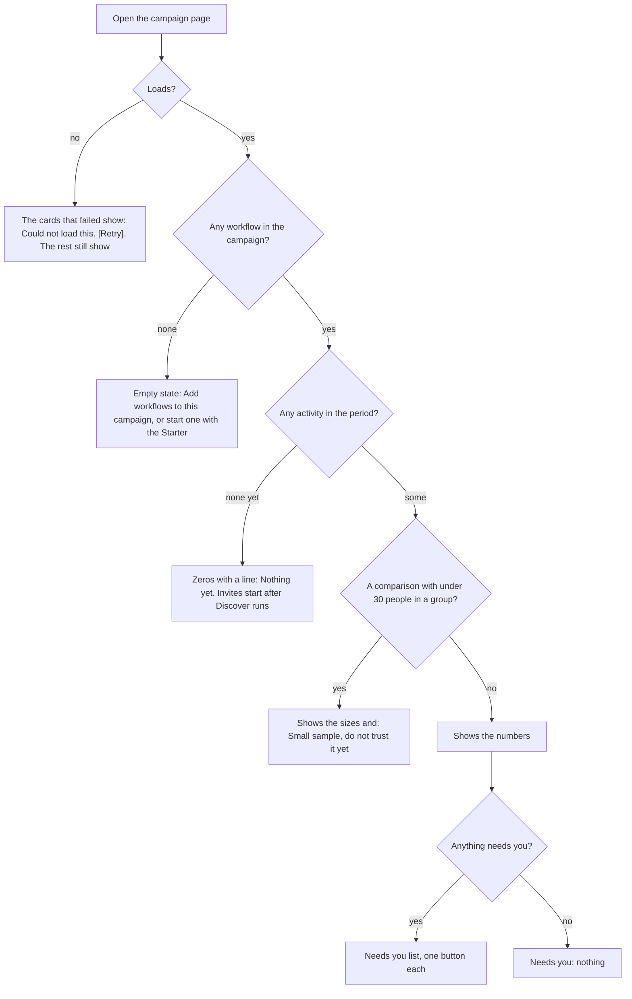

# Lead pipeline, phase 5: campaign page (the morning screen, funnel, fleet health)

- Status: built offline (see Outcome)
- Created: 2026-11-03
- Locked by user: no
- Parent: [lead-outreach-pipeline.md](lead-outreach-pipeline.md)

## Goal

One screen the owner opens each morning that says, in plain words, what the campaign did, what needs them, and whether the accounts are healthy; plus the numbers a GTM engineer needs to tune the pipeline (the funnel, the warm-up test, cost per qualified lead). It reads state the earlier phases already keep; the only new data are a campaign row and a daily rollup. No code is written in this task.

## Requirements

Confirmed (persona reviews of 2026-11-03): a morning screen with plain words (found, invited, accepted, messaged, replied, drafts waiting, problems, handed over this week with the CSV); a plain account health (Healthy, Warning, Paused) with today's allowance and the pending count; a "Pause everything" button; accept rate by score band, by note and by account; warm-up compared with a control group; cost per qualified lead per keyword; a score histogram; fleet health.

Open: none.

## Scope and non-goals

- In scope: `Campaign`, `Workflow.campaignId` and `stage`, the page `/campaigns/:id` and a list `/campaigns`, the daily rollup `CampaignDay` and its job, the fleet health strip, the alarms in the header alerts.
- Out of scope: the Starter (phase 6), emails or digests, a client-facing view, per-client caps (one login, one user), forecasting.

## Specs

### Campaign

- Table `Campaign` (owner, name, `label` = `lead-<slug>`, ideal customer id, voice id, created, archived). Table `Workflow` gets optional `campaignId` and `stage` (DISCOVER, INVITE, WARM_UP, FIRST_MESSAGE, HAND_OFF, NO_ANSWER, OTHER). Both additive; no workflow is required to have one.
- Without the Starter an owner can still group: the workflow's settings get "Campaign" and "Stage" pickers, and a campaign made by hand needs a name and a label. Deleting a campaign keeps its workflows, people and labels.

### The morning screen

```
+------------------------------------------------------------------------------------------------+
| Campaign: Outbound for agencies        Today . 7 days . 30 days          [Pause everything]    |
+------------------------------------------------------------------------------------------------+
| Needs you:  7 comments wait (oldest 9 h)  .  Account Sam is signed out [Fix]  .  Stage 4 did not run |
+------------------------------------------------------------------------------------------------+
| Found 138 -> Qualified 41 -> Invited 29 -> Accepted 9 -> Messaged 8 -> Replied 3 -> Silent 4 -> Handed over 4 |
| Warm-up: accept rate 34 % with, 27 % control (small sample)   Notes: 41 % with, 29 % without     |
+------------------------------------------------------------------------------------------------+
| Handed over this week: 12 people   [Download CSV]    No answer to invite (21+ days): 53  [Open]   |
+------------------------------------------------------------------------------------------------+
| Accounts: Sam  Healthy  invites 9/15 today  pending 412 (14 %)  .  Ada  Warning  pending 2,430 (81 %) |
+------------------------------------------------------------------------------------------------+
```

- "Needs you" lists, each with one button: drafts waiting (opens the inbox), an account that is signed out, restricted or at its pending cap (opens the account drawer), a stage workflow that failed or did not run on schedule (opens the run), the wallet near its floor, an AI cap at 80 percent.
- The funnel for a period, from state already stored (no new state):

| Step | Counted from |
| --- | --- |
| Found | people first seen with the campaign label in the period |
| Qualified | of those, `Person.fit` qualified or a score at or above the line of the ideal customer |
| Invited | `LinkedInInvite.invitedAt` for invites whose origin workflow belongs to the campaign |
| Accepted | `LinkedInInvite.acceptedAt` |
| Messaged | first messages sent (reply queue rows with no conversation) whose origin belongs to the campaign |
| Replied | people with a message from them after our first one |
| Silent | messaged at least 4 days ago, no reply |
| Handed over | people tagged `handed-off` and `no-answer` in the period |

- Cuts: by score band, by note sent or not (`LinkedInInvite.noteSent`), by account, by Find posts block (keyword), by finder (the Discover workflow that found them, read from the person's Found by; the twelve finders of the parent plan show under their workflow's name). The warm-up test compares the accept rate of invited people whose posts we engaged with against those the recipe tagged `control` (the Else branch of the Split block gets a Add label block `control`); the screen shows the sizes and says "small sample" under 30 people in a group.
- Cost per qualified lead: spend by block from the step calls (the ledger keeps workflow and run; calls keep the step), people qualified from the same run; a block that finds posts gets "spend, posts, people, qualified, cost per qualified lead". Beyond the 14 days run items live, numbers come from the rollup.
- Calibration and comparison (added with phases 7 and 10): the accept and reply rates cut by tier, by signal, by source tag (`src-*`), by source post (the signal's post key) and by variant (`variant-a` against `variant-b`); a view "Compare two tags" shows the two groups side by side with sizes and "Small sample" under 30 people a group. The owner reads it and changes the model's weights in phase 7's screen; nothing changes by itself.
- Score histogram and "how many stored people pass at X": from `Person.score` of the campaign's people (stored, so it survives run retention), a slider shows the count above a line before the owner changes the threshold.

### Rollup `CampaignDay`

- One row per campaign and day (counters for each funnel step, spend by label, drafts made, approved, edited, rejected, expired, AI cost) written by a job at the end of the day and recomputed for the last 2 days on each pass. Run items expire at 14 days; this keeps the history and keeps the page fast.
- The job follows the cron-monitor rules (title, purpose, quiet when idle).

### Fleet health (per account, in the strip and in the account drawer)

- Health: Healthy, Warning (pending at 80 percent, an accept-rate drop, UNKNOWN or refused acts in the last day, a recent sign-out) or Paused (paused by the owner, restricted, or at the pending cap). It is one derived word with the reasons listed under it, from `components/accounts/verdict.ts` plus the new signals; the word "safe" is never used.
- Today's allowance per action (from the limits module) and what is used; the pending count and its share of 3,000 (an estimate, shown as one).
- Accept rate per account over 14 days against the 14 before, with an alarm when it falls below half of the earlier rate on at least 20 invites; restrictions, checkpoints and sign-outs in the last 7 days (from session verdicts); the share of invites answered `ALREADY_PENDING`; similarity hits of drafts.
- Alarms appear in the header alerts and in "Needs you"; there is no email.
- "Pause everything": switches the campaign's workflows off and keeps what is already queued (a day of work at most); a second choice "Also stop queued acts" cancels the campaign's queued acts and waiting drafts. Both are undoable from the same screen.

## Screens, accepted values and negative cases

The screen above is the main one. Short words everywhere: "Found", "Invited", "Accepted", "Messaged", "Replied", "Handed over"; no "funnel", "rollup" or "cohort" on screen.

### Workflow settings: Campaign and Stage

```
+-- Workflow settings -----------------------------------+
|  Campaign  [ None v ]   [ + New campaign ]              |
|  Stage     [ Other v ]  Discover, Invite, Warm up,       |
|            First message, Hand off, No answer, Other    |
+---------------------------------------------------------+
```

| Setting | Accepts | Default | Hint |
| --- | --- | --- | --- |
| Campaign | none or one of my campaigns | None | "Group workflows to see them together." |
| Stage | Discover, Invite, Warm up, First message, Hand off, No answer, Other | Other | "Where this workflow sits in the campaign." |
| New campaign: name | 1 to 60 characters, unique for the owner | none | none |

### Pause everything

```
+---------------------------------------------------+
| Pause Outbound for agencies?                      |
|  This switches off its 6 workflows.               |
|  What is already queued (about a day) still goes. |
|  [ ] Also stop queued acts and waiting drafts     |
|                       [ Cancel ]  [ Pause ]       |
+---------------------------------------------------+
```

After pausing the page shows "Paused. [Resume]" and the button changes. Resume switches the same workflows back on; nothing cancelled comes back.

### Page states and negative cases



- Period switch (Today, 7 days, 30 days) default 7 days. A period with the campaign not yet started shows from its start day.
- An account that is paused, restricted or signed out shows "Paused" with the reason; it is not counted in "room today".
- A step with a failed workflow shows the run's one-sentence error and a button "Open the run".

## Approach

- [x] Tests first: the health word, the label, the periods and the alarm rule (contracts `campaign.unit.test.ts`); each funnel count on a seeded database with two campaigns, the cuts, pause and resume, and the rollup written twice (`campaign.service.integration.test.ts`)
- [x] Migration (additive) and the campaign pickers on a workflow
- [x] Queries and the rollup job; tRPC `campaign` router (owner scoped)
- [~] The page: needs-you list, funnel, cuts, accounts strip, Pause everything; the list page. Not done: the link from the dashboard, the header alerts, cost per qualified lead, the calibration cuts
- [ ] Real path: run Stages 1, 2, 4 for a test campaign and read the page against the database. Not done

## Edge cases and risks

- A person in two campaigns (the same label rules apply to one person): counted in each by their own label; the page says so.
- Invites made before a workflow joined a campaign have no origin in it: not counted; the page says "from the day the workflow joined".
- Wall-clock times in conversations make "silent" right to about a day.
- Small samples: every comparison shows its sizes and says so under 30.
- Cost: spend by block needs the step calls; for older runs the rollup has only totals by label.
- Performance: the funnel reads indexed columns (invite origin and dates, person label); the rollup keeps long periods cheap.
- Rollback: additive tables and pickers; nothing depends on a campaign existing.

## Verification

- `pnpm lint && pnpm ts:check && pnpm test:unit:run && pnpm build`; brain integration tests; body tests for the health word and the control-group wording.
- Real path: the page on a test user with a seeded campaign, the numbers checked by hand against SQL. State what could not be run.

## Outcome

Shipped: contracts `campaign.ts` (stages, periods, `campaignLabelOf`, `healthOf`, the accept-drop rule); migration `20261104160000_lead_pipeline_campaigns` (`Campaign`, `CampaignDay`, `Workflow.campaignId` and `stage`); `CampaignService` (create, delete, place, pause with an optional cancel of queued acts, invites and waiting drafts, resume of the same workflows), `CampaignStatsService` (funnel, cuts by fit, note and account, the warm-up test against the `control` label, the score histogram, needs-you), `FleetHealthService` (Healthy, Warning or Paused with reasons), `CampaignRollupService` and the job `campaign-rollup`; router `campaign`; pages `/campaigns` and `/campaigns/:id`, the Campaign and Stage pickers in the workflow settings, a sidebar entry.

Deviations: the funnel reads people by the campaign label and invites by `originWorkflowId`; Messaged, Replied and Silent come from the person's last sent and received times (replies carry no origin yet, so they are not told apart by workflow), and Handed over counts people with the campaign label and `handed-off` changed in the period. The page reads the tables live; the rollup keeps the daily numbers but nothing reads it yet. Not built: cost per qualified lead, the cuts by keyword, finder, tier, signal, source and variant, the wallet and AI cap items of Needs you, the header alerts, the CSV button (a link opens the people in My network with the campaign label), a dashboard link, and the real-path run. Not seen in a browser.

Follow-ups: reply origin (with 4b), cost per qualified lead from the step calls, header alerts.
