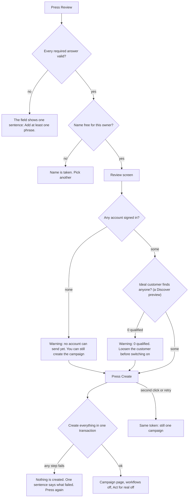

# Lead pipeline, phase 6: Campaign Starter

- Status: rejected (2026-11-13, not done; owner asked to focus only on campaign-detail-insights). Was: built offline (see Outcome)
- Created: 2026-11-03
- Locked by user: no (the owner said: plan it, do not build it)
- Parent: [lead-outreach-pipeline.md](lead-outreach-pipeline.md)

## Goal

One form that builds the six workflows of the outreach pipeline on the owner's own canvas, with safe defaults, switched off and with "Act for real" off, so a founder can set the pipeline up alone and a GTM engineer can still open and edit every block. The Starter is a small framework of "recipes" so other workflows (waking old connections, a competitor's engagers, a hiring signal) can be offered the same way later. No code is written in this task.

## Requirements

Confirmed (owner, 2026-11-03): the Starter is planned now and not built before the blocks. The owner builds the automation on the platform by themselves; the Starter only saves the typing.

Confirmed (founder review): the user must never have to see a block, a threshold or "keyword 2" unless they ask; safe defaults for everything else; the six workflows appear already built, and the owner names the campaign and switches it on.

Open: none. Build only after phases 1 to 4 (the blocks) and 5 (the page that is its home).

## Scope and non-goals

- In scope: a recipe registry in `packages/contracts`, one recipe "Engage-first outreach", the form, the review screen, the creation of the campaign, ideal customer, voice and six workflows, the "Go live" checklist, tests.
- Out of scope: other recipes (the registry makes them cheap later), editing a campaign by re-running the form (the workflows are edited on the canvas), AI that builds workflows (the 10x plan said do not build it), templates for single workflows (the existing `WorkflowNew` templates stay as they are).

## Specs

### Where it lives

- A card "Outreach campaign" at the top of `/workflows/new` and a button on `/campaigns`. The existing single-workflow templates (`templateCatalog`) are untouched.
- A recipe is a pure description in contracts: an id, a title, the questions (a zod schema), a `build(answers)` that returns the campaign, the ideal customer, the voice and the graphs, and the capacity sentence. It is tested like `templateGraph` is today (golden snapshots and validation).

### The form (plain words, one page, safe defaults)

| # | Question | Becomes | Default |
| --- | --- | --- | --- |
| 1 | Campaign name | campaign name, label `lead-<slug>`, workflow names ("<name> . 1 Discover") | none |
| 2 | What problem do you solve? Words people use when they post about it (1 to 5 phrases) | one Find posts block per phrase | none |
| 3 | Who is your ideal customer? Job titles, seniority, locations, company sizes, industries; or pick a saved ideal customer | the ideal customer (created or reused) and the score line | Balanced (qualified at 60) |
| 4 | Which accounts? | Select accounts: every signed-in account, or a pick | every signed-in account |
| 5 | Connection note (optional, with variables) | the note of the invite block for the best-scored people | none (no note) |
| 6 | First message (with variables), written by Automatic or With AI (voice) | the message block | none |
| 7 | Warm-up: reactions yes or no; comments: off, Automatic templates, With AI | Stage 3 blocks | reactions on, comments off |
| 8 | When should it run? Time zone and a start time | stagger of the six schedules (Discover at the start time, Invite one hour later, First message every 2 hours, Warm-up in the afternoon, Hand-off and No answer the next morning) | 09:00 in the browser's zone |
| 9 | Hand-off: a daily CSV (always) and an optional address to send it to | Export to CSV and Send via API | CSV only |
| 10 | Posts a day | the number of posts in Find posts | from the accounts: posts needed = invites a day divided by qualified people per post |

- Everything else is a fixed default the owner never sees: the 14-day window, the 4-day silence, the 21-day listing, the reaction mix, 90 percent warm-up and 10 percent control group, days apart, 10 drafts a day and 48 hours to decide in Ask me first, the order of ranking.
- "Describe your customer in a sentence" fills the titles, seniority and sizes with rule-based suggestions from our own option lists (no AI), which the owner ticks or unticks, if that helper exists by then (the 10x plan's guided setup); otherwise the owner picks.

### The review screen (before anything is created)

- A small diagram of the six workflows (the same picture as the parent plan) with the number of blocks in each.
- The capacity sentence: "5 accounts can send about 46 to 57 invites a day. At 8 posts a day you will find about 120 people a day, more than you can invite, so only the best are invited."
- The estimated daily data cost and the AI cost cap, in dollars; today's room per account from the limits module; the accounts that are not signed in and will be skipped.
- "Nothing will act on LinkedIn yet" in one line, with the reason (Act for real is off in every block).

### What it creates (one transaction, idempotent)

- The ideal customer (or reuses the picked one), the writing voice if With AI was chosen, the `Campaign` row, and six workflows with `campaignId` and `stage`, all switched off, each with "Act for real" off on its act blocks, each saved as version 1 in the workflow history. Blocks have plain labels, positions laid out left to right, and the Split block's Else carries a Add label `control`.
- A client token in the request makes a double click create one campaign; the same name for the same owner is refused with a sentence.
- It uses `workflow.create` and the graph validator; any graph that does not validate with only notes (no errors) is a bug in the recipe and fails its test.

### Going live (the campaign page, Phase 5)

1. "Preview each stage": runs each workflow as a preview through the worker and shows what would happen (counts, the sample drafts, today's room), with the spend of the preview.
2. "Switch on, in order": Discover first (it only reads and costs data), then Invite, First message and Warm-up. For each act block the owner switches "Act for real" on through one control that shows the first-use notice once. Each switch is a normal save, so it shows in the workflow history.
3. The owner can open any stage on the canvas and change anything; the campaign keeps only references, so nothing desyncs.
- Deleting a campaign asks whether to delete its workflows too (default no).

## More recipes: finders (confirmed 2026-11-04)

The registry holds one recipe for the whole pipeline and three small ones that add a finder (one Discover workflow, switched off) to a campaign that already exists. They share the same tail (Remove duplicates, Score, Get full profile, Score, Add label `lead-<name>`, Add to list), so Stage 2 onwards picks the people up.

| Recipe | Parent finder | Questions (all with defaults) | What it creates |
| --- | --- | --- | --- |
| Untouched in My network | 1 | campaign (picked); how many a week (200); only people added more than N days ago (any) | one workflow: Profiles with the preset Untouched, the tail |
| Leaders at my target accounts | 3, with 4 first | campaign; which companies (a label or all); job titles and seniority; how many people a company (10) | two workflows: known people at those companies (free), then the paid search for companies with fewer than 3 known people |
| Engagers of my posts | 5 | campaign; which posts (mine, imported, or both); how many a run (10) | one workflow: Posts (not done), Commenters, Reactors, the tail, Mark posts done |

```
+-- Add a finder to Outbound for agencies --------------------------------+
|  Finder        ( ) Untouched in My network                             |
|                (o) Leaders at my target accounts                       |
|                ( ) Engagers of my posts                                |
|  Companies     [ label: target v ]      Titles [ Head of Growth, CMO ] |
|  People each   [ 10 ]                   Runs [ weekly v ]               |
|                                        [ Cancel ]  [ Review ]          |
+------------------------------------------------------------------------+
```

- Accepted values: companies, one label of `/companies` or all; titles, 1 to 10 phrases of up to 60 characters; people each, 1 to 50; how many, 1 to 1,000; runs, daily or weekly.
- Negative cases: a label with no companies ("No companies have this label." before Create); no titles ("Add at least one title."); a finder already in the campaign ("This campaign already has this finder."); creation is one transaction, so a failure creates nothing, and the same client token makes a double click create one.
- The review screen shows the paid cost of one run, as for the pipeline recipe. Nothing runs until the owner switches the workflow on.
- The blue-sky automations of the parent plan become recipes the same way (confirmed 2026-11-04): the sixteen are specified in [phase 10](lead-pipeline-p10-automations.md), each with its questions, workflows and defaults, in three waves.

## Screens, accepted values and negative cases

One page, plain words, no block names. Defaults are filled so a founder can press Next five times.

```
+-- New outreach campaign -------------------------------------------------------+
|  1 Name            [ Outbound for agencies____________ ]      1 to 60 chars    |
|  2 What problem do you solve?   words people use when they post about it       |
|                    [ onboarding too slow ] [ x ]  [ client churn ] [ x ] [+]   |
|                    1 to 5 phrases, up to 100 characters each                   |
|  3 Who is your ideal customer?                                                 |
|     Titles [ founder, head of growth ]   Locations [ United States ]           |
|     Sizes  [ 11-50, 51-200 ]   Industries [ Software ]   or [ Use a saved one v ]|
|  4 Accounts        (o) Every signed-in account   ( ) Pick                      |
|  5 Connection note [ optional, up to 200 characters, {first_name} works ]      |
|  6 First message   [ ........ ]  words: (o) mine  ( ) written by AI, in [Voice v]|
|  7 Warm-up         [x] React to their posts   Comments: (o) Off ( ) My texts ( ) AI |
|  8 When            [ 09:00 ] [ Asia/Kolkata v ]                                |
|  9 Hand-off        [x] Daily CSV   Also send to [ https://... optional ]       |
| 10 Posts a day     [ 8 ]  we suggest 8 for 5 accounts                          |
|                                              [ Back ]  [ Review ]              |
+--------------------------------------------------------------------------------+
```

| Question | Accepts | Default |
| --- | --- | --- |
| Name | 1 to 60 characters, unique for the owner | none |
| Problem phrases | 1 to 5 phrases, 3 to 100 characters each | none (at least one) |
| Ideal customer | titles, seniority, locations, sizes, industries (from our option lists), or a saved one | none (at least one title or one saved customer) |
| Accounts | Every signed-in account, or pick 1 to 20 | Every signed-in |
| Connection note | empty or up to 200 characters with variables and spintax | empty |
| First message | 1 to 4,000 characters, or With AI and a voice | empty (required) |
| Warm-up | reactions on or off; comments Off, My texts (1 to 20), With AI and a voice | reactions on, comments Off |
| When | a time and a time zone | 09:00, the browser's zone |
| Hand-off | daily CSV (always) and an optional HTTPS address | CSV only |
| Posts a day | 1 to 50 | suggested from the accounts |

Review screen:

```
+-- Review: Outbound for agencies --------------------------------------------------+
|  1 Discover > 2 Invite > 3 Warm up > 4 First message > 5 Hand off > 6 No answer   |
|     (9 blocks)  (8)       (9)         (7)              (6)          (5)           |
|  5 accounts can send about 46 to 57 invites a day. At 8 posts a day you will find |
|  about 120 people a day, more than you can invite, so only the best are invited.  |
|  Data cost a day about $3.50 . AI cap $5 a month                                  |
|  Sam 15 invites today . Ada 14 . Max 16 . Zoe not signed in (skipped)             |
|  Nothing will act on LinkedIn yet.                                                 |
|                                    [ Back ]  [ Create the campaign ]               |
+------------------------------------------------------------------------------------+
```

Go live checklist (on the campaign page):

```
+-- Go live ----------------------------------------------------+
|  [x] 1 Discover   previewed, 41 people would qualify  [Switch on]|
|  [ ] 2 Invite     preview it first                    [Preview]  |
|  [ ] 3 Warm up    preview it first                    [Preview]  |
|  [ ] 4 First message                                  [Preview]  |
|  Act for real is off in every block. Switch it on one stage at a time. |
+---------------------------------------------------------------+
```

### Negative cases



- A second campaign with the same keywords and accounts: the review warns "This competes with Outbound for agencies for the same people and room."
- Posts a day above what the accounts can use: the sentence says so and offers the suggested number.
- A phrase that is too short, a note over 200 characters, a first message with an unknown variable: the field shows the sentence from the same checks the blocks use.

## Approach

- [x] Recipe registry and the "Engage-first outreach" recipe in contracts with tests (all six graphs for five answer sets: no `validateGraph` error and every block setting parses; Act for real stays off; the control group is the Else of the split). Golden snapshots were not added
- [x] Brain: `campaign.createOutreach` (an idempotent, clean-up-on-failure create; reuses `workflow.create`); every created stage can be switched on
- [~] Body: the form, the review screen, the card on `/workflows/new`, the go-live list on the campaign page. Not done: the review's data cost, the competing-campaign warning, the "0 qualified" Discover preview, the first-use notice when switching Act for real on
- [ ] Real path: create a campaign on a test user, preview each stage through the worker, switch on Discover only, read the run. Not done

## Edge cases and risks

- No signed-in account: the form says so and the review shows zero room; the campaign is still created.
- An ideal customer that is too narrow gives zero qualified people: the preview of Stage 1 says "0 qualified" before anything is switched on.
- Two campaigns using the same keywords and accounts compete for the same people and the same room: the review warns when it sees it.
- Posts a day too high for the accounts: the sentence says so; the default is derived, not 20.
- The six schedules must not overlap a run of the same workflow: staggered by design, each finishes inside its period.
- Rollback: delete the campaign and its workflows; no data of people is touched.

## Verification

- `pnpm lint && pnpm ts:check && pnpm test:unit:run && pnpm build`; contracts tests for each recipe; brain integration tests for the transaction and the token; body tests for the form's answers.
- Real path as above. State what could not be run.

## Outcome

Shipped: contracts `recipes.ts` (`outreachAnswersSchema` with one sentence for each wrong answer, `buildOutreach`, `capacityOf`, a `RECIPES` registry with one entry); `CampaignStarterService.createOutreach` and the tRPC `campaign.createOutreach`; the page `/campaigns/new` (the form and the review), the card on `/workflows/new`, the Outreach campaign button on `/campaigns`, and a Go live list on the campaign page (Preview and Switch on for each stage).

Deviations: the first message is written by the owner only (With AI needs 4b, which is not built); the ideal customer form takes titles, locations and a saved customer (seniority, size and industry are accepted by the answers but not asked on the form); "found in the last 14 days" is the 30 day window; the idempotency is the campaign name (a second click is refused with a sentence) and a failure part way removes what was made, not a client token and one transaction; the data cost of a day, the competing-campaign warning and the 0-qualified check are not on the review; the three finder recipes are not built (the registry is ready for them); versions are the ones `workflow.create` makes. Not seen in a browser.

Follow-ups: With AI first messages (4b), the finder recipes, the review's cost line, the first-use notice for Act for real.
