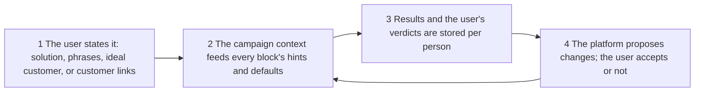
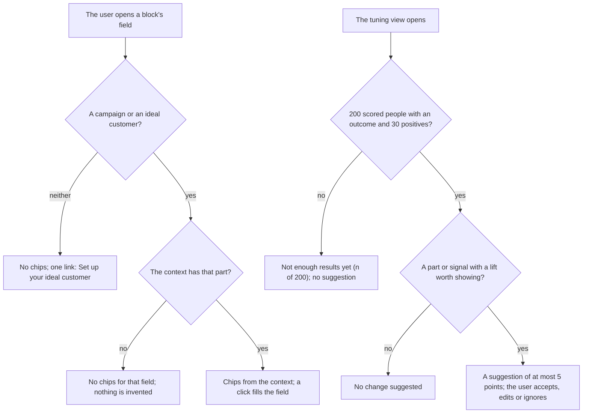
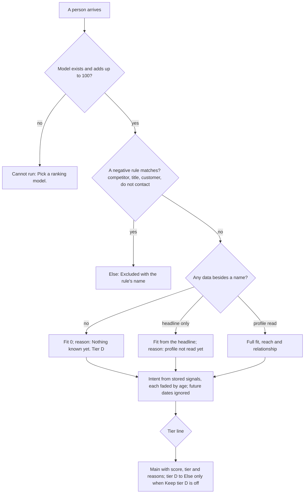
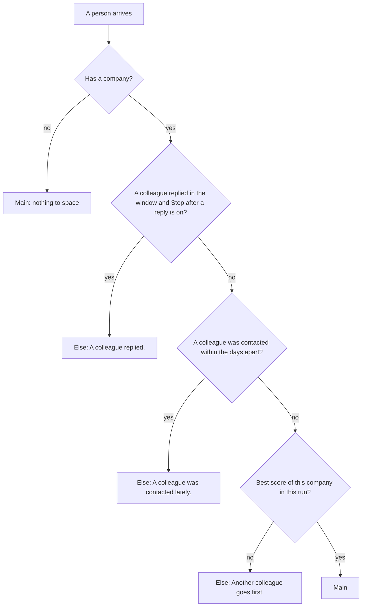
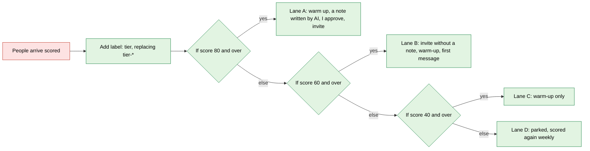

# Lead pipeline, phase 7: ranking and routing (signals, scoring models, per-company control)

- Status: done (built offline; the learning half and the model screen are deferred, see Outcome)
- Created: 2026-11-04
- Locked by user: no (the blocks N1, N2, N4, N5, N8 and the ranking model were approved in principle on 2026-11-04)
- Parent: [lead-outreach-pipeline.md](lead-outreach-pipeline.md) (section "Blue-sky automations")

## Goal

Rank every person and every account from everything we know about them, treat each tier differently, and keep outreach from hitting the same company twice. One saved scoring model per campaign, signals kept with their dates so they fade, and small blocks to pick the best people per company, space them out and stop contacting someone. No code is written in this task.

## Requirements

Confirmed (owner, 2026-11-04): the ranking model as the default (fit 50, intent 30, reach 10, relationship 10; tiers 80, 60, 40; a review lane for tier A), to be tuned on real results; blocks N1 Score by signals, N2 Score company, N4 Pick best per company, N5 Space out people of one company, N8 Stop contacting them; all sixteen automations (phase 10 builds them).

Open: none.

Confirmed (owner, 2026-11-04, for the SaaS product where each user brings their own accounts and finds their own prospects): the platform learns each user's ideal customer from what the user states and from the user's own results, with no fine-tuned model per user, no cross-user learning by default, and weight changes only proposed (see "How the platform learns the ICP").

## Scope and non-goals

- In scope: `ScoreModel` and its editor, `PersonSignal` and `CompanySignal` (the signal store), N1, N2, N4, N5, N8, the facts "has the signal" and "tier" for If person state, "Replace tags" on Add label, "Leave out people at companies labelled" on Remove duplicates, the tier lanes as documented chains, the campaign context, the feedback store and the weight suggestions.
- Out of scope: automatic weight changes (the tuning view only suggests), machine-learned or fine-tuned scores, AI scoring, cross-user learning, the signals that come from new reads (phase 9) and from AI labels (phase 8).

## The data

- `PersonSignal`: owner, slug, type, at (a date), via (a post key or a company slug), excerpt (at most 140 characters, a short piece of what they wrote; cleared at 90 days), source workflow and block, created. Unique on `(owner, slug, type, via, day)`, so a read twice a day writes once. Rows kept 365 days (older than that fades to nothing anyway). Types: asked, posted, commented, reacted, engagedOurPost, viewed, requested, accepted, replied, notNow, jobchange, hiringCompany, funding, competitor, employee, shared, mutual.
- `CompanySignal`: owner, company slug, type (hiring, ads, funding, growth, tool), at, via, detail (a fixed word or a short role title). Same retention.
- Who writes them: every collector block with "Keep" on (the existing `CollectKeepService`) writes the signals it found; the read tasks' import services write `requested`, `accepted`, `replied`, `viewed`; N7, N9 and N3 write theirs later (phase 8). No scoring block writes signals.
- Erasure and Do not contact delete a person's signals; a suppression stops new ones.
- `ScoreModel`: owner, name (unique per owner), kind (PERSON or COMPANY), parts (fit, intent, reach, relationship; whole numbers that add up to 100), the weights inside each part, signal weights with their half-lives, negative rules (words, title lists, a company label for customers), tier lines. Presets built in: Balanced, Fit first, Intent first. Additive; `Icp` stays the source of titles, seniority, sizes, industries and places for fit.

## How the platform learns the ICP (per user and campaign)

The platform never guesses an ICP. It knows only what the user states and what the user's own results show, in four steps. Nothing here is shared with another user.



### 1 Cold start (the user states it once)

- The campaign holds a `solution` (up to 500 characters: what we sell and to whom) and its problem `phrases` (up to 10), beside its ideal customer, voice and labels (additive columns on `Campaign`, phase 5). A user with no campaign uses their default ideal customer.
- Three ways in, all in the Starter and on the ideal customer page: fill the fields; "Describe your customer in a sentence" (rule-based suggestions from our option lists that the user ticks, AI suggestions in phase 8); "Paste 5 to 20 of your best customers' profile links" (the A5 chain: Get full profile, Find the pattern, then "Use as ideal customer").

### 2 Hints and defaults from the campaign context

- One read-only object, `CampaignContext` (solution, phrases, ideal customer parts, voice, label meanings, examples), is built for the workflow's campaign (`Workflow.campaignId`) or the user's default ideal customer. The editor's field hints read it; the brain and the Starter read the same function.
- Fields with a `suggest` source get new sources: `icp.titles`, `icp.seniority`, `icp.sizes`, `icp.industries`, `icp.places`, `icp.phrases`, `icp.labels`. They show as chips under the field ("From your ideal customer: Head of Growth, CMO"); a click fills the field. Nothing is applied silently, and a field the user typed is never overwritten.
- Where it shows: Find posts (phrases), Search people, People at the company and Search companies (titles, sizes, places), Score by signals (the model's fit part), Label with AI (label meanings, phase 8), Write words (goal, voice). A user with no ideal customer yet sees no chips and one link, "Set up your ideal customer".

### 3 Learning from the user's own results (no model training)

| What the user does or what happens | Stored as | Used for |
| --- | --- | --- |
| Accepted, replied, booked, replied elsewhere (A15), bounced | already kept (`LinkedInInvite`, conversations, labels) | the outcome of each scored person |
| A thumbs up or "Not a fit" (with a reason: wrong role, size, industry, place, other) on a person in My network or the hand-off list | `PersonFeedback` (owner, slug, campaign, verdict GOOD or NOT_FIT, reason, at) | example people for the ideal customer and for Label with AI (phase 8) |
| A customer added or labelled `customer` | the label | A5 finds the pattern again monthly |
| An edit to an AI draft | counts kept as in phase 4 | a later "voice tips" idea, not in this plan |

- Nothing is trained. The platform stores the person's score parts and signals at the time of scoring (`PersonScoreSnapshot`: owner, slug, model version, parts, signal types, tier, at, 90 days; rows older fall off), so a result can be compared with what the model saw then.
- Weight suggestions (the tuning view, `ScoreModel` suggestions): for each part and each signal type, the reply rate (positive outcome = replied or booked; accepted shown beside it) of people with it against people without it, with sizes and the lift. A suggestion moves a weight by at most 5 points a time, keeps the four parts adding to 100, and never goes below 0. It appears only when the campaign has at least 200 scored people with an outcome and at least 30 positives; below that the screen says "Not enough results yet (82 of 200)". The user accepts, edits or ignores it; an accepted change is a new model version with the numbers kept in its history, so it can be undone.
- Examples for AI: the user's GOOD and NOT_FIT people and the corrected labels of phase 8 go into the AI prompt as up to 3 short examples per label or per verdict (few-shot). This gets most of what a custom model would, is cheap and can be read, changed and deleted.

### 4 What it does not do

- No fine-tuned or trained model per user: a user has hundreds of outcomes, not tens of thousands, so it would overfit; it costs more; and personal data in model weights cannot be erased.
- No learning across users by default. A later opt-in prior per industry (counts only, no person's data, never from a person's text) is a separate decision.
- No change of weights or ideal customer without the user's click.

### Negative cases



## Block cards and screens

The design rules of the parent apply. Item fields and the Else output are as in "What every block hands on".

### The ranking model screen (tab "Ranking" on the ideal customer page)

```
+-- Ranking model: Balanced ----------------------- [Duplicate] [Reset] --+
|  Parts (add up to 100)   Fit [50]  Intent [30]  Reach [10]  Relationship [10] |
|  Fit      title 15 . seniority 8 . function 4 . company size 8 . industry 6   |
|           place 4 . tools 5                                                   |
|  Intent   signal                         points  fades after                  |
|           Asked for a tool                [ 20 ]  [ 14 ] days     [x]          |
|           Asked to connect with us        [ 20 ]  [ 30 ] days     [x]          |
|           Posted about the problem        [ 15 ]  [ 30 ] days     [x]          |
|           Engaged with our posts          [ 15 ]  [ 30 ] days     [x]          |
|           Visited our profile             [ 12 ]  [ 14 ] days     [x]          |
|           New role in an ICP title        [ 10 ]  [ 90 ] days     [x]          |
|           ... (the full table of the parent plan)   Intent is capped at 30      |
|  Reach    active lately 4 . posts regularly 2 . mutual connections 2 . language 2 |
|  Relationship  shared school 4 . employer 4 . group 4   at most 8              |
|  Never rank   competitors [names]  titles [intern, student]  customers [label customer] |
|  Tiers    A [80]  B [60]  C [40]                                              |
+-------------------------------------------------------------------------------+
```

| Setting | Accepts | Default | Hint |
| --- | --- | --- | --- |
| Parts | four whole numbers adding up to 100 | 50, 30, 10, 10 | "Where the points come from." |
| A weight | 0 up to its part's total | the preset's | none |
| Signal points | 0 to 30 | the parent's table | none |
| Fades after | 1 to 365 days | the parent's table | "Half the points are gone by then." |
| Never rank: names | up to 50 company names | empty | "People at these are left out." |
| Never rank: titles | up to 50 words | intern, student, retired, recruiter | none |
| Customers label | a company label | customer | "Companies saved with it are left out." |
| Tiers | three descending lines, 1 to 100 | 80, 60, 40 | none |

- A saved model is used by N1 and N2; the older "Score against an ideal customer" keeps its own rules and is not touched. Saving a model that does not add up to 100 shows "Parts must add up to 100." on the field.
- The tuning view (phase 5) suggests weight changes from real accept and reply rates; the owner presses Apply. Nothing changes by itself.

### N1 Score by signals (`score.signals`)

One thing: scores each person for fit, intent, reach and relationship, and says why.

```
+------------------------------------------------------------------+
| [gauge] Score by signals                              Ready      |
|  Input | Settings | Output                                       |
|------------------------------------------------------------------|
|  Model         [ Balanced v ]  [ Edit ]                           |
|  Tier lines    A [80]  B [60]  C [40]                             |
|  Signals fade  [ Normal v ]                                       |
|  > Advanced:   Ideal customer [ Outbound v ]  Keep tier D [ on ]  |
|------------------------------------------------------------------|
|  Scores people by fit, intent, reach and relationship. A from 80, |
|  B from 60, C from 40. Tier D is kept and parked.                |
+------------------------------------------------------------------+
```

| Setting | Accepts | Default | Hint |
| --- | --- | --- | --- |
| Model | a saved person model | Balanced | none |
| Tier lines | three descending lines | the model's | none |
| Signals fade | Slow (x2), Normal, Fast (x0.5) | Normal | "How fast old signals count less." |
| Ideal customer (advanced) | one of my ideal customers | the model's | "Who counts as a fit." |
| Keep tier D (advanced) | on, off | on | "Off sends them to Else." |

- Takes people. Reads the item (headline, title, company, location), the profile read when there is one (size, industry, flags `hiring`, `openToWork`, `creator`, `premium`), the stored signals of the person with their dates, and the facts of N9 when present. Fit, intent, reach and relationship are computed as in the parent's model: negative rules first, then the four parts, each signal at points x 0.5^(age / fade).
- Hands on: main = people with `score`, `tier` (A to D) and `matched` (every reason, the top three shown); Else = people a negative rule excluded, `reason` "Excluded: competitor." (or title, customer, do not contact), plus tier D when "Keep tier D" is off. Step message: "120 in, 14 A, 31 B, 40 C, 25 D, 10 excluded."
- The tier is not stored on its own: Add to list keeps the score on the list member, and the Add label block (with "Replace tags" below) writes `tier-a` and so on, which later workflows read as a label.



### N2 Score company (`score.company`)

One thing: scores an account from fit and triggers.

| Setting | Accepts | Default | Hint |
| --- | --- | --- | --- |
| Model | a saved company model | Balanced | none |
| Tier lines | three descending lines | 80, 60, 40 | none |
| Triggers fade | Slow, Normal, Fast | Normal | none |

- Takes companies. Fit: size, industry, place, the ideal customer's keywords against the company's specialities and tagline, and the number of qualified people already known there. Triggers from `CompanySignal`: hiring a related role (+15, fades 45 days), ads running (+10, 30), funding (+12, 60), headcount growth (+8, 90), a tool of ours' ecosystem named in a job text (+8, 90, phase 8). Negatives: competitor names, the customers label.
- Hands on: main = companies with `score`, `tier` and reasons; Else = excluded companies ("Excluded: customer."). Step message as N1.
- Negative cases: a company never read is scored on its name and the step says how many were not read; a company with no triggers scores on fit alone.

### N4 Pick best per company (`process.bestPer`)

One thing: keeps the best few people of each company.

| Setting | Accepts | Default | Hint |
| --- | --- | --- | --- |
| Per company | 1 to 20 | 3 | "Most people kept for one company." |
| Spread over roles | on, off | on | "Prefers one of each role tag." |

- Takes people. Groups by the company's link, else its name; a person with no company passes on. Orders by score; with "Spread over roles" it takes one of each role tag (`role:buyer`, `role:champion`, `role:user`) before a second of any.
- Hands on: main = the kept; Else = the rest, `reason` "More than 3 at this company." Step message: "60 in, 24 on, 36 to Else, 12 companies."

### N5 Space out people of one company (`logic.spaceOut`)

One thing: lets one person of a company through every few days, and none after a colleague replied.

| Setting | Accepts | Default | Hint |
| --- | --- | --- | --- |
| Days apart | 1 to 30 | 3 | "Between two people of one company." |
| Stop after a reply | on, off | on | "No more people there once one answered." |
| For how long | 1 to 90 days | 14 | none |

- Takes people. Looks at colleagues in My network (same company link or name) for an invite, message, reaction, comment or reply of ours inside the window. In one run only the best-scored person of a company goes through.
- Hands on: main = allowed; Else = "A colleague was contacted lately." or "A colleague replied." Step message counts each cause.



### N8 Stop contacting them (`output.doNotContact`)

One thing: puts people on Do not contact with a reason.

| Setting | Accepts | Default | Hint |
| --- | --- | --- | --- |
| Reason | up to 60 characters | Stopped by a workflow | "Shown on the person." |
| Pause their colleagues | on, off | off | "Not forever, only for a while." |
| For how long | 1 to 90 days | 14 | none |

- Takes people. Sets the person's Do not contact flag (a suppression row when the person is not in My network yet); "Pause their colleagues" tags colleagues `paused-account` for the days, which N5 reads. Reversible by the owner on My network.
- Hands on: main = the same people with `result { action: "stop", status: "DONE" }`; no Else. A preview shows how many would be stopped and does nothing. Used by the closed loop (A15).
- Negative cases: a person already on Do not contact is left as is ("Already stopped."); a person with no link cannot be stopped ("No profile link.") and goes to the step's note.

### Small changes

- Add label (`process.tag`): setting "Replace tags beginning with" (empty by default; `tier-` makes `tier-a` replace any other `tier-*`), so a person moves between tiers.
- Remove duplicates: setting "Leave out people at companies labelled" (empty by default; `customer`).
- If person state: new facts "Has the signal X within N days" (a choice of the signal types, a number of days) and "Tier is" (A to D, from the item).
- Fit to today's limit: no change.

### The tier lanes (documented chains, built from blocks that exist)



Lane A, B and C each are a daily workflow that starts with Profiles (label `tier-a`, `tier-b`, `tier-c` and invite none); lane D is a weekly workflow that scores the people again and retags them. Phase 10 gives each lane's settings.

## Approach

- [x] Tests first: the score on golden people (each part, each negative rule, fading at 0, 1 and 3 half-lives, a future date), the model validation, the company score, best per company and space out (pure code: `core/ranking.unit.test.ts`, `contracts/ranking.unit.test.ts`; blocks: `rankBlocks.unit.test.ts`)
- [x] Migration (additive): `PersonSignal` and `CompanySignal` (`20261104170000_lead_pipeline_signals`); the built-in models live in contracts. Writers: Score by signals and Score company write what the run found (not `CollectKeepService`)
- [ ] The model screen on the ideal customer page; the person drawer gets a "Signals" list (deferred, see Outcome)
- [x] N1, N2, N4, N5, N8 (contract entry, executor, icon, registry tests); the small changes
- [x] Retention job rules for the new tables; erasure and Do not contact
- [ ] `CampaignContext`, the new `suggest` sources and the chips in the block editor; `solution` and `phrases` on `Campaign` (deferred)
- [ ] `PersonFeedback` (thumbs and "Not a fit") in My network and the hand-off list; `PersonScoreSnapshot`; the suggestion calculation and the tuning view with the 200 and 30 thresholds (deferred)
- [ ] Build the tier lanes and a test campaign on a test user as the real-path check (deferred to phase 10, which builds the lanes)

## Edge cases and risks

- Weights are guesses: show them on screen, change them in one place, and let the tuning view compare real results before anyone changes a number.
- A person scored on a headline only can land in a high tier on a lucky word: the reason says "profile not read yet", and A needs a profile read (a person without one is capped at B).
- Fading uses the signal's date, not the read's: a signal found late counts as old.
- Same person, several companies: the current company counts.
- Customers and competitors lists need upkeep: the screen says how many companies each label holds.
- Performance: signals are read in one query per batch, not per person.
- Privacy: excerpts are short, cleared at 90 days and reached by erasure; no signal holds a message.
- Many users: every table above carries the owner; context, feedback, snapshots and suggestions are never read across owners; erasure of a person removes their feedback and snapshots.
- Biased feedback: a user who marks only the people they liked skews the examples; the screen shows the counts of GOOD and NOT_FIT, and the suggestions use outcomes, not verdicts.
- Thin data: most users will not reach 200 outcomes soon; the defaults carry them and the screen says how far off they are.
- Stale context: a changed ideal customer does not rescore old people by itself; the weekly lane D does.
- Rollback: additive tables; old scoring is untouched.

## Verification

- `pnpm lint && pnpm ts:check && pnpm test:unit:run && pnpm build`; brain integration tests for the stores, the writers, the blocks and the retention.
- Real path: score a real batch from a finder on a test user, read the reasons in the page, compare tiers with the owner's own judgement of ten people. State what could not be run.
- The chips: open Find posts and Search people on a test user with and without an ideal customer; the suggestion calculation on a seeded set (below and above the 200 and 30 thresholds, a lift of zero, the 5 point cap, parts still adding to 100); two test users prove nothing leaks across owners.

## Outcome

Shipped (not seen in a browser, no real model or LinkedIn call):

- Contracts `ranking.ts`: the 17 person signal types and 5 company signal types with points and half-lives, the three built-in models (Balanced 50/30/10/10, Fit first 65/20/8/7, Intent first 35/45/10/10), tier lines (80, 60, 40, must go down), `tierOf`, `fadeFactor`, fade speeds (slow x2, fast x0.5).
- Brain `core/ranking.ts`: `rankPerson` (negative rules first: competitor signal, never-rank title, never-rank company, excluded title; fit from `scoreIcp` scaled to what the ideal customer asks for; intent from the freshest signal of each type, faded, capped at the intent part; reach from followers; relationship from shared and mutual; no profile read caps a person at tier B), `rankCompany`, `pickBestPer`, `spaceOutReason`.
- Migration `20261104170000_lead_pipeline_signals` (`PersonSignal`, `CompanySignal`, one row per owner, slug, type, source and day), `SignalService` (write skips people on Do not contact, read, cleanup: 365 days, excerpt 140 characters cleared at 90), `ColleaguesService`, `PeopleService.stopContacting`; erasure, Do not contact and the retention job reach the new tables.
- Blocks `score.signals`, `score.company`, `process.bestPer`, `logic.spaceOut`, `output.doNotContact` (contract, executors in `worker/engine/rankBlocks.ts`, icons), `PersonItem.tier`, `CompanyItem.score/tier/matched`; small changes: Add label "Replace labels beginning with", Remove duplicates "Leave out people at companies labelled".
- Checks: lint (0 warnings), ts:check, unit tests, clean `pnpm build --force`, the new integration tests (`signal.integration.test.ts`, `rankBlocks.integration.test.ts`) and the whole brain integration suite pass.

Deviations (deferred, not built):

- No saved `ScoreModel`, editor screen or "Edit" button: the block picks one of three built-in models. The saved-model table can be added later without changing the block settings.
- Signals are written by Score by signals and Score company from what the run holds (the item's commented, reacted, employee and hiring signals; a hiring company), not by the collectors; accepted and replied come from My network dates at scoring time. The signal types that no block writes yet (asked, posted, engagedOurPost, viewed, requested, jobchange, funding, competitor and the shared and mutual ones) are read when something stores them; phase 8 and 9 reads and the automations will.
- "Pause their colleagues" on Stop contacting them is not built; the reason is kept in the run's result, not on the person.
- Tier D in Else only when Keep tier D is off; the customers label is not a negative rule (use the never-rank companies list and Remove duplicates with the label).
- Not built: the Signals list in the person drawer, `CampaignContext` and its chips, `PersonFeedback`, `PersonScoreSnapshot`, suggestions and the tuning view, the tier lanes (phase 10), the new facts for If person state ("has the signal", "tier is"; Else for tier is the Score block's own, and the tier is a field of the item).
- The dedupe company label has no test through the engine (items from links carry no company); the lookup is tested in `signal.integration.test.ts`.
