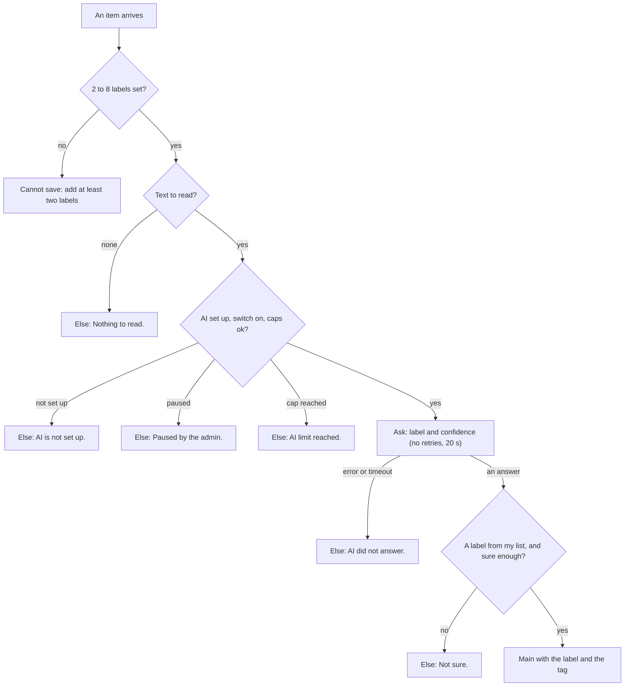

# Lead pipeline, phase 8: reading blocks (Label with AI, Find the pattern, Detect changes, Compare with my account)

- Status: ready for the owner's approval
- Created: 2026-11-04
- Locked by user: no (N3, N6, N7, N9 approved in principle on 2026-11-04)
- Parent: [lead-outreach-pipeline.md](lead-outreach-pipeline.md)
- Needs: phase 4 (the AI service, caps, switch, privacy rules) and phase 7 (the signal store)

## Goal

Four blocks that read and describe, never write: a generic AI label (intent, urgency, tools mentioned), a summary of what a group of people have in common, what changed in a profile since the last read, and what a person shares with our account. Plus two small changes so the pipeline can write a post and use words in an invite note. No code is written in this task.

## Requirements

Confirmed (owner, 2026-11-04): the nine new blocks including Label with AI (N3); Label with AI is the generic AI block, it reads and labels and does not write; it follows the AI service rules of phase 4 (caps, switch, redaction, a notice).

Open: none.

Confirmed (owner, 2026-11-04, SaaS: each user brings their own accounts and finds their own prospects): AI hints and labels are tuned to each user from their own campaign context and their own corrections, as few-shot examples in the prompt; no model is trained or fine-tuned per user (phase 7, "How the platform learns the ICP").

## Scope and non-goals

- In scope: N3 `process.classify`, N6 `process.pattern`, N7 `collect.changes`, N9 `collect.shared`; Write words gets a third kind (a post from a topic) and the Drafts inbox a kind POST; Write a post and Send connection request accept `{written}`; new variables `{shared_school}`, `{shared_employer}`, `{shared_city}`, `{new_role}`.
- Out of scope: AI that extracts free text into fields (a later block), AI scoring, any AI that acts, fine-tuning or training a model per user.

## Making the AI fit the user (phase 7's campaign context)

- Suggest label meanings: in Label with AI a button "Suggest from my solution" asks the AI service (new kind `suggest`, ledger label "AI suggestions", same caps, switch and redaction, a preview of the pack) for 2 to 8 labels with a one-sentence meaning each, from the campaign's `solution` and `phrases` only (no person's data). The user edits, keeps or removes each; nothing is saved until they press Save. Without a campaign, the button asks for a one-line description first. Else rule: AI off or capped gives "AI is not set up." or "AI limit reached." and no suggestion.
- Examples: Label with AI has an advanced setting "Use my examples" (on). When the owner corrects a label on an item (in the preview or the Output tab: "Wrong label, use: ..."), the correction is kept as `LabelExample` (owner, workflow, block, label, text excerpt up to 300 characters, at; 90 days; reached by erasure). A run adds up to 3 examples per label (the newest) to the pack as quoted data, with the same injection rules. The block says "12 examples used."
- Fit examples: people the user marked GOOD or NOT_FIT (phase 7) are the ideal customer's example people; Find the pattern can use them ("From my verdicts") instead of a label.
- Hints: the label field, Read and the goal of Write words show chips from `icp.labels` and `icp.phrases` (phase 7); no chip is applied without a click.
- Nothing here crosses users: examples, suggestions and verdicts are read per owner only.

## Block cards and screens

The design rules of the parent apply.

### N3 Label with AI (`process.classify`)

One thing: puts one label from my list on each item by reading its text.

```
+------------------------------------------------------------------+
| [tag] Label with AI                                   Ready      |
|  Input | Settings | Output                                       |
|------------------------------------------------------------------|
|  Read          [ Post text v ]                                     |
|  Labels        asking    Asks for a tool or advice          [x]   |
|                complaint Complains about the problem        [x]   |
|                switching Compares or leaves a competitor   [x]   |
|                hiring    Announces a hire for the role      [x]   |
|                [ + Add a label ]       2 to 8                     |
|  Sure at least [ 70 ] percent                                     |
|  > Advanced:   Also tag the item [ on ]   Read at most [ 100 ] a run |
|------------------------------------------------------------------|
|  Reads each post and labels it asking, complaint, switching or   |
|  hiring. Not sure goes to Else.                     [ Preview ]  |
+------------------------------------------------------------------+
```

| Setting | Accepts | Default | Hint |
| --- | --- | --- | --- |
| Read | Post text, Headline, About, Last message, Job text | by the item's kind (post: Post text; person: Headline; conversation: Last message; job: Job text) | "What the AI reads." |
| Labels | 2 to 8; a name up to 24 characters (letters, digits, dash) and a meaning up to 120 | none, at least two | "Say in your words what each one means." |
| Sure at least | 50 to 95 percent | 70 | "Below this the item goes to Else." |
| Also tag the item (advanced) | on, off | on | "Adds the tag label:name." |
| Read at most a run (advanced) | 1 to 500 | 100 | "Caps the cost of one run." |

- Takes any item that has the chosen text. Runs: for each item, build a pack of only that text and the label list, ask the AI service for `{ label, confidence }` (a structured answer checked against the list), keep the label when the confidence is at or above the line.
- Hands on: main = items with `label` (a field of the item and the fact `item.label`) and, when on, the tag `label:<name>`; Else = items not labelled with one reason ("Not sure.", "Nothing to read.", "AI is not set up.", "AI limit reached.", "AI did not answer.", "Paused by the admin."). Step message: "90 in, 61 labelled (28 asking, 20 complaint, 8 switching, 5 hiring), 29 to Else. AI cost $0.03."
- Same rules as Write words: the text is quoted data, text that tries to give orders is not obeyed (the item goes to Else "Not sure."), caps and the `ai` switch apply, spend is a ledger line "AI labels", a preview reads up to 3 items and shows the pack and the answer, and a post is not sent with names, links or ids.
- Use: A1 (intent and urgency), A4 (tools in a job text), anything that needs a branch by meaning (the next block is an If on the label: `logic.if` already has "has one of these labels").



### N6 Find the pattern (`process.pattern`)

One thing: sums up what a group of people have in common, so the owner can build the ideal customer from real customers.

```
+------------------------------------------------------------------+
| [chart] Find the pattern                              Ready      |
|  Input | Settings | Output                                       |
|------------------------------------------------------------------|
|  Show the top  [ 10 ]                                             |
|  Look at       [x] Titles [x] Companies [x] Schools [x] Skills    |
|                [x] Company sizes [x] Industries [x] Places        |
|------------------------------------------------------------------|
|  Sums up what the people that reach it have in common.           |
|  Output tab: titles, companies, schools, skills, sizes.          |
+------------------------------------------------------------------+
```

| Setting | Accepts | Default | Hint |
| --- | --- | --- | --- |
| Show the top | 3 to 20 | 10 | none |
| Look at | any of titles, companies, schools, skills, company sizes, industries, places | all | none |

- Takes people with a profile read (put Get full profile before it). It is rule-based counting, no AI and no cost.
- Hands on: main = the same people, unchanged; the Output tab shows the report: for each part the top values with a count and a share ("Head of Growth 31 %"), a tick box per value and a button "Use as ideal customer" that creates or updates an ideal customer from the ticked values. Step message: "42 people, 37 with a full profile."
- Negative cases: fewer than 5 profiles gives "Too few to see a pattern. Read more profiles." with no report; people without a profile read are counted and left out of the numbers.

### N7 Detect changes (`collect.changes`)

One thing: says what changed in a person's profile since we last read it.

| Setting | Accepts | Default | Hint |
| --- | --- | --- | --- |
| Watch | any of job, company, headline, place | job, company | none |
| Compare with | The previous read, A read at least N days old | The previous read | none |
| Read again first | on, off | off | "Paid, about $0.004 a person." |

- Takes people. Compares the newest stored read of the person with the one before (`PersonSnapshot`): a new position or a changed company is `new_role`; a changed headline is `new_headline`; a changed place is `moved`. With "Read again first" on it reads the profile now (paid, shown in the estimate; people read in the last 30 days are skipped unless the owner insists).
- Hands on: main = people with a change, each with `facts` (`change.kind`, `change.since`) and the new variable `{new_role}`; with Keep the signal `jobchange` is written; Else = "No change." or "Read only once, nothing to compare."
- Negative cases: a person never read goes to Else "Never read."; two reads on the same day count as one; a company page that was renamed is not a job change (same company link, so no change).

### N9 Compare with my account (`collect.shared`)

One thing: finds what a person shares with the account that will write to them.

| Setting | Accepts | Default | Hint |
| --- | --- | --- | --- |
| Accounts | Any of my accounts, From "Select accounts", One account | Any of my accounts | none |
| Compare | any of school, past employer, skills, place | all | none |

- Takes people with a profile read. Compares with each account's own stored profile (the planned "Get my profile" read of the account; without it the block says "Read the account's own profile first.").
- Hands on: main = all the people; those with something in common carry `facts` `shared.school`, `shared.employer`, `shared.skills` (a count and the first name), `shared.city`, and the variables `{shared_school}`, `{shared_employer}`, `{shared_city}`; with Keep the signal `shared` is written. No Else. Step message: "40 people, 9 share a school, 6 an employer."
- A fact is true or absent; the words must have a fallback (`{shared_school:your school}`), and Write words uses it only when present.
- Negative cases: an account whose profile was never read gives "not known" for its people; two accounts that differ give the facts of the account that will write (when the account is chosen later the facts of all are kept and the right one is used at send time).

### Writing a post and a note with `{written}` (C13)

- Write words gets a third kind: with the setting "Topics" (up to 20 lines) it starts a chain with the least recently used topic (as Get full profile can start one), and the result is a post draft in the voice. The Drafts inbox shows the kind POST with the draft text and the account that will post.
- "Write a post" accepts words from the block before it: a new choice "From the block before" beside "Written here" and "A saved draft"; it still posts through the existing publication rules (1 hour apart, 3 a day, same words refused for 7 days).
- "Send connection request": the note field accepts `{written}` as it accepts `{first_name}`; an invite with an empty `{written}` is sent without a note.

## Approach

- [ ] Tests first: the label schema and the answer check, the pattern counts, the change detection on two snapshots, the shared facts on two profiles
- [ ] N3 on the AI service of phase 4 (a new kind `classify`, ledger label "AI labels")
- [ ] "Suggest from my solution" (kind `suggest`, ledger label "AI suggestions"); `LabelExample` and "Use my examples"; the correction control; "From my verdicts" on N6
- [ ] N6, N7, N9 (contract entry, executor, icon, registry tests); the Output tab for N6 and the "Use as ideal customer" button
- [ ] C13: the third Write words kind, the inbox kind, the two block changes
- [ ] Build A1 and A5 (phase 10) on a test user as the real-path check

## Edge cases and risks

- Injection through the text; a label list that overlaps (the AI picks one and the tuning view shows the confusion); a language the AI does not read; cost on a large batch (the run cap and the owner's caps).
- Label meaning drifts: the label list is part of the block, so a change shows in the workflow history.
- Examples can mislead: a wrong correction teaches the wrong thing; the block shows the examples it used, the owner can delete one, and the newest three per label are the only ones sent.
- A suggestion made from a thin or generic solution text is generic; the owner reads it before saving, and it costs cents (cap and switch apply).
- Many users: examples and suggestions are per owner and never shared; an AI provider sees only the quoted text, the label list and the owner's examples.
- Pattern from a biased group (only the loudest customers): the report shows the group size and says so.
- Job-change detection needs two reads: new people show "Read only once" until the next read.
- Shared facts are only as good as the account's own profile; a stale profile misses a new school.
- Privacy: the AI sees only the text read, no names unless the text holds them; chat text follows the phase 4 rules; reports hold counts, not people.
- Rollback: additive blocks; N3 is off when `AI_PROVIDER` is empty or the `ai` switch is off.

## Verification

- `pnpm lint && pnpm ts:check && pnpm test:unit:run && pnpm build`; brain integration tests for the four blocks and the inbox kind.
- Real path: N3 on real posts with a real key (opt-in live test, counts only), N6 on ten real customers, N7 on people read twice, N9 with two real accounts. State what could not be run.
- Examples: correct three labels on a preview and see the next run use them (the count and the changed result); delete one and see it gone; two test users prove one user's examples never reach another's pack. The agreement check of the parent plan's "To verify after the plan is executed" (85 percent on 50 hand-labelled posts) is run with and without examples.

## Outcome

Filled in when done.
