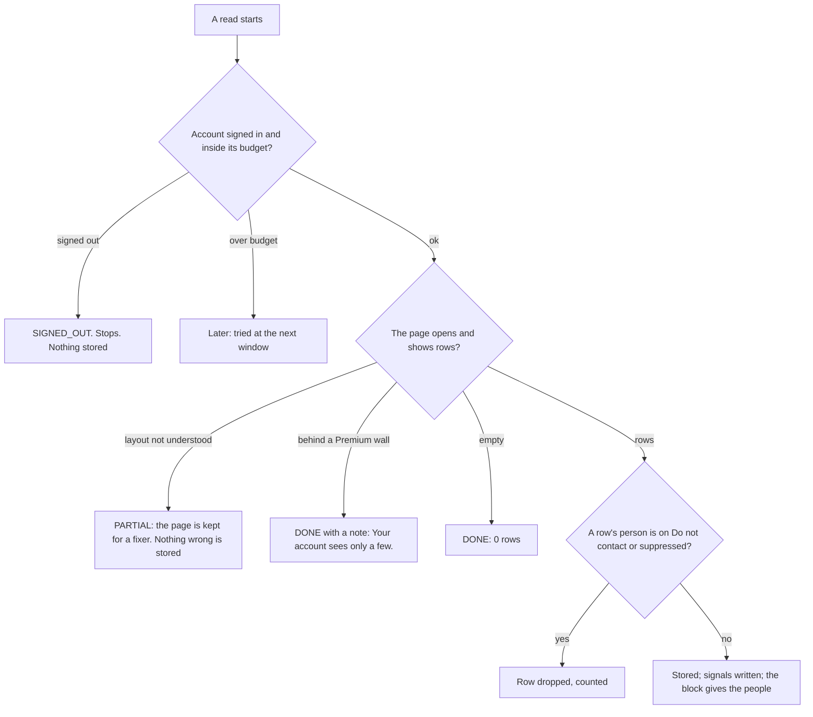

# Lead pipeline, phase 9: new reads (notifications, profile viewers, my feed, mutual connections)

- Status: ready for the owner's approval
- Created: 2026-11-04
- Locked by user: no (the three reads were approved on 2026-11-04: who viewed my profile, my feed, notifications; the mutual-connections read is added for automation A6, which the owner asked to include)
- Parent: [lead-outreach-pipeline.md](lead-outreach-pipeline.md)
- Needs: phase 7 (the signal store)

## Goal

Read the places on the owner's own accounts where interest shows up: the notifications page (profile views, reactions and comments on our posts, accepted invitations, new jobs and other life events, mentions), the list of people who viewed the profile, the feed (announcements and life events of connections), and, for a few top-tier people, the mutual connections. Each read becomes signals on a person or a company, and a block in the Account Actions group so a workflow can use it. All are read-only. No code is written in this task.

## Requirements

Confirmed (owner, 2026-11-04): two small spider tasks, who viewed my profile and my feed; also the view notifications on LinkedIn; all sixteen automations, which include A6 (warm path), whose reads are the mutual connections.

Open: none. One number is a proposal for the owner to change later: mutual reads 10 a day an account (6 to 8 after the rule).

## Scope and non-goals

- In scope: S2 `linkedin-notifications`, S3 `linkedin-viewers`, S4 the feed capture (an extension of `linkedin-browse`, version 2, not a new task), S5 `linkedin-mutual`; their imports, tables, schedules; the blocks `account.getNotifications`, `account.getViewers`, `account.getFeed`, `account.getMutual`; signals; the Today checklist items.
- Out of scope: clicking, replying or reacting to anything in these places; reading anyone's private data; anonymous viewers' identities (they become a company signal at most); Sales Navigator pages.

## The reads

| Task | Reads | Input | Output file | Class | Runs |
| --- | --- | --- | --- | --- | --- |
| S2 `linkedin-notifications` | the notifications page | `{ since?: time, limit?: up to 100 }` | `notifications.json` | BACKGROUND | every 4 hours inside office hours, at most 4 a day |
| S3 `linkedin-viewers` | the profile viewers page (`/analytics/profile-views/`) | `{ limit?: up to 50 }` | `viewers.json` | BACKGROUND | once a day |
| S4 `linkedin-browse` v2 | the feed it already opens for the daily visit | the existing input | adds `feed.json` | BACKGROUND (as today) | with the daily visit |
| S5 `linkedin-mutual` | the mutual connections of up to 3 people | `{ slugs: up to 3 }` | `mutual.json` | ACTION | on a block's request, 10 reads a day at most |

- Every task follows the lifecycle of the `spider-task-writer` skill: starts on a signed-in feed, checks each landed page for the sign-in page (`SIGNED_OUT`), saves the session only when its own check passed, keeps the final page of a failed run. Each declares `SIGNED_OUT` and has the `/uas/login` unit test the registry requires, a `budget` taken from a real run (the estimates are not guessed), and an entry in `ACCOUNT_ACTION_TASKS` for its block.
- Recording first. Three of the four pages were recorded once on 2026-11-03 (one test account, a Free account, en-US; findings below); mutual connections was not. Keep a fixture per layout seen, plain CSS selectors only, shadow-root-aware paths. Still unverified: everything marked below, a Premium account, a second account's layout, and the mutual-connections page.

### Recorded on 2026-11-03 (read from the saved pages; nothing was run against LinkedIn for this note)

| Page | Verified | Still unverified |
| --- | --- | --- |
| Notifications, `/notifications/` | The tabs are checkboxes with labels All, Jobs, My posts, Mentions. The filter address is `?filter=<value>`: `jobs_all`, `my_posts_all`, `my_posts_comments`, `my_posts_reactions`, `mentions_all`; My posts has a sub-filter (All, Comments, Reactions) that opens from a caret. A row is a card under `data-sdui-screen="...NotificationPillType"` with `p[componentkey^="notification-card-headline_"]` holding `<strong>Name</strong> commented on <strong>Owner's</strong> post: excerpt`, an avatar link `a[href*="/in/<slug>/"]` for the person, and the time as `<p><span>9m</span></p>`. The same text appears three times in the markup (accessible copies), so read the headline only. A row has no link to the post (the anchors point to `/feed/`), so no post key can be read. Kinds seen on All: someone commented on or reposted or posted (the network's activity, not ours), "You appeared in N searches this week", "You may know X", a game invite. | The tabs Jobs, My posts (with its sub-filters) and Mentions were saved as loading skeletons, not as empty lists (the pictures of the saved pages and of the video show grey placeholder rows for 10 to 40 seconds after each click, although the page's own requests answered 200), so the kinds that matter (viewed your profile, reacted to or commented on my post, accepted, job change) were not seen. Unknown whether the rows load only after more time or a scroll, whether this automated browser is blocked from them, or whether this account has none. Needs a re-recording that waits and scrolls, then keeps the page by hand. |
| Profile viewers | The page is `/analytics/profile-views/` (`/me/profile-views` redirects to it; `/in/profile-views` is a 404). A Free account sees only totals: "Who's viewed your profile, past 90 days", a count ("13 profile viewers"), and group rows "N works at <Company>", "N found you through a LinkedIn profile", "N has a connection who may be hiring...", each with a View button, and "Unlock the list with Premium". No viewer's name or link is on the page. | What a Premium account sees; what the View buttons open; whether a viewer ever shows by name for a Free account. |
| Feed, `/feed/` | The post list is in the main document. A post header has `a[href*="/in/<slug>/"]` with a child `div[aria-label="<Name> Verified Profile 3rd+"]` (the connection degree is in the label), the time as `<p><span>1d</span></p>`, `button[aria-label="Follow <Name>"]`, `button[aria-label="Open control menu for post by <Name>"]`. A post has no link to itself and no `urn:li:` before comments load. A company post links `/company/<slug>/`. | Life events (new job, anniversary), reposts, polls: none appears in the saved feed pages (14 to 16 posts and one promoted post); the feed is personalised, so a life event needs its own recording. |
| Mutual connections | Not recorded. | Everything. |

Effects on this plan (changes made below): a Free account's viewers read gives companies and counts, not people, so it writes company signals (`viewed`) only; notification rows have a person and a kind but no post key; the feed gives no post key, only the author, the degree and an excerpt.
- Files hold fixed words, names, profile slugs and times; nothing else. A notification's text is read to classify the kind and is not kept.

### What each file holds

| File | Row |
| --- | --- |
| `notifications.json` | kind (viewed, reacted, commented, mentioned, accepted, jobchange, anniversary, birthday, posted, other), the person (name, slug from the avatar link), the time as shown ("2h"); no post key (a row has no post link) |
| `viewers.json` | the page's total and period ("13 in 90 days"); group rows (kind: works-at, found-through-profile, connection-hiring, other; the company name for works-at; the count); person rows (name, slug, headline, time) only where the page shows them, which a Free account never does (a Premium page is unrecorded) |
| `feed.json` | posts the visit saw: author (name, slug, connection degree), a hash of the first 200 characters as the post's identity (the feed gives no post key), text up to 500 characters, time as shown, kind (post, life event, promoted) |
| `mutual.json` | for each slug: the count and up to 10 mutual connections (name, slug), only people the account is connected to |

### Imports and storage

- `NotificationImport`, `ViewerImport`, `FeedImport`, `MutualImport` (as `ConnectionImport`): a finished run waits to be stored, a worker job reads the files.
- `AccountNotification` (account, kind, slug?, time, seen): kept 30 days. `ProfileViewer` (account, slug?, group kind, company name?, count, read on): 30 days. `FeedPost` (account, author slug?, content hash, excerpt 500, kind, time): 14 days. `MutualLink` (account, slug, mutual slug): 30 days.
- Each import also writes signals (phase 7): `viewed` (a person where the page names one; for a Free account a company signal from each "N works at <Company>" row, with the count), `engagedOurPost` (reacted or commented on our post; carries the person and the time, no post key), `accepted` (and it sets `LinkedInInvite.acceptedAt` and the person's state, so an accept is noticed within 4 hours, not a day), `jobchange` and `funding` from life-event posts, `mutual`. A person seen only by a read joins My network as a discovery person with the reason sentence ("Viewed your profile on 3 Nov"), so the finders and presets can see them; Do not contact and suppressed people are never added.
- Scheduling: `account-daily` asks for the reads (new `next…At` columns on the account, additive), only for an ACTIVE account signed in within a day, inside its office hours and its browsing budget. The reads count as background (the 40 percent share); a refusal is `later`.

## Block cards and screens

The design rules of the parent apply. All four blocks sit in the Account Actions group and read: they act on nothing on LinkedIn.

### Get notifications (`account.getNotifications`)

One thing: gives the people behind my notifications.

```
+------------------------------------------------------------------+
| [bell] Get notifications                              Ready      |
|  Input | Settings | Output                                       |
|------------------------------------------------------------------|
|  Accounts      [ Every signed-in account v ]                      |
|  Since         [ The last time v ]                                |
|  Kinds         [x] Viewed me  [x] Engaged with my posts           |
|                [x] Accepted    [x] Life events   [ ] Mentions     |
|  > Advanced:   Read from LinkedIn first [ on ]                    |
|------------------------------------------------------------------|
|  Gives the people who viewed me, engaged, accepted or changed    |
|  jobs since the last time.                         [ Preview ]   |
+------------------------------------------------------------------+
```

| Setting | Accepts | Default | Hint |
| --- | --- | --- | --- |
| Accounts | Every signed-in account, pick, one | Every signed-in account | none |
| Since | The last time, 24 hours, 7 days | The last time | "Only newer ones." |
| Kinds | any of viewed me, engaged with my posts, accepted, life events, mentions | all but mentions | none |
| Read from LinkedIn first (advanced) | on, off | on | "Off uses what was already read." |

- Hands on: main = people (one item per person, with `signals` of the kinds found and `result` null); no Else. The step says "3 accounts, 42 notifications, 31 people."

### Get profile viewers (`account.getViewers`)

Same shape and settings as above without Kinds; gives the people the page names and, for every group row "N works at <Company>", the company with the count as a company signal. A Free account sees only totals and groups (recorded 2026-11-03), so its output is companies, never people. Hint: "A free account sees companies, not people."

### Get my feed posts (`account.getFeed`)

One thing: gives the posts and life events my accounts saw in their feed. It reads what the daily visit already stored (no new browsing).

| Setting | Accepts | Default | Hint |
| --- | --- | --- | --- |
| Accounts | as above | Every signed-in account | none |
| Since | 24 hours, 3 days, 14 days | 24 hours | none |
| Show | Posts, Life events, Both | Both | "Life events: new job, anniversary." |

- Hands on: main = post items (author, text, link) and, for life events, people with the signal; Else none. A feed with only ads gives "No posts seen."
- This is the block the registry line for `linkedin-browse` marked as planned.

### Get mutual connections (`account.getMutual`)

One thing: finds who in my network knows a person.

| Setting | Accepts | Default | Hint |
| --- | --- | --- | --- |
| Accounts | the account that will write (From "Select accounts", one) | From "Select accounts" | none |
| People a run | 1 to 20 | 5 | "Each one costs a page view." |

- Takes people with a high score only: put Fit to today's limit with "For: mutual reads" and an If on the tier before it. Reads at most 10 a day an account (limit by the rule, so 6 to 8); a person whose account is connected to nobody they know gets no list.
- Hands on: main = people with `facts` `mutual.count` and up to 10 names (kept only as pointers: slugs), and the variable `{mutual_name}` (the first mutual connection, a connection of the writing account); Else = people not read because of the limit ("No room left today.").

### Negative cases for all four reads



### Screens

- Account drawer, Today checklist: two new items "Read notifications" and "Read viewers" with last run, next time and "Run now" (as the other items); the feed shows under the daily visit.
- Person drawer (My network): a "Signals" list (from phase 7): "Viewed your profile, 2 days ago", "Reacted to your post, yesterday", with the account that saw it.
- My network: a quick filter "Showed interest in the last [7] days" (any signal of the kinds viewed, engagedOurPost, requested, accepted), so the inbound lane (A13) can start from it.

## Approach

- [ ] Recording sessions on a real account for each page; fixtures; notes (account, date, layout)
- [ ] Tests first: the schemas of the four files, one reader test per fixture and layout, one test per verdict with the hands mocked, the `/uas/login` test, an e2e stand-in page for each new page shape
- [ ] 9a S2 notifications and its block (also gives faster accept detection); 9b S3 viewers; 9c S4 the feed capture and its block; 9d S5 mutual and its block (last, on tier A only)
- [ ] Brain: migration (additive: the four imports, the four stores, the schedule columns), import jobs, signal writers, retention
- [ ] Today checklist items, the signals list, the quick filter
- [ ] Spider task checklist (`.github/skills/spider-task-writer/assets/checklist.md`) copied here and ticked per task

## Edge cases and risks

- Opening the notifications page clears the red badge on LinkedIn: harmless, said in the task's notes.
- A Free account sees companies and counts only, no viewer names: the viewers read cannot feed lane A or the inbound capture (A13) with people. It feeds Score company (a "viewed" signal) and the notifications read carries the person-level signals. Whether a Premium account shows names is unverified, so no recipe depends on it.
- Reading too often looks like a bot: 4 notification reads and 1 viewers read a day, inside office hours, never at the same minute as another run; the 10 minute gap between runs of an account applies.
- Mutual connections cost one profile view each: tier A only, 10 a day at most, in runs of 3.
- A person's name without a link (an anonymous or private profile): never added to My network.
- Wall-clock times ("2h") are approximate: the read's own time is used for ordering.
- Privacy: only what the account itself sees; rows kept 30 days (feed 14); signals keep the fixed type and date.
- Unverified until recorded: every page address and markup, the free-account limits, the notification kinds that LinkedIn adds or renames, whether LinkedIn throttles these pages.
- Rollback: additive tables and tasks; each read can be switched off per account, and the `acts` switch of phase 3 does not apply (they act on nothing), so a separate switch `reads` in `PlatformSetting` stops them all.

## Verification

- `pnpm lint && pnpm ts:check && pnpm test:unit:run && pnpm build`; the registry test; brain integration tests for the imports, the signals and the retention; spider e2e for the new page shapes.
- Real path: a devtools run of each task on a test account, the rows in My network and the signals list in the page, then the four blocks in a preview through the worker. State what could not be run.

## Outcome

Filled in when done.
