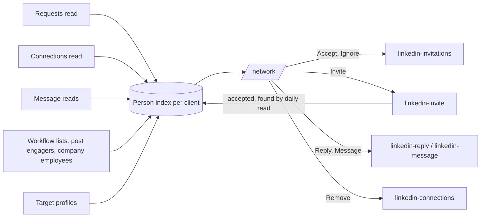

# My network: one page to work every profile of the agency's LinkedIn accounts

- Status: in progress <!-- draft | locked | in progress | done -->
- Created: 2026-10-30
- Locked by user: yes, 2026-10-30 ("lock it and work on phase 1")
- Version: 6. Persona reviews of the `/people` drafts: round 1 Agency Owner 6, GTM Engineer 6, Sales Rep 6, Founder 4, Platform
  Admin 6; round 2 all 8; round 3 all 9; round 4 all 10. This `/network` version: round 5 Agency Owner 9, GTM Engineer 9,
  Sales Rep 10, Founder 10, Platform Admin 9; round 6 Agency Owner 10, GTM Engineer 10, Platform Admin 10 (Sales Rep and Founder
  already 10). All five at 10/10.

## Goal

One page, **`/network` ("My network")**, where an agency (or a founder with one account) does all LinkedIn people work for a
client: answer replies, accept requests, invite the right people, and see who accepted and what it cost. It absorbs the
connections page, `/lists`, `/profiles` and the planned `/people` (there is no `/people`). A client can log in and see only
their own people. It has no size limit by design.

## Answers locked by the owner (2026-10-30)

1. Invite limits: 20 a day and 100 a week per account.
2. A client may log in and see only their own people.
3. No size limit: as many clients, accounts and people as possible.
4. Everything lives on `/network`; the other people pages redirect into it.

## Today (checked in the code, 2026-10-30)

| Page | Shows | Acts |
| --- | --- | --- |
| `/network` | Received requests of one account, 100 a read | Accept, ignore (10 a run, 50 a day) |
| `/accounts/:id/connections` | Connections of one account, 1,000 a read | Message, remove (10 a day) |
| `/lists` | Workflow list members (post engagers, company employees), ICP score and matched reasons | Status, move, label, do-not-contact, export |
| `/profiles` | Pasted target profiles | Edit, label, archive, visit |
| `/unibox` | Conversations (stays its own page; the drawer shows the chat) | Reply, first message to a connection |
| Person drawer | Snapshot, list member, target, connections | Paid full read (price shown) |

Gaps: no way to send a connection request; no single list; offset paging; no full-text search; "client" is only the free-text
`LinkedInAccount.clientLabel` (MEMORY: one client per account is already decided); no client log-in.

## Decisions from the reviews

- **Work, not sources.** Tabs are what to do; where a person came from is the reason and a filter.
- **Clients are real and separate.** One row per person per client; status, labels, notes and Do not contact belong to that
  client. Only the owner can make Do not contact agency-wide ("for all clients"), and Erase is always agency-wide. Every action
  runs inside one client.
- **One status, mostly automatic.** New, Contacted (set when we invite or message), Replied (set by the chat), Not interested,
  Done. Not interested and Done take a person out of Needs me; one click, undoable. Replaces the list member status.
- **Plain words.** "Found by", fit as Strong or Maybe with matched reasons in words, note fields inserted with buttons.
- **Cut:** followers, keyboard action keys, saved views, location/title/last-touch filters, bulk first messages, the capacity
  strip, separate people pages.

## What it looks like

```
┌─ My network ──────────────────────────────────────────────────────────────────────────────┐
│ [Client: Acme ▾] [Account: All ▾]                [Search name, company, profile link…]   │
│ Today:  Reply to 2 · Accept 5 · Invite 10 · +12 new since your last visit                │
│ New this week: 38 · Invited 340 · Accepted 96 (28%) · Replied 21 · Data spent $4.10  [30d]│
├───────────────────────────────────────────────────────────────────────────────────────────┤
│ [Needs me 17] [Waiting 340] [Everyone 10k+] [Do not contact 9]                           │
│ Found by ▾   Fit ▾   Label ▾                                   [Select all 17] [Export]   │
├───┬──────────────────────────┬────────────────────────────────────────┬──────┬───────────┤
│ ☐ │ ● Ana Silva  in          │ Replied: "Sure, send the deck" · 1 h    │Strong│ [Reply]   │
│ ☐ │   Head of Sales, Bolt    │                                        │      │           │
│ ☐ │ ● Ravi Kumar  in         │ Sent you a request · 3 h               │Maybe │ [Accept]  │
│ ☐ │   Founder, Lumen         │                                        │      │           │
│ ☐ │   Mia Chen  in           │ Commented "we're hiring 3 SDRs" on     │Strong│ [Invite]  │
│ ☐ │   VP Growth, Kite        │ your post · 2 d                        │      │           │
└───┴──────────────────────────┴────────────────────────────────────────┴──────┴───────────┘
                                   ┌─ Drawer: Ana Silva ─────────────────────────┐
  click a row →                    │ Head of Sales, Bolt · Strong · Replied      │
                                   │ Also found by: Post commenters (Oct)        │
                                   │ [Reply] [Do not contact] [Erase]  ◀ ▶       │
                                   │ ( Chat | Profile | History )                │
                                   │ Them: Sure, send the deck                   │
                                   │ [ type a reply…                     Send ]  │
                                   └─────────────────────────────────────────────┘
```

A client who logs in sees the same page for their client only: no client picker, no Data spent, no Erase, no LinkedIn actions.



## Proposal

### 1. The page (`/network`, sidebar "My network")

- **Today line:** "Reply to 2 · Accept 5 · Invite 10 · +12 new since your last visit", one button each, opening the matching
  filter ("Invite" from phase 2). Nothing to do: "All done for today." (from phase 2: "... 34 invites are waiting for an
  answer.")
- **First visit with nobody to invite:** one card under the Today line (replies and requests still show above it), "Tell us who
  your customer is and we'll find people", opening the existing guided start.
- **Client picker** top left (hidden with one client), **account picker** inside it (hidden with one account). **All clients**
  shows one Today line per client; clicking a line picks that client. Acting needs one client.
- **Four tabs with counts:** **Needs me** (unread replies, then requests to accept, then people ready to invite), **Waiting**
  (invited or messaged, no answer), **Everyone**, **Do not contact**.
- **Search** (name, headline, company, profile link) and three filters: **Found by** (requests, connections, each workflow by
  name, target profiles), **Fit** (Strong, Maybe, None), **Label**.
- **The table, one row per person in the client:** photo, name and headline, LinkedIn icon, **Reason** in one line with a link
  (the person's own words where there are some), **Fit**, last touch with an unread dot, status, a "new since your last visit"
  dot, and one **Next step** button: Reply, Accept, Invite or none. Account chips only with several accounts.
- **After any action the next row is selected.** Keys: j/k move, Enter opens the drawer.
- **Old addresses:** `/accounts/:id/connections`, `/lists` and `/profiles` redirect to `/network` with the matching filter
  (`/lists?list=X` becomes Found by X). List management (new, rename, delete) moves into the Found by menu.
- **Add people:** paste profile links (up to 200); they land in the picked client under a list picked or created in the same
  dialog, and show as Found by that list. Someone already in the client is merged, not duplicated; people on Do not contact and
  links that are not profiles are skipped with a count; nothing is read or charged.

### 2. The drawer (existing person view, extended)

- Header: name, reason, "Also found by", fit with matched reasons, status, labels, **Do not contact** (this client; the owner
  also gets "for all clients"), **Erase** (owner only).
- **Chat** tab (the Unibox thread, reply inline), **Profile** tab (snapshot; the paid full read shows its price and is charged to
  this client), **History** tab (request, accepted, invited, invite accepted, withdrawn, messages, status, with the account).
- Next step and Previous/Next at the top.

### 3. Bulk

- Select rows on the page (up to 100) or **"All N matching"** for Invite, Add to list, Label, Status, Do not contact and Export.
- "All N matching" is a brain worker job with progress and a result line; resumable; batched; one per client at a time; never a
  paid read; never across clients.
- **Invite dialog:** note (300 characters) with "Insert first name" and "Insert company" buttons; the account choice only with
  several accounts; one sentence: "You can safely send 20 today. 120 selected: 20 today, the rest over the next 6 days." Capped
  at 14 days of the client's capacity; the rest is refused in that sentence.
- **Skipped with a reason:** do not contact, already connected, a request pending either way, invited or withdrawn by any
  account of this client in the last 3 weeks.
- **Export:** the picked client only, at most 10,000 rows a job, fixed columns in product words (name, profile link, headline,
  company, reason, found by, fit, status, labels, last touch), streamed. Every export is logged (user, client, rows, time).

### 4. Invites (new LinkedIn capability, phase 2)

- New spider task `linkedin-invite` (spider-task-writer skill): open the profile, Connect, add the note, Send; `markAttempt`
  before Send, `UNKNOWN` when unclear, never retried; `SIGNED_OUT` verdict.
- Limits per account (locked): **20 a day, 100 a week**, 30–90 s apart, office hours (existing browse budget).
- States: Queued, Sent (`invitedAt`), Accepted (`acceptedAt`), Withdrawn, Failed. Acceptance: while the account has pending
  invites, a daily read of the newest connections, page after page until one already known appears.
- Invites still pending after 3 weeks are withdrawn automatically.
- An account that is `SIGNED_OUT`, restricted or failing stops its queue: red chip, a line on the Today bar, an item in the cron
  monitor; nothing retried until it signs in again.

### 5. Results line (per client)

- Phase 1: "New this week: 38 · Data spent this month: $4.10". "New this week" opens those people; "Data spent" opens the
  client's charges on the Usage page.
- Phase 2 adds, with a 7 / 30 / 90 day picker: "Invited · Accepted (%) · Replied", and a table by account and by found-by with
  Invited, Accepted, Replied, Data spent and Cost per accept ("n/a" with no accepts). An accept, and the data spent on that
  person, are credited to the source that led to the invite (else the first source).

### 6. Client log-in (phase 3)

- The owner invites people of a client by email from the client picker ("Give Acme access"). They sign up or sign in through the
  existing authentik sign-in; a verified email that matches the invite joins that client as a **client member**.
- A client member sees `/network` for their client only (the same tabs, reasons, drawer Chat, Profile and History, the results
  line without Data spent) and can export and mark Do not contact for their own client. Nothing else: no LinkedIn actions, no
  paid profile reads, no other client, no spend, wallet, Usage, workflows, accounts, Erase or settings. The sidebar shows only
  My network.
- Enforced in brain, not in the page: a client member's every query is scoped to their client id from the session; a foreign
  id answers `NOT_FOUND`. The owner can remove access at any time; a removed member's next request is refused.

### 7. Data with no size limit

- **Client** (id, owner, name); `LinkedInAccount.clientId`, backfilled from `clientLabel` (one client per account); accounts
  without one go to "My accounts". **ClientMember** (client, email, invited, joined, removed). Paid reads record the client on
  the spend ledger; earlier charges move to the client of their account in the same backfill.
- **Person** (one per client and profile): slug, member id when known, name, headline, company, photo, status, labels, notes,
  fit (the highest workflow score of its sources), reason (kind, workflow id, post or company ref, the person's own words, at),
  last touch, first seen, `tabs` flags, `search` (`tsvector`, built-in Postgres full-text, no extension).
- **PersonLink** (person, account, kind: request, connection, invite, conversation, list member, target; source row id, at,
  invite state and times).
- **No size limit by design:** every query and every index starts with the client id; no `OFFSET` (keyset pagination on sort
  key and id); no `COUNT(*)` (counts per client and tab in a counter table, shown as "10k+" above 10,000); search runs inside one
  client; bulk, backfill and export are batched worker jobs that resume. Because everything is keyed by client, the Person and
  PersonLink tables can be split by client (Postgres hash partitions) when one table grows past what one index serves well, with
  no change to the app. The practical limit is LinkedIn's per-account caps, not the database.
- **Suppression** is do not contact, keyed by slug and member id, with a client id (that client only) or none (all clients:
  owner's choice and every Erase); every import and the backfill check it first.
- **Erase** (drawer, owner only): deletes the person's rows across all clients (Person, links, list members, connection,
  request, conversations and messages with them, snapshot), writes Suppression, and records one dated entry (who asked, when,
  no personal data). Keeping slug and member id after erasure is flagged for counsel.
- **Erasures and exports** (owner only, a section on the Usage page): the erase entries and the export log, by client and date.
- Import services write Person and PersonLink in the same transaction; a one-time backfill builds them in batches.

### 8. Phases

1. Client model, Person index and backfill, `/network` with Today, four tabs, drawer, accept, ignore, reply, message, remove, add
   to list, status, label, do not contact, erase, export, the phase 1 results line, Erasures and exports on Usage.
   `/accounts/:id/connections`, `/lists` and `/profiles` redirect into `/network`. Inviting stays hidden until phase 2.
2. `linkedin-invite`, invite dialog and bulk invite, acceptance reads, withdraw, full results line.
3. Client log-in: invites by email, client members, the client view of `/network`.

## Open questions

- None. Locked answers above.

## Edge cases and risks

- Same person under two slugs (vanity change): merged only when the member id matches.
- A person in two clients has two rows with separate status and Do not contact; Erase and an owner's "for all clients" apply
  to both.
- A client member must never see another client: one scoped procedure for client members, integration tests that try every
  route with a foreign id, and the sidebar is not the guard.
- Invites carry the highest LinkedIn risk: daily and weekly caps, office hours, spread, withdraw, automatic stop on trouble.
- Migration is additive; `clientLabel` is kept until the Client backfill is verified; old addresses keep working by redirect.

## Verification

- `pnpm lint && pnpm ts:check && pnpm test:unit:run && pnpm build`; integration tests for index writes, suppression on import,
  erase, keyset paging, the bulk job, a refused export over 10,000 rows (logged), client-member isolation on every route, and a
  client member's Do not contact leaving another client's row untouched, and brain refusing a paid read asked by a client member; a
  seeded 10M-person local database to time the list query (target under 300 ms).

## Outcome (phase 1, front end, 2026-10-30)

- Built in `apps/body`: `/network` (`pages/Network.tsx`, lazy) with client and account pickers, All clients Today lines, Today line
  (no Invite), first-visit card, results line, four tabs with counts, debounced search, Found by / Fit / Label filters, table with
  next step (Reply, Accept with 5 s Undo and Start anyway), j/k/Enter, page selection (100) with bulk Status, Label, Do not
  contact, Export, Add people dialog, Load more; drawer with Chat (thread and reply, or a first message to a connection), Profile
  (`PersonView`, paid read charged to the client), History (with Remove connection), Do not contact, for all clients, Erase.
  Code in `components/my-network/`; view state in the address (`client`, `tab`, `found`, `fit`, `label`, `q`, `new`, `open`).
- Redirects: `/accounts/:id/connections`, `/lists` (`?list=`), `/profiles`. The old Connections, Lists and Profiles pages and their
  components were deleted; their sidebar entries are gone. Usage has "Erasures and exports".
- Deviations: "New this week" opens Everyone with "new since your last visit" (no week filter in `people.list`); list management
  (new, rename, delete) in the Found by menu and client create, rename and account assignment are not built (APIs exist);
  Accounts and Proxies are lazy-loaded so the main chunk stays under Vite's 500 kB warning. Not seen in a browser (sign-in needed).
