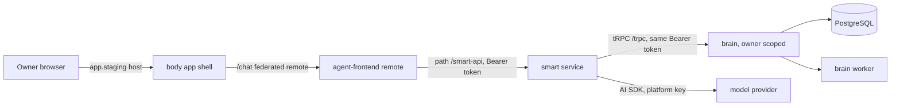

# OpenUI agent chat at /chat

- Status: rejected (2026-11-13, not done; owner asked to focus only on campaign-detail-insights). Was: locked <!-- draft | locked | in progress | done -->
- Created: 2026-11-06
- Locked by user: yes, 2026-11-06 <!-- change to "yes, <date>" only after the user confirms -->

## Goal

Give each owner a chat at `/chat` where they ask about their own LinkedIn data (campaigns and their performance, network, companies, posts, people in depth) and get the answer as a generated interface (OpenUI Lang: stat cards, tables, lists, person and company cards). The same chat sets up workflows and campaigns, with a confirm step. The agent never performs a LinkedIn action on its own.

## Requirements

Confirmed (from the owner's request):

- Three new parts: `smart` (the backend service: the agent and all its backend tools), `agent-frontend` (the chat UI), and a separate UI library of components the model may use.
- The frontend is a micro frontend inside the app at `https://app.staging.elitale.com/chat`, with the same sign-in as the other pages.
- Generated UI uses OpenUI Lang (the open standard, `https://www.openui.com/docs`).
- Reads: campaigns, network, posts, company details, person details in depth, campaign performance this week and in total.
- Actions from the chat: read more about a profile, set up a workflow, set up a campaign.

Naming (owner, 2026-11-06): the backend service is `smart`, not `agent-backend`; it holds the agent and registers every tool. First target is staging only.

Owner answers (2026-11-06, multiple choice):

- Micro frontend: module-federation remote loaded inside the body shell (keeps the sidebar). Not the recommended option (the recommendation was a separate deployable). Accepted as chosen; build coupling is in Edge cases.
- Model gateway: hosted OpenUI Gateway, confirmed 2026-11-06, then changed on 2026-11-06 to a self-built gateway inside `smart` (owner: yes), because LinkedIn data must not go to a third party.
- Chat writes: LinkedIn acts (invite, message, post) behind a confirm card, in addition to prepared drafts. Not the recommended option. CONFLICT with the v1 default and with "the agent never acts on its own". Confirmed 2026-11-06.
- Token lifetime: fix refresh before `/chat` ships (recommended).
- Thread history: kept in brain's database, 30-day retention, deleted on erasure (recommended).
- Lock: confirmed 2026-11-06. The owner's picks are the locked decisions: module federation, hosted OpenUI Gateway, LinkedIn acts from chat behind a confirm card, token refresh before ship, thread history with 30-day retention. The two conflicting picks (gateway, acts) were confirmed in a second question.

Still open (not confirmed, recommendation used for now):

- UI library name: `packages/gen-ui` (provisional).
- Copy says "Assistant" (recommended) or "Chat".
- Spend caps: owner $2 a day, platform $5 a day, booked as "Agent chat" (recommended).
- v1 tool list (see Approach, step 3 and 4), now including the LinkedIn acts above.

## Scope and non-goals

- In scope: `apps/smart`, `apps/agent-frontend`, `packages/gen-ui`, a brain `agent` router for threads and confirmed writes, the ingress paths, Dockerfiles, staging manifests, a sidebar link in body, tests for each part.
- Out of scope (v1): LinkedIn acts from the chat, voice, file upload, production rollout (staging first), the agent writing to any table directly, a hosted gateway, fine-tuning, cross-user learning.

## Architecture

Decisions (recommended, pending the answers above):

- D1. Module federation: the chat is a remote bundle loaded into the body shell at `/chat`, so the sidebar stays. React, React Router, the auth context and the tRPC client are body's singletons (versions must match). Same origin, so no CORS and the same sessionStorage tokens.
- D2. The agent holds no database access. Its tools call brain's existing tRPC procedures with the owner's own token, so brain keeps ownership scoping, Do not contact, limits and spend rules.
- D3. Renderer and prompt helpers come from the open-source OpenUI packages (`@openuidev/react-lang`, `@openuidev/react-ui`, `@openuidev/lang-core`, `@openuidev/cli`, names from the docs fetched 2026-11-06; check versions when installed). Model calls go through a self-built gateway inside `smart` (owner decision 2026-11-06): streaming parse with `@openuidev/lang-core`, one correction call to our model through the AI SDK (at most two attempts), provider failover in our code, error-code counts in logs with no prompt or answer text. No hosted OpenUI API, so no data goes to a third party.
- D4. The model never presses a button. A confirm card calls brain directly after the owner clicks. Paid reads show their price on the card (`dataReads.ts`). LinkedIn acts (owner's pick) run only after a confirm card, through the existing act services and their limits, one act per click.
- D5. The renderer only draws components from the catalog. Links are http(s) or an internal path only. Unknown components or props are dropped with a visible note.
- D6. `smart` is stateless; threads live in brain.

## Phases (owner, 2026-11-06)

1. Blockers: token refresh (step 0 below). Built and gated on 2026-11-06; not yet proven on staging.
2. Deploy the OpenUI components, the agent service and the gateway, then a hello-world test: one component, one answer through the self-built gateway, one screen at `/chat`. No OpenUI key is needed. Needs from the owner: a model key for `smart` in the staging secrets (never pasted in chat), and a go-ahead to push, because a push to `main` deploys staging.
3. More tools and longer automated tasks: more read and prepare tools (steps 3 and 4), and long-running work (set-up runs, scheduled checks, reads that take minutes) started by the agent as brain jobs, with progress shown in the thread. Writes and acts stay behind confirm cards.

## Approach

- [x] Step 0 (blocker), built 2026-11-06: scope `openid profile email offline_access` and `automaticSilentRenew` in `apps/body/src/auth/config.ts`; the stored refresh token is used by the library on its own (no `useRefreshToken` setting exists in oidc-client-ts 3.5). An expired token is renewed once before each API batch (`apps/body/src/trpc/authHeaders.ts`, tested). Blueprint `infra/authentik/blueprints/automatedlinkedin.yaml` adds `scope-offline_access` (name checked in authentik 2026.8.3; applied locally, status successful; discovery lists `offline_access`). Not proven yet: a real session that outlives five minutes on staging. Sessions issued before this change have no refresh token, so each user signs in once after the deploy.
- [ ] Step 1: `packages/gen-ui` (ESM, not CommonJS, so body can import it at runtime, see the contracts gotcha in memory). Catalog of components with plain props: `StatCard`, `Table`, `Chart` (bar, line), `Card`, `PersonCard`, `CompanyCard`, `PostCard`, `CampaignCard`, `WorkflowCard`, `ConfirmAction` (shows cost, asks the owner to press). Spec JSON generated with `@openuidev/cli generate --spec` at build time. Tests: each component renders from fixtures; spec and catalog stay equal.
- [ ] Step 2: `apps/smart` (Express 5, like brain). `POST /smart-api/chat` streams OpenUI Lang. Checks the authentik access token (`jose`, same issuer and audience env as brain). System prompt generated from the spec. Model through the AI SDK (`ai` 7 as in brain, `core/aiModel.ts` pattern). Gateway module: streaming parse with `@openuidev/lang-core`, one correction call (at most two attempts), provider failover, error-code counts only in logs. Tool calls validated with zod; tool results capped (50 rows, plus counts). Turn limits: 8 tool calls, 60 seconds, output token cap. Tests: unit with a fake model; a token-less call answers 401.
- [ ] Step 3: `smart` tools, read first. Campaigns and performance (this week and total), network (search, filters, counts, person detail from the stored snapshot), companies and company people, posts, workflows (list, one, runs), spend, account health (no secrets). Each tool maps to one existing brain procedure (names checked when built).
- [ ] Step 4: `smart` tools, paid and prepared. "Read this profile" calls the paid data read only after the confirm card. "Set up a workflow" and "set up a campaign" call the existing starter or workflow services and save switched off; the confirm card shows what will be created.
- [ ] Step 5: brain `agent` router: threads and messages (`AgentThread`, `AgentMessage`, additive migration), list and open, delete, retention job (30 days), erasure hook (a person erased removes the names in the threads that mention them), spend booking in `SpendLedger` (label "Agent chat", the same caps as step 2 in open question 6).
- [ ] Step 6: `apps/agent-frontend` (React, Vite 8, Tailwind v4 and shadcn like body; `@openuidev/react-ui` `AgentInterface`, `fetchLLM` pointed at `/smart-api/chat`). Exposed as a federated remote with one page for `/chat`; React, the router and the auth context are body's singletons, so there is no second sign-in. Renders with `Renderer` from the library. Error boundary per message.
- [ ] Step 7: body sidebar entry "Chat" (`app-sidebar.tsx`) and `page-title.ts` entry. Copy says "Assistant" in the UI if open question 8 agrees; the route stays `/chat` (the word "chat" already means LinkedIn conversations in Unibox).
- [ ] Step 8: deploy. `apps/smart/Dockerfile` and `apps/agent-frontend/Dockerfile` (build context repo root). Manifests in `deploy/components/agent` (like `deploy/components/spider`), included by the staging overlay. Ingress: `/smart-api` to `smart`; the remote bundle (`remoteEntry.js`) served under `/remotes/chat/` by its own small static service, which body's shell loads. `deploy/scripts/changed-apps.sh` gets lines for both apps and for `packages/gen-ui`. `staging.yml` gets publish and deploy steps and `rollout status` lines for the two new workloads. GHCR pull secret added to both new Deployments.
- [ ] Step 9: observability and limits. Health endpoints (`GET /health`, same shape as brain). Logs never hold prompts, answers or person text (the rule for per-person text in memory). Rate limit per owner (for example 20 turns an hour, to be set).
- [ ] Step 10: staging run as the owner account, a real model call under the capped key, screenshots of a campaign performance answer, a person card, a workflow confirm card. Then `MEMORY.md` update.

Tool list v1 (open question 8):

| Tool | Kind | Brain procedure (verify name when built) |
| --- | --- | --- |
| Campaigns and performance (this week, total) | read | `campaign.overview`, `campaign` list |
| Network people (search, filters, counts) | read | `people.list`, `people.counts` |
| Person detail | read | `person.detail` (stored snapshot) |
| Read this profile | paid read, confirm | data read via `dataReads.ts` |
| Company detail and people | read | `companyPage` |
| Posts | read | `linkedInPost.list`, `postPage` |
| Workflows and runs | read | `workflow` list, get, runs |
| Spend | read | `usage` |
| Account health (no secrets) | read | `linkedInAccount.list` |
| Set up a workflow (off) | prepare, confirm | workflow create (verify) |
| Set up a campaign (off) | prepare, confirm | campaign starter service (verify) |
| Invite a person (owner's pick) | act, confirm | `LinkedInInviteService` (limits kept) |
| Message or reply (owner's pick) | act, confirm | message and reply services (verify) |
| Publish a post (owner's pick) | act, confirm | `PostPublicationService` (verify) |

## Edge cases and risks

- Prompt injection: names, headlines, posts and messages are third-party text. The prompt says they are data, never instructions. Writes need a confirm card, so injected text cannot trigger one.
- Invalid OpenUI Lang from the model: the renderer drops unknown parts and shows the text; one repair retry in the backend; a parse error never blanks the page.
- Hallucinated ids: every tool argument is validated; brain rejects any id the owner does not own (NOT_FOUND).
- Cost runaway: tool-call cap, token cap, daily caps, per-owner rate limit, paid reads only after a confirm with a price.
- Do not contact and suppressed people: the read tools show them as they are; the prepare tools refuse to include them (brain's services already refuse).
- Token expiry mid-turn: tool calls fail with UNAUTHORIZED; the UI asks to sign in again and keeps the thread. Step 0 removes the 5 minute cliff.
- Concurrency: two turns on one thread; one turn at a time per thread (lock or reject).
- Large data: tools return capped rows and counts only; no full table is ever sent to the model.
- Privacy: no prompt or answer in logs or Sentry; threads deleted after 30 days and on erasure; the model provider and its retention policy named in the plan before staging gets real data.
- Erasure: the erase path for people must also clean `AgentMessage` text that names them (not only the people tables).
- Auth: `smart` trusts only the authentik access token; no cookie, no shared secret with the browser.
- Dev vs production: no AI key set means "Chat is not set up" (like `aiConfigured()`), not an error. Local dev needs an authentik token for `/smart-api`.
- Docker and CI: new images are private on GHCR (pull secret needed, see memory); arm64 builds on a Mac fail on GKE (build linux/amd64, CI already does); every new required env var (`AI_*`, agent auth vars) goes into `STAGING_SECRETS_ENV` before the merge that needs it, because merging to `main` deploys staging.
- Monorepo gates: `packages/*` changes build and test the whole repo in CI; the `changed-apps.sh` lines decide what deploys.
- Rollback: remove the `/chat` and `/smart-api` ingress paths, roll the two Deployments back to the previous `sha-`. The migration is additive (new tables), so no data rollback is needed.
- Naming: "chat" already means LinkedIn conversations in Unibox; copy must say "Assistant" if open question 8 agrees, to avoid confusion.
- Brain contract change: a new `agent` router is in `AppRouter`, which body type-checks; keep it `erasableSyntaxOnly`-safe (no constructor parameter properties) and `import type` in body.
- Self-built gateway: correction quality depends on the model we configure, not on OpenUI's tuned one. There is no hosted dashboard, so we log error codes only, never prompt or answer text.
- LinkedIn acts from chat (owner's pick): a model-chosen act is still an act. Only the confirm card may start one; the act services keep their daily limits, Do not contact and one send per person; a failed or unsure act is shown as such and never retried by the agent.
- Module federation: a shared-singleton version drift between body and the remote breaks at runtime; the remote's failure must show a fallback inside the page, never a blank sidebar layout; the build needs a federation plugin added to the Vite 8 setup.

## Verification

- `pnpm lint && pnpm ts:check && pnpm test:unit:run && pnpm build` (whole monorepo, after `pnpm --filter @automatedLinkedIn/contracts build:lib` if contracts change).
- Brain integration tests for the `agent` router and the retention and erasure jobs: `env -u DATABASE_URL pnpm --filter @automatedLinkedIn/brain exec vitest --config vitest.integration.config.mts <file> --run`.
- `smart`: unit tests with a fake model, plus one real call under the capped key on staging.
- Browser: sign in on staging, open `/chat`, ask for campaign performance this week and total, open a person card, confirm a workflow draft, check it is off in `/workflows`. Screenshots kept in the Outcome. The agent cannot sign in to staging by itself, so the owner runs this step if the sign-in is not available.
- Negative checks: a token-less call gets 401; a tool asking for another owner's id gets NOT_FOUND; a paid read without the confirm is refused; a model reply with an unknown component is dropped.

## Outcome

Not started. Waiting for the owner to answer the open questions and lock this plan.
