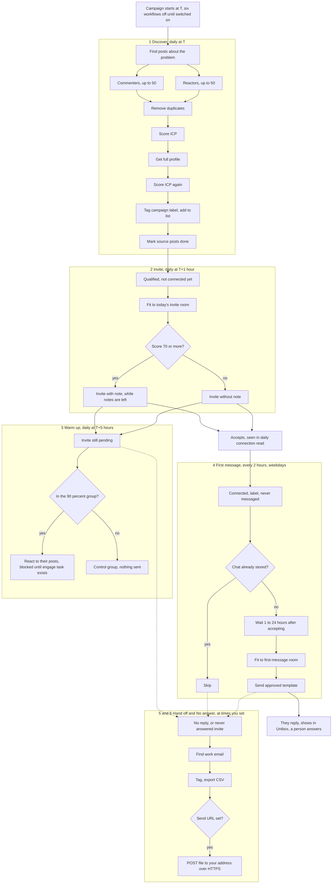
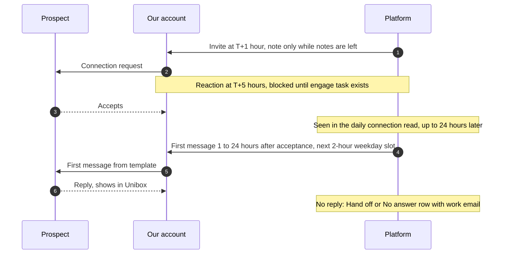
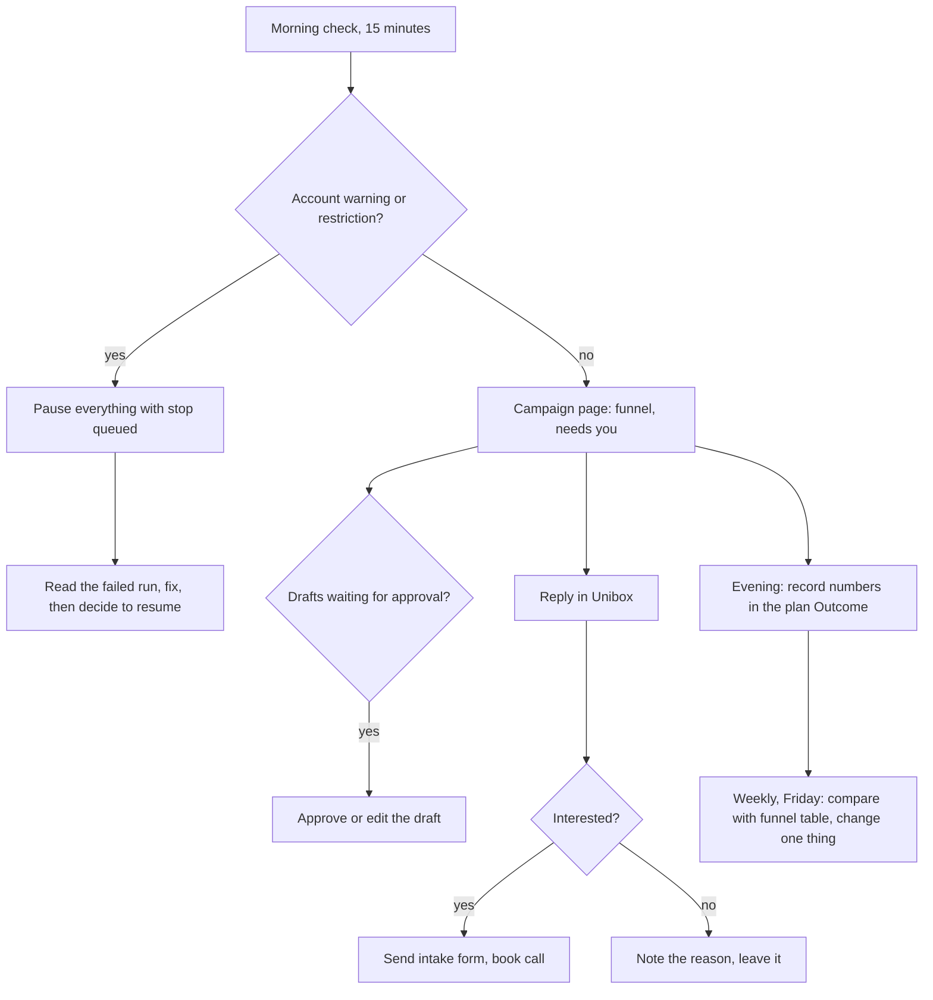
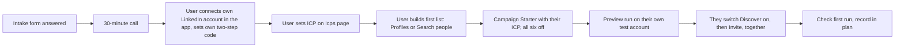
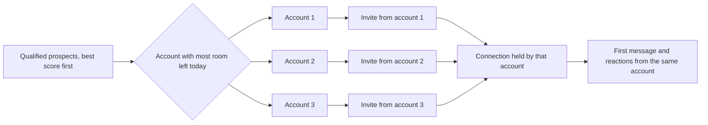

# Release preview program: find and onboard 5 qualified users in 2 weeks

- Status: draft <!-- draft | locked | in progress | done -->
- Created: 2026-11-06
- Locked by user: no <!-- change to "yes, <date>" only after the user confirms -->

## Goal

Onboard 5 highly qualified users fully onto the platform (accounts connected, ICP set, first campaign running) by 2026-11-20, through a personal, limit-respecting outreach run that we control and can stop at any time. First, the campaign is deployed on staging with all six workflows off, so the 5 can test the product; nothing is sent until they have tested and Invite is switched on.

## Requirements

Confirmed:

- Target: 5 fully onboarded users in 14 days (2026-11-06 to 2026-11-20).
- Confirmed 2026-11-06: the five are found by the campaign, not named in advance; the campaign launches first, and the five are known from the replies and booked calls.
- Outreach uses the platform's own campaign tooling (Campaign Starter, ICP, Pause everything with stop queued), on accounts that belong to us or to the prospects.
- Every message is written as a reviewed template and sent as a random spintax variant, so no two messages match. A person approves the templates once before any send. No bulk copy-paste.
- Stay inside the platform's limits (contracts `PLATFORM_MAX`): invites 20 a day and 100 a week per account, first messages 20 a day; the account's seeded 65 to 80 percent applies.
- Confirmed 2026-11-06: each message template is approved once by a person before any send, and the first-message workflow then sends automatically (Q4, Q7).
- Confirmed 2026-11-06: the first message is one line, and it ends with the booking link https://cal.com/elitale/30min instead of an opt-out sentence.
- Confirmed 2026-11-06: 3 LinkedIn accounts, all ours, used on a rotating basis (Q3).
- Confirmed 2026-11-06: invites rotate by room across the 3 accounts; messages and reactions stay with the account that holds the connection; the target is about 480 invites (16 a day per account, Monday to Friday, the top of the platform's weekly share of 80 per account); notes are about 10 to 12 a month in total; if an account is restricted or signed out, the other two take its share.

Open questions (must be empty before locking; recommended answer in brackets):

- Q1. Environment: the 5 users go onto staging (`app.staging.elitale.com`, the only deployed environment in the notes) or a production deployment? [answered: staging. The campaign is deployed there for the 5 to test the product before any outreach].
- Q2. Who are the 5? [answered: not named in advance. The campaign finds them, and we know them once they reply and book a call].
- Q3. Which LinkedIn accounts do we use to reach prospects, and whose are they? [answered: 3 accounts, all ours, used in rotation].
- Q4. Who writes and approves the templates? [answered: a person approves the invite and first-message templates once, before any send; I draft them].
- Q5. Commercial terms for the 5: free preview, length, what we collect, consent wording. [answered: handled offline by the owner, outside this plan].
- Q6. What counts as success? [answered: target 5 onboarded by 2026-11-20, stretch up to 10; report the number onboarded on that date, no fixed minimum].
- Q7. Does the first-message workflow send automatically once switched on, or does each message wait for approval? [answered: automatic once the template is approved; comments keep their approval step].

## Templates and message sequence

Spintax: `{a|b|c}` picks one option for each send, and `{first_name:there}` fills a variable with a fallback. Both templates below were rendered with the product's own renderer and checked with its length and content rules (`templateProblems`, 2026-11-06): no missing variables, under the limits on the longest variant. The first message's only link is the booking link, which the checks accept.

Invite note (sent only while the account has notes left this month, 5 a month at most):

```text
{Hi|Hello|Hey} {first_name:there}, {I came across|I noticed} what you are building{ at {company}|}. {Would love to connect|Happy to connect|Glad to connect}.
```

First message (sent after acceptance, one line):

```text
{Hi|Hello|Hey} {first_name:there}, {thanks for connecting|good to be connected|glad we are connected}. {We work with|We help|We support} {founders|agency owners|GTM teams} {who run|that run} their own LinkedIn outreach, and what you are building{ at {company}|} {caught my eye|stood out to me}. We are opening a small release preview for {five|a handful of} teams. {Would it be useful to try it first|Would you like an early look|Would you be open to a quick look}? {Book a call with this link|Pick a 30-minute slot here|Grab a time here}: https://cal.com/elitale/30min
```

Variants: the invite note has 36 versions and the first message about 11,700. Each send draws one at random.

Message order for one prospect:

| # | Message | When | Limit per account |
| --- | --- | --- | --- |
| 1 | Connection request, with the note while notes are left | Daily, 1 hour after Discover | 20 a day, 100 a week, 65 to 80 percent applied |
| 2 | Reaction on their post | 5 hours after Discover, 90 percent of pending invites | Blocked until the engage task exists |
| 3 | Comment, optional | After the draft is approved | 20 a day |
| 4 | First message | 1 to 24 hours after acceptance, every 2 hours, weekdays, 9-hour window | 20 a day |
| 5 | Reply | When they answer | 40 a day, written by a person |

Rules for the first message: one line (LinkedIn's box may send on Enter; check this on the first run), one link only (the booking link, https://cal.com/elitale/30min), and no opt-out sentence. If a reply asks to stop, mark that person Do not contact the same day.

## Workflows on the platform

Campaign Starter creates six workflows for one campaign, all switched off (`packages/contracts/src/recipes.ts`). T is the campaign start time you choose. Every act block keeps "Act for real" off until you switch it on in the block.

| # | Workflow | Runs | What it does | Depends on | Status |
| --- | --- | --- | --- | --- | --- |
| 1 | Discover | Daily at T | Finds posts about your problem, reads their commenters and reactors (up to 50 each), removes duplicates, scores against the ICP, reads full profiles, scores again, tags with the campaign label, adds to a list, marks the source posts done | Search and post reads (paid data calls), the ICP | Built |
| 2 | Invite | Daily at T+1 hour | Takes qualified people who are not connected yet, fits them to today's invite room, sends the note to those scoring 70 or more and no note to the rest | Invite planner, 5 notes a month per account | Built, sends for real only when "Act for real" is on |
| 3 | Warm up | Daily at T+5 hours | For people with a pending invite, reacts to their posts for 90 percent of them; the other 10 percent are the control group. Optional comments wait for your approval | `engage` task for reactions and comments | Not runnable yet: the engage task is not built |
| 4 | First message | Every 2 hours, from T to T+9 hours, weekdays | Takes connected people with the campaign label who have never been messaged and no stored chat, waits 1 to 24 hours after acceptance, fits to today's first-message room, sends the template | `linkedin-message` task (built and sent for real on 2026-10-29) | Built, sends automatically once the template is approved (Q7) |
| 5 | Hand off | At a time you set | People who did not reply: finds the work email, tags, exports the CSV, optionally posts it to your address | Paid email lookup, your HTTPS address if used | Built |
| 6 | No answer | At a time you set | People who never answered the invite: same as Hand off, with their own tag | As Hand off | Built |

Not in the starter, by design: a reply workflow. Replies are written by a person in Unibox.

Diagram of the full run:



One prospect, in time order:



Daily and weekly routine (run by a person, not a workflow):



Onboarding of each of the 5 users:



### Account rotation

Invites rotate by room (`spreadByRoom`): each person goes to the account with the most room left, one by one, so equal accounts alternate. First messages and reactions come from the account that holds the connection, so each account messages only its own connections.



## Readiness for staging (checked 2026-11-06)

| Item | Status | Needed for |
| --- | --- | --- |
| Campaign Starter, six workflows | Built and deployed | Everything |
| Invites (`linkedin-invite` task, invite send job) | Built and deployed | Invites |
| First messages (`linkedin-message` task) | Built, sent for real 2026-10-29; cancel on pause deployed (PR 203) | First messages |
| Replies (`linkedin-reply`), connections read (`linkedin-connections`) | Built and deployed | Replies, acceptance |
| Account rotation and notes limit | Built and deployed | Rotation |
| Warm-up reactions and comments | Not built: no `linkedin-engage` spider task | Warm up workflow: keep it off for this program |
| Hand-off CSV | Built | Hand-off |
| Booking link | Text only; the cal.com event must be public | First message call to action |
| Intake form and preview terms | Not in the repo | Onboarding, outside the product |
| Data wallet above `DATA_WALLET_FLOOR_USD` | Runtime setting: new runs are refused below the floor | Every paid data call, check before runs |
| Three LinkedIn accounts connected on staging | The owners connect them and enter their own two-step codes | Everything |
| Staging code and pipeline | Nothing new to deploy; spider and brain are on main as of PR 202 and PR 203 | None |

## Scope and non-goals

- In scope: prospect list and ICP, the outreach run on our accounts within limits, the intake form, onboarding of each user (accounts, ICP, first campaign, check-in), a daily review and a go or stop check.
- Out of scope: any bulk or untargeted messaging; automated post engagement (the `linkedin-engage` spider task is not built, so warm-up is manual); scraping other people's data beyond what the platform's own read tasks already do on accounts the user connects; new product features unless a blocker is found.

## Approach

Funnel to hit 5 onboarded (assumptions to check in week 1, see Edge cases):

| Stage | Assumed rate | Count needed |
| --- | --- | --- |
| Invites sent (3 accounts, 16 a day each, Monday to Friday) | — | about 480 |
| Accepted | 35 percent | about 170 |
| Replied to the first message | 25 percent of accepted | about 40 |
| Call booked | 40 percent of replies | about 16 |
| Onboarded | 55 percent of calls | 5 |

Phases:

1. **Nov 6 to 8: set up.** Lock Q1 to Q6. Write the ICP in the platform (the Icps page) and a list of about 500 prospects who fit the ICP, from the team's own networks and the Discover pool, each with a reason they fit. Build the campaign with Campaign Starter (six workflows, all off). Run every workflow in preview only on our own test account. Check the campaign page counts. Write the intake form, the preview terms and the onboarding checklist.
2. **Nov 9 to 13: first outreach wave.** Turn on Invite only, at 16 a day on each of the 3 accounts, Monday to Friday: about 48 a day in total, which reaches about 480 invites by 2026-11-20. A personal note goes on only 5 requests a month per account (LinkedIn's note limit, `notesPerMonth`); the rest go without a note, and the personal message follows after acceptance as a first message (up to 20 a day). Daily check: accepted count, any account warning, any restriction. Pause everything with stop queued at the first sign of a challenge or a restriction. Send the intake form to the people who reply with interest.
3. **Nov 12 to 18: follow-up and onboarding.** First messages only to accepted people who fit, at up to 20 a day on each account, from the account that holds the connection, using the approved first-message template (Q7). Book calls. For each of the 5 who say yes: a 30-minute onboarding call, their LinkedIn accounts connected by them (never by us), their ICP and first list set, one campaign started with the Starter. Check their first run.
4. **Nov 19 to 20: close.** Stop outreach or keep it to people already in conversation. Write a short status: who is onboarded, what each one needs, what broke. Record the results in `MEMORY.md`.

Daily loop (every working day): look at the campaign page, the account health and the invites accepted; stop anything that looks wrong; log the day in the plan's Outcome.

## Edge cases and risks

- Account restriction: LinkedIn may restrict an account that sends too many invites or messages. The platform stops invites on a restricted or signed-out account, but a human must watch the account health daily. Keep our accounts at the lower end of the limit for the first week.
- Accept rate: most invites go without a note, so the 35 percent is untested. If it is lower, the funnel needs more invites than the 2 accounts allow in 2 weeks. Fallback: warm up through referrals and direct messages from our own networks before any cold invite; or accept 3 onboarded and open a second round.
- Warm-up is manual: the automated post engagement task is not built, so no automatic reactions or comments on prospects' posts.
- Rotation: an invite goes to the account with the most room left today, so the three accounts take turns in proportion to their room. A restricted or signed-out account drops out, and its share goes to the other two. Check the split on the campaign page each day.
- Notes: the 5-a-month note limit applies to each account, so three accounts give about 10 to 12 notes a month in total.
- Staging office hours: the staging accounts run invites and messages only Monday to Friday, 09:00 to 18:00, so the daily cap of 16 per account is the binding limit. The weekly share is reached only if every weekday runs.
- Unverified layouts: the notes list several LinkedIn page layouts that are not fully verified on live pages (for example a person who was never written to, and some message windows). A failed run must be read before the next one. The campaign page must be checked after each run.
- Stop safety: "Pause everything" with "Also stop queued acts and waiting drafts" is tested on staging. The queued first-message cancel was merged (PR 203) and is not yet proven on a real queue. Test it once before relying on it.
- Credentials: users hand over LinkedIn credentials to the platform. They are stored encrypted. Never ask a user for their password by message; they enter it in the app and enable their own two-step code.
- Data: prospects' personal data is held in the platform. Write the preview terms before any user signs in (Q5), and tell each user what is kept and how to erase it.
- Dates: the 2-week window is tight for a product that is still on staging. If Q1 says production, add a week of hardening first.
- Compliance: the platform's rules are that it acts on the signed-in user's own account, within published limits, and never sends unsolicited bulk messages. Every message in this plan follows that.
- Spintax variance: the variants keep the text fresh, but they do not remove the need for review. Review the templates once, and check a sample of sent messages each week for wrong grammar or a wrong company name.
- Booking link: the link is in every first message. Before the first send, check that the cal.com event is public, that the 30-minute slots are open, and that the link opens without a login.

## Verification

- Week 1 check (Nov 13): accepted rate and reply rate against the funnel table. If the accept rate is under 20 percent after 80 invites, stop the cold wave and switch to referrals.
- Each onboarded user: their campaign shows real counts in the campaign page, their account is signed in and healthy, and they completed their own first run.
- Weekly: `pnpm lint && pnpm ts:check && pnpm test:unit:run && pnpm build` on the release branch if any code changes are needed.

## Outcome

Filled in when done: who was onboarded, the real funnel numbers against the table, what broke, follow-ups (also copy durable ones to `MEMORY.md`).
